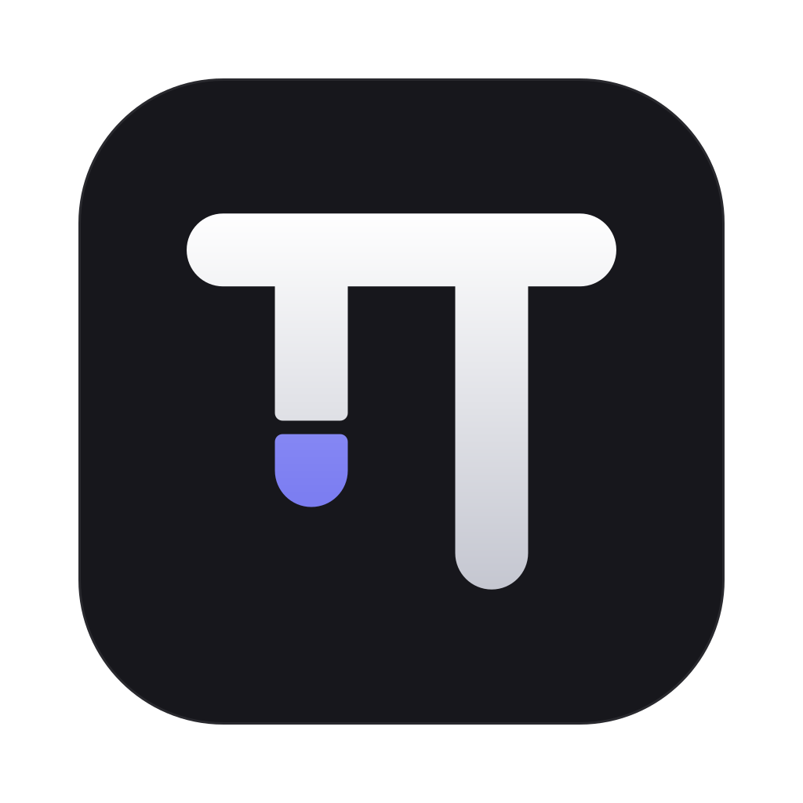
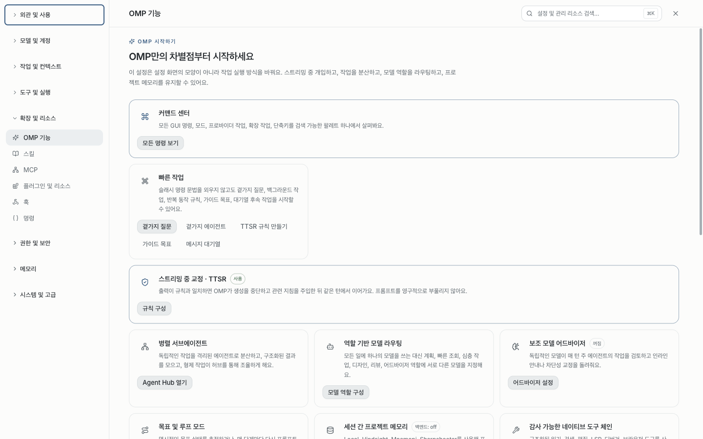
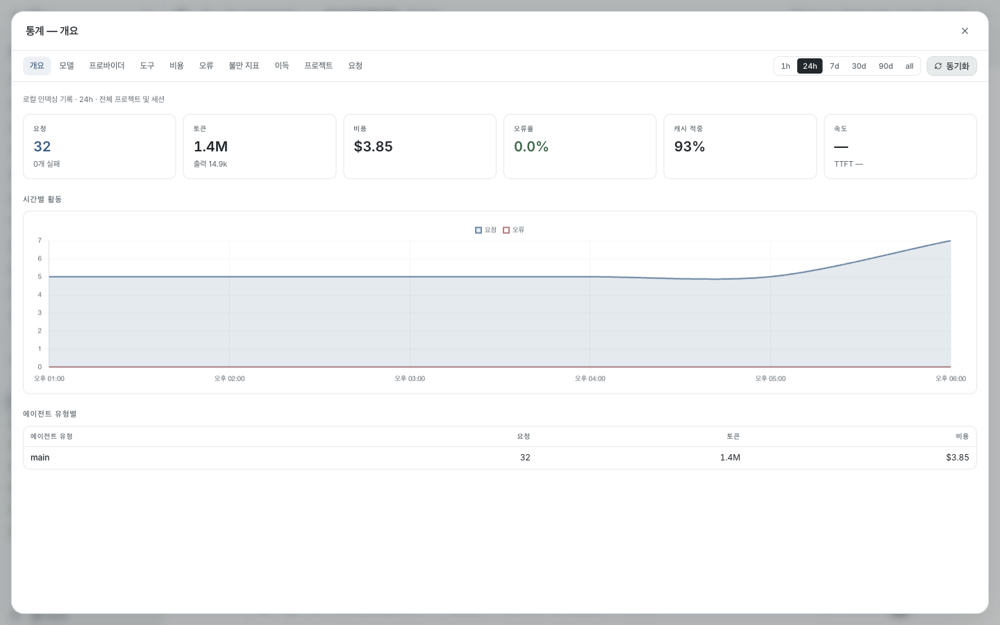

<div align="center">



# omp GUI

**터미널 없이 쓰는 omp 코딩 에이전트**

대화하고, 변경 사항을 검토하고, 여러 작업을 동시에 맡기세요.<br>
설치된 omp를 그대로 쓰기 때문에 `omp update` 한 번이면 앱도 늘 최신이에요.

<br>

<a href="https://github.com/SeuPut0705/omp-gui/releases/latest/download/omp-mac-arm64.dmg"></a>
&nbsp;
<a href="https://github.com/SeuPut0705/omp-gui/releases/latest/download/omp-mac-x64.dmg"></a>
&nbsp;
<a href="https://github.com/SeuPut0705/omp-gui/releases/latest/download/omp-windows-setup.exe"></a>

<sub>
Windows 설치 없이 쓰기: <a href="https://github.com/SeuPut0705/omp-gui/releases/latest/download/omp-windows-portable.exe">포터블 exe</a>
&nbsp;·&nbsp; 내 Mac이 어떤 칩인지: 왼쪽 위  메뉴 → 이 Mac에 관하여
&nbsp;·&nbsp; <a href="https://github.com/SeuPut0705/omp-gui/releases">모든 버전</a>
</sub>

<br><br>


</div>

<br>

<p align="center">
  
</p>

## 3단계로 시작하기

**1. omp 설치** — 이미 쓰고 있다면 건너뛰세요. ([Bun](https://bun.sh)이 필요해요)

```bash
bun install -g @oh-my-pi/pi-coding-agent
```

**2. 앱 설치** — 위 버튼으로 받은 파일을 여세요.

| | |
|---|---|
| **macOS** | DMG를 열고 **omp**를 응용 프로그램 폴더로 드래그. 처음 실행할 때 "확인되지 않은 개발자" 경고가 뜨면 앱을 **우클릭 → 열기** (한 번만 하면 돼요) |
| **Windows** | 설치 파일 실행. SmartScreen 경고가 뜨면 **추가 정보 → 실행** |

**3. 모델 연결** — 처음 실행하면 안내 창이 떠요. **프로바이더 및 로그인**에서 Claude·ChatGPT 등에 로그인하거나 API 키를 넣으면 끝. 터미널 omp에서 이미 로그인했다면 그대로 이어서 쓸 수 있어요.

## 무엇을 할 수 있나요

<table>
<tr>
<td width="50%" valign="top">

### 💬 대화하며 코딩
코드·diff·수식·다이어그램이 보기 좋게 렌더링되고, 에이전트가 파일을 읽고 고치고 명령을 실행하는 과정을 카드로 확인할 수 있어요. 위험한 작업은 승인을 받고 진행해요.

</td>
<td width="50%" valign="top">

### 🗂️ 여러 작업을 동시에
탭마다 독립된 세션이 돌아가요. 두 세션을 나란히 놓고 비교하거나, `⌥T`로 별도 Git 워크트리를 만들어 서로 간섭 없이 작업시킬 수 있어요.

</td>
</tr>
<tr>
<td valign="top">

### 🧭 계획부터 실행까지
**플랜 모드**로 계획을 먼저 받고 승인하면 실행해요. **목표·루프 모드**로 끝날 때까지 이어서 맡기고, 작업 중에도 **곁가지 질문**으로 흐름을 끊지 않고 물어볼 수 있어요.

</td>
<td valign="top">

### 🔀 Git과 PR
변경 파일과 diff를 바로 확인하고, PR 목록·리뷰·생성까지 앱 안에서 해요. PR 제목과 본문 초안도 에이전트가 써 줘요. (`gh` 로그인 필요)

</td>
</tr>
<tr>
<td valign="top">

### 🧩 확장과 설정
모델·역할, 스킬, 플러그인, MCP 서버, 훅, SSH 호스트를 화면에서 관리해요. 설정은 터미널 omp와 같은 파일(`~/.omp`)을 쓰니 어디서 바꿔도 똑같아요.

</td>
<td valign="top">

### 📊 사용량 한눈에
요청·토큰·비용·캐시 적중률·도구 사용을 대시보드로 보고, 프로바이더별 남은 사용량도 확인할 수 있어요.

</td>
</tr>
</table>

<p align="center">
  
  
</p>

## 자주 쓰는 단축키

| macOS | Windows | 동작 |
|---|---|---|
| `⌘T` | `Ctrl+T` | 새 에이전트 탭 |
| `⇧⌘T` | `Ctrl+Shift+T` | 도구 없는 채팅 탭 |
| `⌥T` | `Alt+T` | 새 Git 워크트리 탭 |
| `⌘K` | `Ctrl+K` | 명령 팔레트 — 모든 기능을 검색해서 실행 |
| `⌘,` | `Ctrl+,` | 설정 |
| `⌘B` | `Ctrl+B` | 사이드바 열기/닫기 |
| `⌘/` | `Ctrl+/` | 전체 단축키 보기 |

## 자주 묻는 질문

<details>
<summary><b>터미널 omp와 같이 써도 되나요?</b></summary>

네. 설정, 로그인, 세션 기록을 모두 공유해요. 터미널에서 하던 세션을 앱에서 이어서 열 수도 있어요.
</details>

<details>
<summary><b>omp가 업데이트되면 앱도 다시 받아야 하나요?</b></summary>

아니요. 앱은 설치된 omp를 그대로 실행하기 때문에 `omp update`만 하면 돼요. 앱 자체의 새 버전은 설정의 업데이트 메뉴에서 알려 줘요.
</details>

<details>
<summary><b>"omp를 찾을 수 없음"이라고 나와요</b></summary>

터미널에서 `omp --version`이 동작하는지 확인하세요. 안 되면 위의 설치 명령을 실행하고, 버전이 18.6 미만이면 `omp update` 후 앱을 다시 켜세요. omp를 특이한 위치에 설치했다면 `OMP_GUI_OMP=/경로/omp` 환경 변수로 지정할 수 있어요.
</details>

<details>
<summary><b>왜 macOS에서 경고가 뜨나요?</b></summary>

Apple 공증(유료 개발자 인증)을 받지 않은 앱이라서예요. 처음 한 번만 우클릭 → 열기를 하면 이후로는 그냥 실행돼요. 소스에서 직접 빌드하면 경고가 뜨지 않아요.
</details>

<details>
<summary><b>PR 기능이 동작하지 않아요</b></summary>

GitHub CLI가 필요해요. `gh auth status`로 로그인 상태를 확인하세요.
</details>

## 개발자용

<details>
<summary><b>소스에서 빌드하기</b></summary>

필요: [Bun](https://bun.sh) 1.4+, Git, omp 18.6+

```bash
git clone https://github.com/SeuPut0705/omp-gui.git
cd omp-gui
bun install

bun run dev                                    # 개발 모드
bun run package:mac:arm64 -- --publish never   # → dist/omp-<버전>-arm64.dmg
bun run package:mac:x64 -- --publish never     # Intel Mac
bun run package:win -- --publish never         # Windows 설치 파일 + 포터블
```

테스트:

```bash
bunx vitest run          # 단위·컴포넌트 테스트
bun run check:types      # 타입 검사
bunx playwright test     # E2E (창을 띄우지 않는 백그라운드 모드)
```
</details>

<details>
<summary><b>구조</b></summary>

```
앱 화면 ── 메인 프로세스 ──┬─ 직접 처리: git·gh, 파일, ~/.omp 설정, omp CLI
                           ├─ 원본 omp RPC  (omp --mode rpc-ui)
                           └─ gui-bridge 확장 (실행 중인 세션 상태가 필요한 기능)
```

원본 omp에 없는 GUI 기능은 앱이 직접 처리하거나, 앱이 omp에 함께 불러오는 확장(`resources/gui-bridge`)으로 처리해요. omp를 수정하거나 포크하지 않아요. 개발 규칙은 [AGENTS.md](./AGENTS.md)를 참고하세요.
</details>

## 라이선스

MIT · [nornzach/oh-my-pi-gui](https://github.com/nornzach/oh-my-pi-gui)(MIT)에서 출발한 프로젝트예요.
