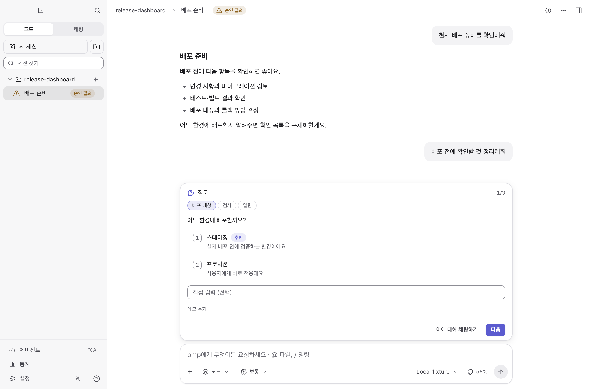
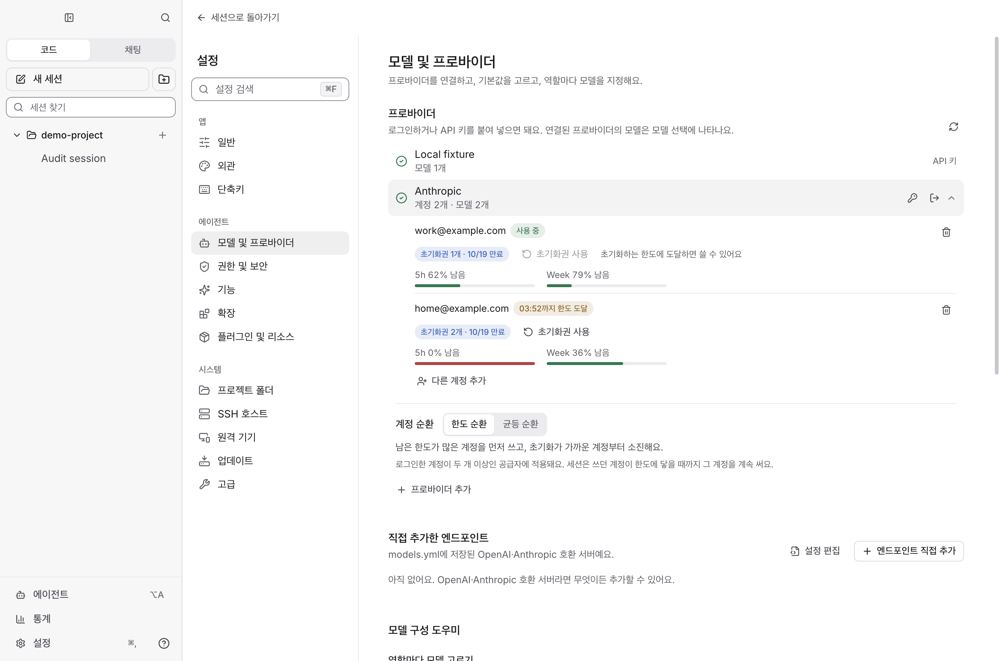
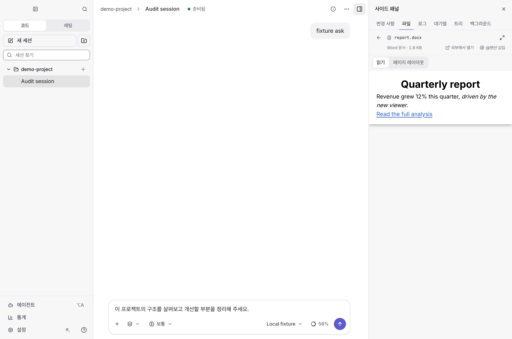
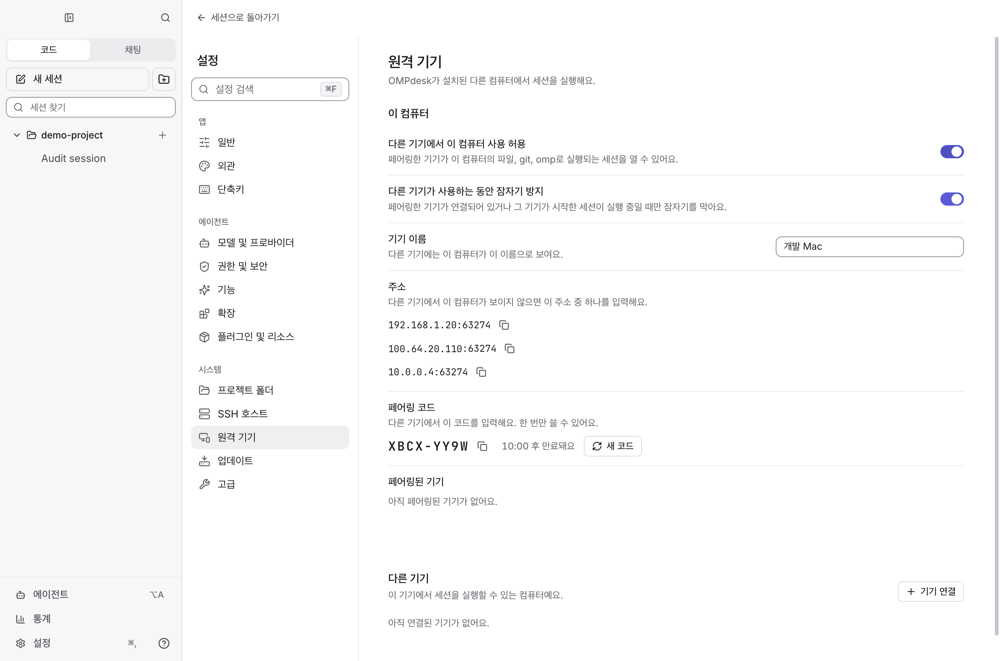

<div align="center">

<picture>
  <source media="(prefers-color-scheme: dark)" srcset="resources/brand/wordmark-dark.svg">
  
</picture>

**설치된 omp로 대화하고, 코드를 고치고, 여러 작업을 한 화면에서 관리하는 데스크톱 앱이에요.**

<a href="https://github.com/SeuPut0705/ompdesk/releases/latest/download/ompdesk-mac-arm64.dmg"></a>
<a href="https://github.com/SeuPut0705/ompdesk/releases/latest/download/ompdesk-windows-setup.exe"></a>

<sub>비공개 저장소예요. 초대를 수락하고, 접근 권한이 있는 GitHub 계정으로 로그인해야 다운로드할 수 있어요.</sub>

<br><br>


</div>

<picture>
  <source media="(prefers-color-scheme: dark)" srcset="docs/screenshots/main-dark.png">
  
</picture>

<sub>스크린샷은 테스트용 omp와 예제 파일로 촬영했어요. 실제 계정·작업 데이터가 아니에요.</sub>

## 목차

- [OMPdesk는 무엇인가요](#ompdesk는-무엇인가요)
- [필요한 것](#필요한-것)
- [시작하기](#시작하기)
- [주요 기능](#주요-기능)
- [업데이트](#업데이트)
- [원격 기기 연결](#원격-기기-연결)
- [문제 해결](#문제-해결)
- [데이터와 개인정보](#데이터와-개인정보)
- [소스에서 실행하기](#소스에서-실행하기)
- [라이선스](#라이선스)

## OMPdesk는 무엇인가요

OMPdesk는 [omp](https://github.com/can1357/oh-my-pi) 코딩 에이전트를 위한 데스크톱 앱이에요. 컴퓨터에 설치된 omp를 그대로 실행하고, 그 위에 대화·작업·파일·Git 화면을 얹어요.

- **omp를 포함하지 않아요.** 앱 안에 omp를 넣거나 고치지 않아요. 터미널에서 쓰던 omp의 설정, 로그인, 세션 기록을 그대로 함께 써요.
- **업데이트는 따로 받아요.** omp는 `omp update`로, OMPdesk는 앱 안에서 업데이트해요.
- **omp의 규칙을 그대로 따라요.** 스킬·플러그인·에이전트·MCP 목록, 설정 검증, 토큰 속도 같은 값은 설치된 omp가 계산한 것을 보여 줘요.

## 필요한 것

| 항목 | 내용 |
|---|---|
| 컴퓨터 | macOS Apple Silicon(M1 이상) 또는 Windows 10/11 x64 |
| omp | 18.8.7 이상. 없으면 OMPdesk가 첫 실행 때 [Bun](https://bun.sh)과 함께 알아서 설치해요. |
| 모델 | 사용할 프로바이더의 로그인 또는 API 키 |
| 선택 | Git 작업에는 Git, GitHub PR 기능에는 [GitHub CLI](https://cli.github.com)(`gh`) 로그인, 내장 REA 도구에는 Node.js. 없으면 OMPdesk가 백그라운드에서 설치해요. |
| 다운로드·업데이트 | 이 저장소에 접근할 수 있는 GitHub 계정 |

## 시작하기

### 1. OMPdesk 설치

맨 위 다운로드 버튼을 누르거나 [Releases 페이지](https://github.com/SeuPut0705/ompdesk/releases)에서 받으세요.

| 운영체제 | 설치 방법 |
|---|---|
| macOS | DMG를 열고 **OMPdesk**를 **응용 프로그램** 폴더로 옮긴 뒤 실행하세요. DMG 안에서 바로 실행하면 자동 업데이트가 동작하지 않아요. |
| Windows | `ompdesk-windows-setup.exe`를 실행하고 안내를 따라가세요. |

첫 실행 때 보안 경고가 나오면 [문제 해결](#문제-해결)을 참고하세요.

### 2. 첫 실행: 필요한 도구는 앱이 설치해요

터미널을 열 필요가 없어요. 처음 켜면 OMPdesk가 이 컴퓨터를 확인하고 빠진 것을 바로 설치해요. 진행 상황은 설치 화면에 단계별로 보이고, 출력은 펼쳐서 볼 수 있어요. 실패하면 이유와 직접 설치하는 방법이 나오고 **다시 시도**할 수 있어요.

| 항목 | 설치 방법 |
|---|---|
| Bun (필수) | Bun 공식 설치 스크립트로 사용자 폴더(`~/.bun`)에 설치해요. 관리자 권한이 필요 없어요. |
| omp (필수) | `bun install -g @oh-my-pi/pi-coding-agent`. 18.8.7보다 낮으면 `omp update`를 실행해요. |
| Git for Windows (Windows 필수) | omp의 셸 도구가 Git Bash를 써요. 이미 설치돼 있으면 그대로 쓰고, 없으면 고정된 PortableGit 릴리스를 SHA-256으로 확인한 뒤 `%LOCALAPPDATA%\ompdesk\tools\git`에 풀어요. 관리자 권한이 필요 없어요. WSL은 쓰지 않아요. |
| Git (macOS, 선택) | `xcode-select --install`. macOS의 설치 창이 떠요. |
| GitHub CLI, Node.js (선택) | macOS는 Homebrew가 있으면 `brew install`, 없으면 공식 압축 파일을 체크섬으로 확인해 OMPdesk 도구 폴더에 풀어요. Windows는 `winget`을 쓰고, 이때 Windows가 권한을 물어볼 수 있어요. |

필수 항목이 끝나면 omp를 다시 찾아 바로 다음 단계로 넘어가요. 선택 항목은 그 뒤 백그라운드에서 설치되고, 상태와 다시 시도는 **설정 › 일반 › 이 컴퓨터**에서 볼 수 있어요. 이미 있는 항목은 건너뛰고, 실패한 항목은 다음 실행 때 다시 시도해요(계속 실패하면 하루에 한 번).

직접 설치하고 싶다면 터미널에서 이렇게 하세요.

```bash
curl -fsSL https://bun.sh/install | bash        # Windows: powershell -c "irm bun.sh/install.ps1 | iex"
bun install -g @oh-my-pi/pi-coding-agent
omp --version
```

이미 설치했는데 18.8.7보다 낮다면 `omp update`를 실행하세요.

### 3. 모델 연결하고 첫 작업 보내기

1. 첫 실행 안내를 따라 계정을 연결하거나 API 키를 넣으세요. 터미널 omp에서 이미 로그인했다면 그 계정을 바로 써요.
2. 프로젝트 폴더를 열고 입력창에 할 일을 적어 보내세요.
3. 모델 배치가 고민되면 **설정 › 모델과 계정**의 **자동으로 구성**을 써 보세요. 제안을 확인하고 **적용**을 눌러야 바뀌어요.

## 주요 기능

### 대화와 작업

- **작업 상자**: 한 번의 작업은 대화 안의 작업 상자 하나로 보여요. 맨 위 줄에 지금 하는 일과 경과 시간이 나오고, 명령 출력·파일 변경·서브에이전트 화면이 높이가 고정된 무대에서 차례로 바뀌어요. 끝나면 완료·실패·중단을 표시하고 바뀐 파일, 실행한 명령, 확인한 이미지를 결과 줄에 모아 보여 줘요.
- **작업 중 방향 바꾸기**: 실행 중에 메시지를 보내면 작업 상자 안에 이어서 붙어요. 대기열에서 지금 전달하거나 다음 턴으로 미룰 수 있어요.
- **질문과 승인 카드**: 에이전트의 질문, 도구 승인, 계획 승인은 대화를 가리지 않는 카드로 입력창 위에 나와요.
- **자동 추론 강도**: 따로 정하지 않으면 작업 난이도에 맞춰 추론 강도를 골라요. 직접 정한 값이 항상 우선해요.
- **긴 대화도 가볍게**: 긴 세션은 최근 기록부터 열고, 위로 스크롤하면 읽던 위치를 지킨 채 이전 기록을 이어 불러와요.
- **기본 제공 REA MCP**: [REA](https://github.com/morluto/rea)의 리버스 엔지니어링 도구를 새 세션에 연결해요. Node.js와 npx가 필요하고 **설정 › 도구와 확장 › MCP**에서 끌 수 있어요. 사용자의 omp 설정은 바꾸지 않아요.

### 계정과 모델

- **여러 계정과 순환**: 프로바이더별 계정과 남은 한도를 보고, 남은 한도 순이나 고르게 돌아가며 계정을 써요.
- **모델 구성 도우미**: 역할별 모델 배치를 조사해 이유와 출처와 함께 제안해요. 조사에는 모델 사용량이 들어요.
- **사용자 지정 프로바이더**: omp가 지원하는 프로토콜과 인증 방식으로 추가하고, 저장 전에 omp 규칙으로 검증해요.
- **통계와 사용량**: 기간별 요청, 비용, 모델, 도구 사용과 계정별 한도를 확인해요.

<picture>
  <source media="(prefers-color-scheme: dark)" srcset="docs/screenshots/models-dark.png">
  
</picture>

### 파일과 병렬 작업

- **분할 화면**: 최대 4개 세션을 나란히 열어요. 각 칸에서 질문에 답하고 메시지를 보낼 수 있어요.
- **Git 워크트리 탭**: 별도 작업 폴더에서 세션을 돌려 같은 저장소의 작업을 나눠요.
- **오른쪽 패널**: 터미널, 변경 사항(diff), 개발 서버 미리보기, 파일 보기를 아이콘으로 바꾸고, ⋮ 메뉴에서 백그라운드 작업·계획·로그·대기열·세션 트리를 열어요.
- **파일 뷰어**: 코드, Markdown, PDF, 이미지·영상, CSV·JSON, Jupyter 노트북, Office 문서(`.docx`, `.xlsx`, `.pptx`)를 열어요.
- **GitHub PR**: PR을 조회·생성하고 체크아웃해요.
- **세션 트리와 분기**: 대화의 특정 지점으로 돌아가거나 거기서부터 새 세션으로 복사해요.

<picture>
  <source media="(prefers-color-scheme: dark)" srcset="docs/screenshots/files-dark.png">
  
</picture>

## 업데이트

### OMPdesk

앱 메뉴의 **업데이트 확인…** 또는 **설정 › 업데이트 및 정보**에서 받아요. macOS는 응용 프로그램 폴더처럼 쓰기 가능한 위치에 설치해 두면 재시작만으로 업데이트돼요.

비공개 릴리스를 받으려면 아래 중 하나가 필요해요. 위에서부터 차례로 찾아 써요.

1. 환경 변수 `GH_TOKEN` 또는 `GITHUB_TOKEN`
2. GitHub CLI 로그인 (`gh auth login`)
3. **설정 › 업데이트 및 정보 › GitHub 접근**에 저장한 [토큰](https://github.com/settings/tokens). classic은 `repo`, fine-grained는 이 저장소의 **Contents 읽기** 권한이 필요해요. 토큰은 OS의 안전한 저장소로 암호화해 보관해요.

브라우저 로그인만으로는 앱 업데이트가 인증되지 않아요. **접근 확인**으로 점검할 수 있어요.

### omp

```bash
omp update
```

업데이트한 뒤 OMPdesk를 다시 켜세요.

## 원격 기기 연결

다른 컴퓨터의 omp, 파일, Git, 계정으로 작업할 수 있어요.

1. 양쪽 컴퓨터에 OMPdesk를 설치하세요. omp는 각 컴퓨터에서 첫 실행 때 설치돼요.
2. **작업을 실행할 컴퓨터**에서 **설정 › 기기 및 연결 › OMPdesk 공유 › 다른 기기에서 이 컴퓨터 사용 허용**을 켜고, 표시된 연결 코드(`XXXX-XXXX`)를 확인하세요. 코드는 10분 동안 한 번만 쓸 수 있어요.
3. **지금 쓰는 컴퓨터**에서 **기기 연결**을 누르고 같은 네트워크의 기기를 고르거나 주소를 입력한 뒤 코드를 넣으세요. Tailscale 같은 네트워크에서는 주소를 직접 입력하세요.
4. 사이드바에서 연결한 기기의 프로젝트와 세션을 열어요.

연결은 기기별 키로 인증하고 암호화해요. 원격 탭의 설정·통계는 그 컴퓨터 기준이에요.

<picture>
  <source media="(prefers-color-scheme: dark)" srcset="docs/screenshots/remote-dark.png">
  
</picture>

## 문제 해결

| 증상 | 확인할 것 |
|---|---|
| 다운로드 링크가 404예요 | 저장소 초대를 수락했는지, 권한 있는 GitHub 계정으로 로그인했는지 확인하세요. |
| macOS에서 개발자 확인 경고가 나와요 | Apple 공증을 받지 않은 빌드예요. Finder에서 앱을 **우클릭 → 열기**로 한 번 실행하세요. 계속 막히면 **시스템 설정 › 개인정보 보호 및 보안**에서 허용하세요. |
| Windows SmartScreen이 막아요 | **추가 정보 → 실행**을 누르세요. 회사 정책으로 막히면 관리자에게 문의하세요. |
| omp를 찾을 수 없어요 | 설치 화면이나 **설정 › 일반 › 이 컴퓨터**에서 실패 이유를 확인하고 **다시 시도**를 누르세요. 직접 설치했다면 터미널에서 `omp --version`을 확인하세요. 다른 경로에 설치했다면 `OMP_GUI_OMP` 환경 변수에 실행 파일 경로를 지정하세요. |
| omp 버전이 낮다고 나와요 | OMPdesk가 `omp update`를 알아서 실행해요. 실패했다면 터미널에서 `omp update` 후 **다시 시작**을 누르세요. 18.8.7 이상이 필요해요. |
| 앱 업데이트에 로그인이 필요해요 | `gh auth status` 또는 설정의 **GitHub 접근 › 접근 확인**으로 확인하세요. |
| PR 기능이 동작하지 않아요 | Git 저장소를 열었는지, `gh auth status`가 로그인 상태인지 확인하세요. |

## 데이터와 개인정보

- 앱 설정과 omp의 설정·계정·세션은 실행하는 컴퓨터에 저장돼요. 원격 탭의 데이터는 작업을 실행하는 컴퓨터에 있어요.
- OMPdesk는 사용 통계를 따로 수집하지 않아요. omp의 OTLP 텔레메트리 내보내기를 켜면 omp가 지정한 `OTEL_*` 주소로 보낼 수 있어요.
- 오프라인 앱은 아니에요. 모델 요청은 연결한 프로바이더로 가고, 웹 검색·로그인·GitHub·업데이트·원격 연결·세션 공유 업로드에도 네트워크를 써요.
- 앱에는 배포용 토큰이 들어 있지 않아요. 업데이트용 토큰은 사용자가 직접 설정해요.

## 소스에서 실행하기

저장소 접근 권한, Bun, Git, omp 18.8.7 이상이 필요해요.

```bash
git clone https://github.com/SeuPut0705/ompdesk.git
cd ompdesk
bun install
bun run dev
```

개발·검사·배포 규칙은 [AGENTS.md](AGENTS.md), 버전별 변경 내역은 [CHANGELOG.md](CHANGELOG.md)에 있어요.

## 라이선스

[MIT 라이선스](LICENSE)로 배포해요.
