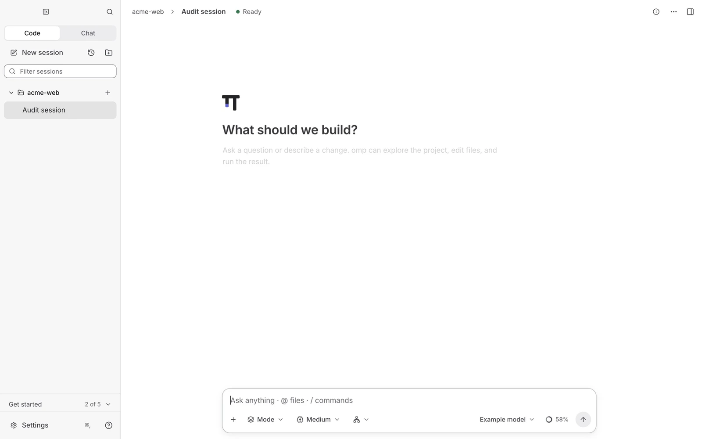
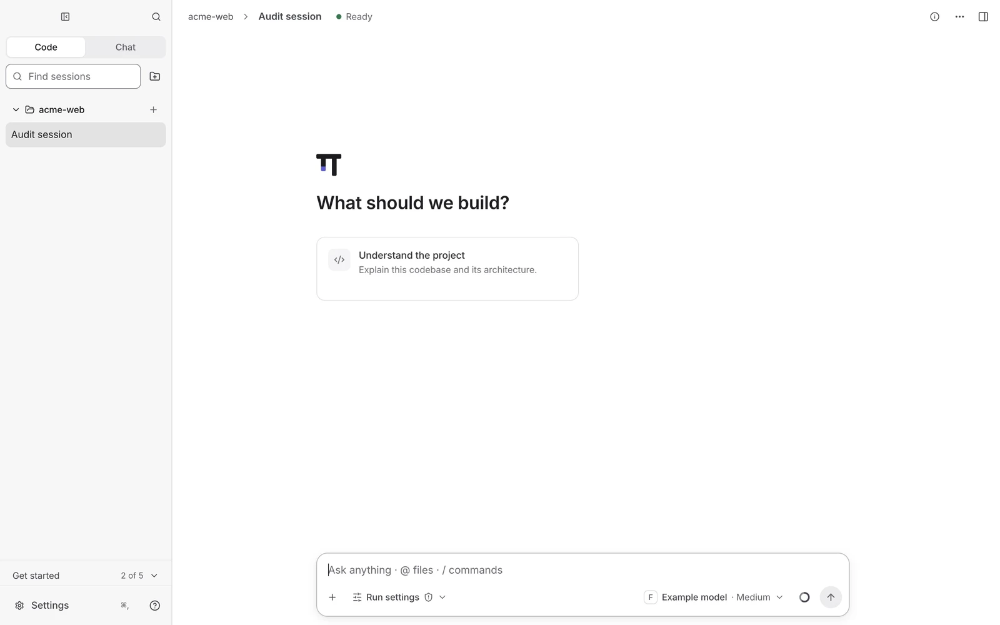
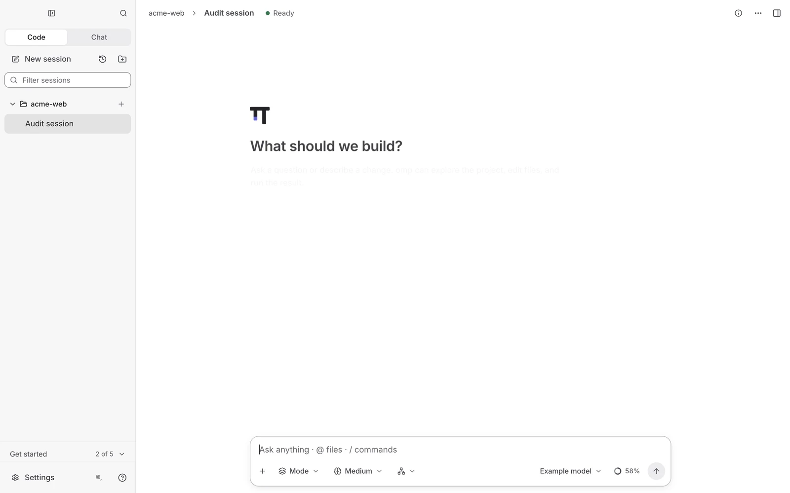
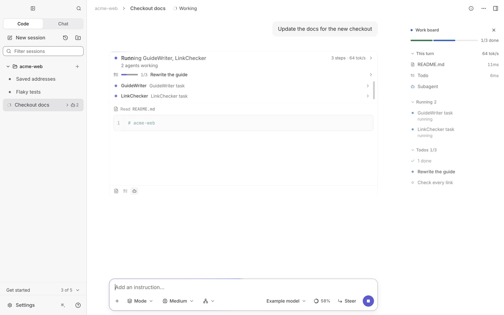
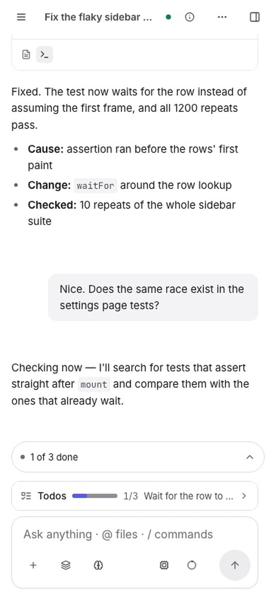
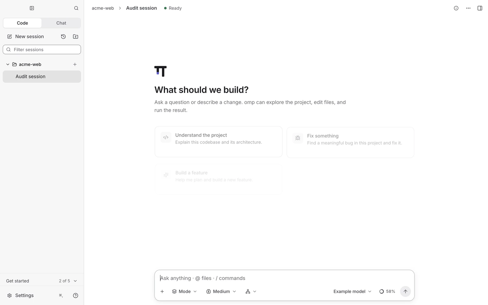
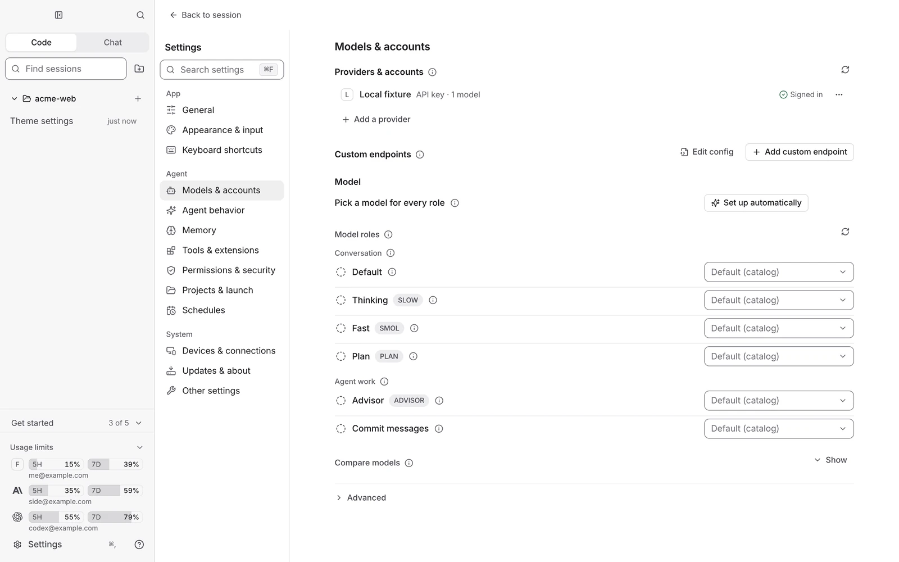
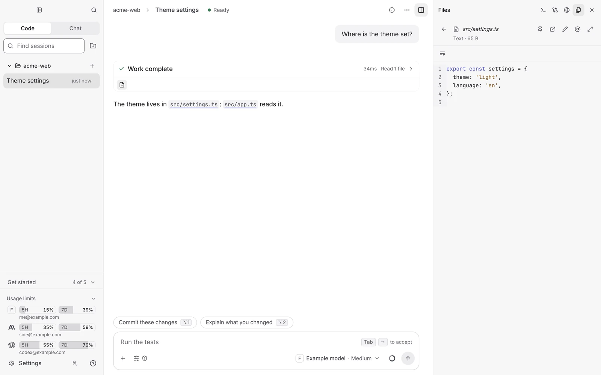

<div align="center">

**English** · [한국어](README.ko.md)

<picture>
  <source media="(prefers-color-scheme: dark)" srcset="resources/brand/wordmark-dark.svg">
  
</picture>

**The desktop app for the omp coding agent: parallel sessions, Autopilot, and your phone.**

<a href="https://github.com/SeuPut0705/ompdesk/releases/latest/download/ompdesk-mac-arm64.dmg"></a>
<a href="https://github.com/SeuPut0705/ompdesk/releases/latest/download/ompdesk-windows-setup.exe"></a>

[](https://github.com/SeuPut0705/ompdesk/releases/latest)

[](LICENSE)

<sub>An unofficial app for [omp](https://github.com/can1357/oh-my-pi), not affiliated with its authors. The UI is in English and Korean.</sub>

<picture>
  <source media="(prefers-color-scheme: dark)" srcset="docs/media/hero-dark.webp">
  
</picture>

<sub>Recorded on a test omp with example files, not real accounts or data.</sub>

</div>

## Why OMPdesk

- **Stock omp, nothing forked.** It runs the omp on your computer, with the same settings, logins and sessions as your terminal, and installs it for you on first launch.
- **Many sessions at once.** Split view, git worktrees, and agents that fan work out, compare the results and merge the best one.
- **Work that keeps going.** Autopilot runs unattended, a restart or update picks every task back up, and your phone can steer a run.
- **Remembers and knows how to work.** Built-in memory recalls earlier decisions, and engineering playbooks and language skills ship with the app.

## Features

<table>
<tr>
<td width="50%" valign="top"><b>Autopilot</b><br>An endless run in its own git worktree: audit, implement, verify, commit, every cycle. By default a green cycle lands on your default branch (one pull request if the branch is protected); without a remote, commits stay local, and Advanced picks another level. A per-project <code>AUTOPILOT.md</code>, written for you, sets its direction. <a href="docs/autopilot.md">How it works</a>.<br><a href="docs/media/autopilot.webp"></a></td>
<td width="50%" valign="top"><b>Parallel sessions and orchestration</b><br>An agent opens sessions in their own worktrees, follows them on the work board, compares the branches and merges the winner itself. Nothing is pushed.<br><a href="docs/media/fan-out.webp"></a></td>
</tr>
<tr>
<td width="50%" valign="top"><b>Split view and work board</b><br>Up to four sessions side by side. Each one's subagents, todos, checks, changed files and waiting questions sit on a live board beside it.<br><a href="docs/media/split-board.webp"></a></td>
<td width="50%" valign="top"><b>Mobile web (beta, off by default)</b><br>Steer a running task from your phone over your own Tailscale network: copy the link and open it on a device signed in to the same Tailscale account. No pairing code, with opt-in push notifications. <a href="docs/mobile-web.md">Set it up</a>.<br><a href="docs/media/phone.webp"></a></td>
</tr>
<tr>
<td width="50%" valign="top"><b>Resume after restart</b><br>Quit, crash or update in the middle of a task and the next launch continues it where it stopped, background jobs and subagents included.<br><a href="docs/media/resume.webp"></a></td>
<td width="50%" valign="top"><b>Accounts and models</b><br>Several accounts per provider with live limit gauges, and a model role for every kind of job, set up for you in seconds from what you are signed in to.<br><picture><source media="(prefers-color-scheme: dark)" srcset="docs/media/models-dark.webp"></picture></td>
</tr>
<tr>
<td width="50%" valign="top"><b>Files, Changes, Preview, Terminal</b><br>Code, Markdown, PDF and Office files, diffs, a live preview and a terminal, beside the chat.<br><picture><source media="(prefers-color-scheme: dark)" srcset="docs/media/files-dark.webp"></picture></td>
<td width="50%" valign="top"><b>Remote devices</b><br>Run sessions on another of your computers, with its omp, files and accounts, and steer them from here. Tailscale only, no pairing code. <a href="docs/remote-devices.md">How</a>.<br><picture><source media="(prefers-color-scheme: dark)" srcset="docs/media/devices-dark.webp"></picture></td>
</tr>
</table>

### Also built in

- **Memory.** Decisions, rules and each turn's conclusion are kept locally and recalled when a later prompt needs them; your paired computers share them. Settings › Memory shows and edits it.
- **Skills.** Engineering playbooks from [pstack](https://github.com/cursor/plugins/tree/main/pstack), language and framework skills from [ECC](https://github.com/affaan-m/ECC), and reverse-engineering tools from REA. Each can be turned off in Settings.
- **Small automations.** Plan or Goal mode picked per request, session titles that follow the work, and suggested next prompts. Each has its own switch in Settings › Agent behavior.
- **Computer use.** On by default; one session drives the desktop at a time, and `/computer off` turns it off.
- **Keeps the computer working.** A charging laptop keeps running tasks with the lid closed, and finished worktrees and caches are cleaned up without losing anything.

## Install

1. **Download** with a button above. macOS: open the DMG and drag **OMPdesk** to Applications. Windows: run the setup; it installs for your user in one click.
2. **Launch it.** On first launch OMPdesk installs omp, Bun and (on Windows) Git by itself. No terminal.
3. **Sign in to a model** (a provider login or an API key). A terminal omp login works as is.

macOS first open: the build is signed but not notarized, so right-click the app and choose **Open** once. Windows SmartScreen: **More info → Run anyway**.

Needs macOS on Apple Silicon or Windows 10/11 x64. omp 18.12.3 or newer, installed for you.

## Updates

OMPdesk, omp, the CLIs of your connected accounts, and omp's plugins, skills and MCP servers update themselves while the app is open. A restart for an app update continues running work after relaunch. No GitHub account or token is needed. [Details](docs/updates.md).

## FAQ

- **Is it the official omp app?** No. It is an unofficial app that drives the omp you have installed; omp itself is never modified.
- **Does it cost anything?** No. It is open source under the Apache License 2.0 and needs no account. Your model providers bill you as they do in the terminal.
- **Can the agent control my computer?** Computer use is on by default, and only one session drives the desktop at a time. On macOS it needs Screen Recording and Accessibility granted to OMPdesk. With omp's default tool approval the agent acts without asking: set **Tool approval** to always ask in Settings › Permissions & security, or turn it off with `/computer off`.
- **I closed the window and the app is still running.** By design: tasks continue until you quit (⌘Q or the tray menu).
- **Something else broke.** See [Troubleshooting](docs/troubleshooting.md), or open an [issue](https://github.com/SeuPut0705/ompdesk/issues).

## Privacy

- **Local.** Settings, sessions, accounts and memory stay on your own computers. Model calls go to your own providers.
- **No telemetry.** OMPdesk collects no usage statistics and switches omp's OTLP export off.
- **Your tailnet only.** Mobile web and remote devices connect only through your own Tailscale network; Mobile web is off by default.

## Docs

- [Autopilot](docs/autopilot.md): start a run, steer it from its work board, stop it, and where its work goes.
- [Mobile web](docs/mobile-web.md): steer a running task from your phone over Tailscale.
- [Remote devices](docs/remote-devices.md): run sessions on another computer.
- [Updates](docs/updates.md): what updates itself, and how to turn it off.
- [Troubleshooting](docs/troubleshooting.md): common problems and installing by hand.
- [Developing on Windows](docs/windows-dev.md): setup and limits for contributors.
- Design records: [work board](docs/work-board-design.md), [work card](docs/work-card-design.md).

## Build from source

Needs Bun, Git and omp 18.12.3 or newer.

```bash
git clone https://github.com/SeuPut0705/ompdesk.git
cd ompdesk
bun install
bun run dev
```

Development, checks and release rules are in [AGENTS.md](AGENTS.md); changes per version in [CHANGELOG.md](CHANGELOG.md). To re-record the media above: `bun run readme:media`.

## Contributing · Security · License

[Contributing](CONTRIBUTING.md) · [Security](SECURITY.md) · [Apache License 2.0](LICENSE) · [Notice](NOTICE) · [Third-party notices](THIRD_PARTY_NOTICES.txt)

<sub>Versions up to v0.41.0 were released under the MIT License.</sub>

Made by [@SeuPut0705](https://github.com/SeuPut0705)
