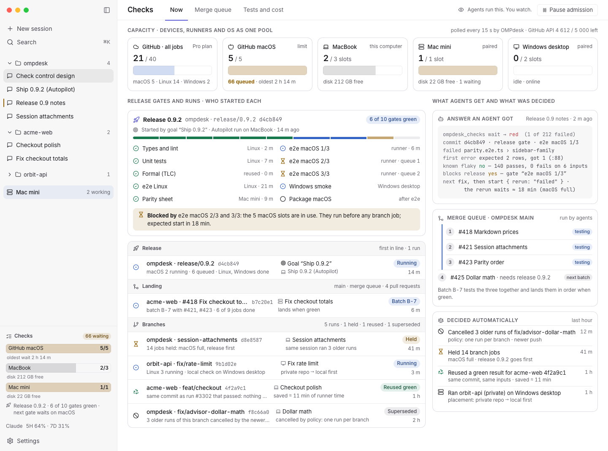

# Check control

Design for the owner's review, 13 Nov 2026. Evidence pass the same day. Nothing here is built. P0 is already in flight as the workflow enforcement of agent `CiQueueStructure`; this page is everything after it. Pictures use fake data (made-up repos, `example.com`, the real theme tokens and shared components), English labels, both themes.

**One sentence.** Agents start, wait for, judge, retry and quarantine checks through one tool that sees every computer and GitHub runner as one pool. The person only watches, and is asked only when a decision is theirs.

**How to read the evidence.** Every claim about a competitor or GitHub carries `[O#]` or `[I]`. `[O#]` is observed, and `#` is the source in §12 (file and symbol at a commit, or a URL fetched on 13 Nov 2026). `[I]` is inferred, and says from what. `[R]` is reported by the owner and not re-measured. A vendor's own docs are `[O]` for what the vendor says, not for what the product does.

## 1. Problem, in today's numbers

| Fact | Number | Evidence |
| --- | --- | --- |
| Concurrent macOS jobs this account may run | 5 on Free, Pro and Team, 50 on Enterprise, shared by standard and larger runners. Pro also caps all jobs at 40 | `[O4]` limits.md, "Job concurrency limits for GitHub-hosted runners" |
| macOS jobs queued by branch batch runs | 71, so main's own runs and the release waited hours. 71 ÷ 5 is at least 15 waves | `[O1]` commit message |
| One project's release check | 142 min (Playwright 115 min, 1 144 tests, one worker), from scratch three times | `[O2]` |
| Session polling of CI | polled ×508 and ×636 in two sessions | `[R]` owner's session list |
| Cancelling overlapping runs | by hand | `[R]` |

Three machines, each with its own heavy slots (`ompdesk heavy`), and a GitHub account with its own limits. Nothing connects them, and no session knows what another session already started `[I]` from the three facts above, since each has its own counter.

## 2. Paid tools are the floor: what they do, what we do, what the evidence changed

Verdicts. **Holds** means the evidence supports the "better here" claim. **Narrowed** means the first draft over-claimed and the claim shrank. **Unproven** means no source we could read tests it, so it stays `[I]`.

| Concern | Paid tools do (observed) | Better here, verdict, and why only OMPdesk can | Skipped |
| --- | --- | --- | --- |
| Capacity and queue view | Buildkite's queue page shows agents in use, idle, paused, draining, jobs by state and wait p50/p95/p99, refreshed every 15 s `[O7]`. The agent exports `jobs_running` by priority and queue `[O6]`. The public pipeline page lists builds by branch, user, state and date, with commit and duration, and no capacity `[O16]` | **Holds, narrower.** The numbers are table stakes. What we add is one pool across MacBook, Mac mini, Windows desktop and the GitHub macOS limit, and for every job the session, goal and release gate behind it. Sessions, goals and devices are OMPdesk's own state `[I]`. We could not read the logged-in dashboards, so "they do not show it" is `[I]` | Autoscaling fleets, agent tokens, p99 histograms |
| Ordering, cancelling, priority | Buildkite concurrency groups run jobs in scheduling order (`ordered`) or by priority (`eager`), have `cancel_in_progress`, and report `concurrency_wait_time_ms`, but state that they do not guarantee only the latest job runs `[O7]`. GitHub `concurrency` supports `queue: max`, up to 100 queued runs per group `[O4]` | **Narrowed a lot.** FIFO, priority and cancel-in-progress exist natively. They are declared by hand per step, with limits set by hand, and know nothing of a release gate or a session `[I]`. Our claim is now only that **one rule, derived from lane and gate, spans CI and local**. P0 already uses GitHub's native `concurrency`. We build an admission queue only where GitHub cannot (the account-wide macOS limit, several devices) | A general scheduler |
| History and trends | CircleCI Insights charts success rate, p50 and p95 duration, credits per workflow and job, with up to 24 h lag, and is not billing-grade `[O12]`. The public page (logged out) shows workflow runs, total duration, total credits, success rate and throughput over 24 h to 90 d with a branch filter `[O16]`. `circleci-cli` has no Insights client `[O11]` | **Unproven.** Per gate and per goal series are our idea, and "live" follows from owning the poller and journals `[I]`. We found no code behind the competitor charts. REA's bundle capture of both public pages saw 3 inline scripts and 0 route candidates, so it recovered nothing `[O15]` | Org-wide dashboards, billing-grade accuracy |
| Flaky tests | Trunk, Datadog and Buildkite enforce quarantine **at the test runner inside the CI job**. Trunk's CLI fetches a quarantine config per run and rewrites the exit code (`gather_exit_code_and_quarantined_tests_context`, `gather_quarantine_context`) `[O9]`. Datadog's tracer fetches test-management data per session and suppresses failures (`get-test-management-tests.js`, `quarantinedFailingTests` in `jest.js`) `[O10]`. `bktec` has retry and muted-test flags `[O8]`. Datadog policies quarantine by age, branch or failure rate `[O13]` | **Narrowed.** "No UI step" is not ours alone, Datadog automates quarantine by policy `[O13]`. What differs is that state sits in the local check journal with no SaaS round trip (`flaky.rs`, `CLEAR_AFTER = 5`) `[O17]`, and the agent that hits the failure is told in-session, with the session that quarantined it. The second point is `[I]`, since we did not read their APIs end to end. Our rule is simpler (same digest, pass and fail) than Datadog's | AI root-cause categories, code-owner routing, Jira, Slack mail |
| Merge queue | GitHub's queue builds a temporary branch per queued PR on top of those ahead, fires `merge_group`, builds up to 100 at once, and its merge limits **do not combine builds** `[O5]`. It exists only for public repos owned by an organization, or private repos in orgs on Enterprise Cloud `[O5]`. Trunk batches PRs into one test run, bisects failures with their own concurrency, defaults 5 min wait and batch of 4 `[O14]` | **Changed.** `SeuPut0705/ompdesk` is a user-owned repo `[O1]`, so GitHub's queue is **not available** to it. And even where it is, it does not batch builds. P3 is therefore OMPdesk's own queue with real batching, closer to Trunk than to GitHub's. That is a bigger build than the first draft said, and it makes the order knowledge (release first, goal grouping) the whole product rather than an add-on | Parallel queues from a build graph, optimistic merging |
| Test splitting and selection | `bktec` plans runs from the server's per-file timing (`FetchFilesTiming`) and splits across parallel jobs `[O8]`. Datadog skips tests by coverage (Test Impact Analysis) `[O13]` | **Gap, not a claim.** We reuse by input digest (`ompdesk check`) and rerun only failures `[O2]`. We have **no timing-based split** and no coverage selection. A P4 candidate, not in scope | Coverage selection |
| Waiting | `circleci run watch` blocks until a terminal state, exits 0, 1, 6, 7 or 8 by outcome, has `--failfast`, and polls from 5 s up to 30 s per invocation `[O11]`. Datadog sends flaky-test notices to email and Slack `[O13]` | **Narrowed.** A blocking wait with outcome-coded exits already exists in a paid vendor's CLI. We do not claim to have invented waiting. What differs is cost and shape. **N waiting agents share one poll** (their CLI polls per process), and the result is a judgment, not a status `[I]` | Public webhooks |
| Cost | Credits in Insights `[O12]`. Datadog's Test Health shows time lost to flaky tests `[O13]` | Runner minutes by OS next to **local placement** and **disk care**: a private repo runs on a free local Mac, a full disk blocks a start `[I]` | SSO, RBAC, audit retention, SLA |

What we borrow as ideas only, with no code copied. Outcome-coded exit codes for `ompdesk checks wait` (from `circleci run watch`). A lease with a heartbeat for held admissions (from `bktec`'s `AcquireLease` and `HeartbeatLease`, `[O8]`). Retry budgets that shrink with test duration (from Datadog's five buckets of up to 20, `dynamic-atr-retries.js`, `[O10]`). Skipping a bisection combination already known red (Trunk docs, `[O14]`).

## 3. Data model

One deep module, `ChecksHub`, owns all of it. Its interface is three calls (`start`, `wait`, `status`) plus one read-only stream for screens (`watch`). Everything below is internal. Fact adapters sit at two real seams, GitHub (REST) and local (heavy slots and journals), each with a fake for tests.

```ts
type Os = "macos" | "windows" | "linux";
type Where = { kind: "device"; deviceId: DeviceId } | { kind: "github-hosted" } | { kind: "self-hosted"; runnerId: string };

/** Slot and capacity per OS and machine. One shape for a Mac's heavy slots and for GitHub's macOS limit. */
type Pool = { id: PoolId; os: Os; where: Where; limit: number; running: number; queued: number;
              oldestWaitMs: number; diskFreeGb?: number; asOf: Timestamp; state: "live" | "stale" | "offline" };

/** Who asked. Main-owned provenance, never read from text. */
type Origin = { kind: "session"; session: SavedSessionId; device: DeviceId; goal?: GoalId }
            | { kind: "person" } | { kind: "outside"; claimedName: string } | { kind: "foreign" };

type Lane = "release" | "land" | "branch" | "local";
type Run = { id: RunId; repo: RepoId; ref: string; sha: Sha; lane: Lane; trigger: "push" | "pull_request" | "dispatch" | "queue" | "local";
             origin: Origin; gate?: GateId; jobs: Job[]; verdict?: "green" | "red" | "cancelled";
             reusedFrom?: RunId; supersededBy?: RunId; digest: InputsDigest };
type Job = { id: JobId; os: Os; pool: PoolId; state: "held" | "queued" | "running" | "passed" | "failed" | "cancelled" | "reused";
             queuedAt: Timestamp; startedAt?: Timestamp; endedAt?: Timestamp; billedMin?: number };

/** A named set of jobs a release needs; progress is "6 of 10 gates green". */
type Gate = { id: GateId; release: ReleaseId; jobs: JobSelector; required: true };

type Policy = { id: string; scope: "global" | RepoId; when: Condition; action: "cancel-superseded" | "hold" | "reuse" | "place" | "batch" | "quarantine" | "rerun-failed";
                mode: "enforce" | "advise"; ownerOverride?: boolean };
type Decision = { policy: string; run: RunId; action: string; reason: string; at: Timestamp };   // the "Decided automatically" log

type QueueEntry = { id: string; repo: RepoId; base: string; pr: number; sha: Sha; lane: Lane; position: number;
                    batch?: BatchId; state: "waiting" | "testing" | "ready" | "landing" | "failed" | "removed" };

type TestResult = { test: TestId /* hash(repo, fqn) */; run: RunId; outcome: "pass" | "fail" | "skip"; durationMs: number; digest: InputsDigest; attempt: number };
type TestHistory = { test: TestId; p50Ms30d: number; state: "active" | "quarantined" | "cleared"; quarantinedBy?: Origin; cleanSince: number /* of 5 */ };

/** What an agent receives. Carries the judgment, so it never reads logs. */
type Answer = { verdict: "green" | "red" | "unknown"; asOf: Timestamp; counts: { passed: number; failed: number };
                failed: { test: string; firstError: string | null; knownFlaky: boolean; history: string }[];
                blocksRelease: { gate: GateId } | null; expectedWaitMin: number | null; reused?: { from: RunId; savedMin: number };
                next: "fix" | "rerun-failed" | "wait" | "land" | "ask-owner"; notes: string[] };
```

## 4. Where each fact comes from

| Fact | Source | How |
| --- | --- | --- |
| GitHub runs, jobs, queue depth | REST `actions/runs` and jobs, per repo | **One poller** (`GithubPoller`) in one place, the core process like the other new domains (native-rust ledger; open decision, §11). Conditional requests, back-off on `x-ratelimit-remaining`, a budget of about 2 000 of the 5 000 authenticated requests per hour `[O4 for the 5 000 and the GITHUB_TOKEN 1 000; the 2 000 is a design choice]`. **Sessions never call GitHub for checks.** No webhooks, since a desktop app has no public address `[I]` |
| GitHub limits (5 macOS, 40 total) | Plan documentation `[O4]`, cross-checked by the highest concurrency actually observed | The pool's `limit`. A repo variable can override it |
| Device slots and disk | `ompdesk heavy status --json` (`heavy.rs` pool and `Volumes`, `scripts/lock-slots.ts` reads it) on each computer, read over the paired link `[O17]` | One `Pool` per computer. A link loss shows `offline` and counts as zero capacity |
| Local runs, results, flaky state | `ompdesk check` journals in `<cache>/ompdesk/checks/runs/<id>/` and `flaky.rs` `[O2, O17]` | Read by the hub, not re-run |
| Who started a run | AgentControl provenance (`openedBy`), Autopilot run and goal, the control-socket caller | Written into `Run.origin` at `start`. A run no session started is `person` or `foreign` and is shown, never governed |
| Release gates | The repo's release facts (AUTOPILOT.md) and the gate names in the workflow | `Gate` list per release |
| Runner minutes and cost | GitHub billing usage report (REST, `docs.github.com/en/rest/billing/usage`, seen as a search result only) | `[I]` the per-OS Actions SKU is in it. Verify before P4. Monthly, cached |

## 5. Policies

All are product behavior with no setting, like heavy slots. A policy only ever acts on what OMPdesk may govern (§9). Every action is written to the `Decision` log with its reason, and the answer to the affected agent says so.

| # | Owner's wish | Rule | Phase |
| --- | --- | --- | --- |
| 2 | Overlapping runs cancel themselves | One live run per repo, ref and workflow. A newer push to the same ref cancels the older one. Never a release, queue, other-ref or person-started run. GitHub's `concurrency` and Buildkite's `cancel_in_progress` do this per workflow `[O4, O7]`, so we only add it where no workflow can | P0 (workflow `concurrency`), P1 for runs outside workflows |
| 2 | Release-bound work first | Lane order is release, land, branch, local, derived from the gate and goal, not set by hand per step. A free macOS slot goes to the oldest release job, then the rest | P0 (repo variable), P2 in the hub |
| 2 | Wait when full | Admission is a queue **in OMPdesk**, per pool, FIFO within a lane. Jobs a pool cannot start stay `held` locally instead of queueing 71 at GitHub, so cancelling is free and no job meets GitHub's 24 h self-hosted queue limit `[O4]`. Answers carry an expected start. A held entry keeps a lease with a heartbeat, like `bktec`'s pool leases `[O8]` | P2 |
| 2 | Reuse a green result | Same commit, same workflow file hash, same inputs and tool digest as a green run starts nothing and returns `reused`. Reuse is never keyed on the sha alone | P0 (same-commit), P2 (digest) |
| 3 | Merge queue | Lane `land`. **OMPdesk's own queue.** GitHub's queue is unavailable to user-owned repos and does not combine builds `[O5]`. Release-bound branches batch (goal-grouped, target size from history, default to start from Trunk's 4 and 5 min `[O14]`), build once on a temporary branch OMPdesk owns, and land in order when green. A red batch bisects and skips combinations already known red. Where a repo has GitHub's queue, OMPdesk can enqueue into it instead, without batching | P3 |
| 4 | Flaky tests | Quarantine a test that passed and failed on one digest. Rerun only failed jobs and tests. Clear after 5 clean runs on different inputs `[O17]`. Release gates still fail while a quarantined test failed in that run. Slowdown alert when a test runs over 1.3× its 30-day median in 3 runs in a row `[proposal]` | P4 |
| 5 | Local or runner | Private repo goes local first (free minutes), public goes to a runner. macOS-only work goes to a runner only when no local Mac has a slot. No start while a volume is under `min_free` (disk care owns cleanup). Spend past the runner budget the person set is escalated, §8 | P4 |

### Durable admission, queue effects and result delivery

The hub owns only an exact dispatch receipt: repository, run ID and attempt. Workflow/ref/time similarity is not provenance. Admission freezes the requested SHA; a result for another SHA, stale facts or a release-blocking quarantined failure cannot establish reusable green.

A dispatch intent and its capacity reservation are saved before the external write. A definite refusal returns the place. A lost or ambiguous response is **UNCONFIRMED**, not a refusal or a retry opportunity: `unknown`/`ask-owner` names the reservation and cause, and restart retains it. Only authoritative run evidence can reconcile it automatically. With no such evidence, capacity may remain blocked indefinitely; this release has no new owner-reconciliation action and promises no eventual recovery.

Queue acknowledgements and effects follow their durable saved state. Stable batch/result receipts absorb replay after a lost response. An unconfirmed batch remains pending with a lease; a conclusively final unknown verdict fails the trial rather than silently resending the workflow.

Result notifications use a persisted random hub-instance namespace, run ID and phase (`unconfirmed` or `result`). Source replay keeps that opaque key. The canonical recipient resolver checks the original saved session and device; it must not guess a path, invent a caller, or bypass a hidden, deleted, disabled or unreachable target. Only a matching **Disk** receiver receipt permits source ACK. Memory-only acceptance, a save error or a lost response retains source responsibility. Disk acceptance transfers durable outbox responsibility; it is not evidence that a model read the result, and transport is at-least-once, not exactly-once.

Old local journals may lack a first error or per-test history. Those fields are shown as not recorded, never invented as empty errors, zero history or a non-flaky pass.

## 6. The agent tool

`ompdesk_checks`, with the CLI twin `ompdesk checks` for outside callers. Three operations replace every `gh run` poll. The twin returns an exit code per outcome, as `circleci run watch` does `[O11]`, with codes of our own.

| Operation | Input | Returns |
| --- | --- | --- |
| `start` | `purpose` (branch, release, land), `scope` (changed, full), optional `rerun: "failed"`, `repo`/`ref` default to the session's | `{ runId, decision: started \| reused \| held \| refused, placement, expectedStartMin, reason }` |
| `wait` | `runId`, `until` (result, any) | An `Answer`. The call ends when the result arrives. It is the control socket's server-side wait, not a loop, so it spends no turns and no GitHub request of its own |
| `status` | `scope` (mine, repo, all) | Pools and runs, cheap, so an agent can judge "is macOS full, should I start the release gate now" |

Rules the tool enforces so agents do not have to decide them. Placement and lane come from policy, never from the caller. A session can only cancel or rerun its own runs. `status` is served from the hub's cache and costs no GitHub request.

## 7. Acceptance: agents actually use it

A tool agents may ignore changes nothing. Five criteria, each with the part of the design that meets it, and the proof in 5.

| # | Criterion | How the design meets it |
| --- | --- | --- |
| 1 | **Only path.** Starting checks (`gh workflow run`, `gh run rerun`, a push that triggers them) goes through the tool. A run started outside it is refused by the workflow | The workflow's first job, `admit`, a 5-second Linux job, requires an admission ticket the tool supplies as a dispatch input. The ticket is an HMAC of repo, ref, sha and expiry. Its key is an Actions secret that is also in the OMPdesk keychain and never in a session's environment. A hand-run macOS job fails at `admit` with "start it with ompdesk_checks". A plain push may still run cheap Linux jobs. Honest limit, §9. Until P2, P0's `-f mac=true` is the only gate |
| 2 | **Waiting by notification.** The session is woken when the result arrives. Zero polling | `wait` rides the control socket's server-side waits and lifecycle events (the machinery `ompdesk_session_result` already uses). The `check-runs` prompt section tells agents to call `wait` and never poll. Waste-guards already hint at polling loops, and extending that hint to `gh run view` and `gh run watch` is a proposal. The board row says "this session is woken when the result arrives" |
| 3 | **Answers that carry the judgment.** Green or red, failing test names with the first error line, known flaky or not, blocks a release gate or not, expected wait | The `Answer` type in §3. `knownFlaky` and `history` come from `TestHistory`, `blocksRelease` from `Gate`, `expectedWaitMin` from pool throughput. `verdict` is `unknown` when the poller is stale. It is never "green" from old data |
| 4 | **Policy decides** what runs where (local or runner, macOS or not) | `start` has no placement argument. Placement, lane and macOS use come from §5 and are reported back as `decision` and `reason`, so an agent follows the answer rather than arguing with it |
| 5 | **Proof.** Several sessions given the same task, before and after | Run one fixed task ("land these three branches and report green") in 4 sessions on `main` before P2 and again after. Compare per session and in total: runs started, peak macOS queue depth, polls (from the existing session pace counters), and **wrong green reports** (an agent said green while the gate was red or unknown, judged from the hub's journal). The page's "Are agents using it?" card keeps the live figures: runs started through the tool, refusals, polls, wrong greens |

## 8. What the person sees

Watching, not operating. Controls: **Pause admission** (new starts are refused with "paused by the owner"). Nothing else is a button.

| Surface | Content |
| --- | --- |
| Sidebar block (footer pin like Usage; draws nothing when no pool has work) | One slim gauge per pool that has work (GitHub macOS 5/5 with its queue, MacBook 2/3, Mac mini 1/1), one release-gate line. Built from `UsageGauges`, `Badge`, `ProgressBar`. A tap opens the page |
| Checks page (destination page, not one of the four side-panel views, since it has its own navigation) | Tabs **Now**, **Merge queue**, **Tests and cost**. Now shows pools by device, runner and OS; the release gates and what blocks them; runs by lane, each with **started by session and goal**; the last answer an agent received; the merge queue; the "Decided automatically" log. Tests and cost shows flaky tests and who quarantined them, slowdowns, queue depth, runner minutes, adoption figures |
| Work board | The existing check row becomes "Check · release gate · 18 min" with a note that the session wakes on the result. A tap opens the page on that run |
| Phone | The same block in the drawer, the same page in one column under phone density, tabs as a segmented control |
| Asking the person | Only when the decision is theirs, such as runner spend over budget, or two release-bound runs competing for one macOS slot. The hub sends it to the goal's session as mail and that agent asks through the normal ask card. No new attention kind |

Mockups (fake data, real tokens; the sidebar block is in every picture):

| View | Light | Dark |
| --- | --- | --- |
| Now (desktop) | [check-control-now-light.png](check-control-now-light.png) | [check-control-now-dark.png](check-control-now-dark.png) |
| Tests and cost (desktop) | [check-control-tests-light.png](check-control-tests-light.png) | [check-control-tests-dark.png](check-control-tests-dark.png) |
| Work board link | [check-control-board-light.png](check-control-board-light.png) | [check-control-board-dark.png](check-control-board-dark.png) |
| Phone, 390 px (drawer and page) | [check-control-phone-light.png](check-control-phone-light.png) | [check-control-phone-dark.png](check-control-phone-dark.png) |



The merge-queue card in these pictures shows one batch. Given §2, the batch is OMPdesk's own, not a GitHub `merge_group`.

Parity at build time: `sidebar-checks` and `checks-page` surfaces for the parity sheet (ui-parity rule), one string key per label in `en` and `ko`.

## 9. What OMPdesk must never do

1. Cancel another repo's run, a run a person started, a release or queue run, or a run on another ref, except through a named policy, and then only a run that a newer run of the same repo, ref and workflow superseded. Foreign jobs that eat capacity (other repos, the same account) are shown and counted, never touched.
2. Spend GitHub API quota per session. One poller, a budget, stale-and-say-so when limited.
3. Report green from data older than the poll window. The answer says `unknown`.
4. Start heavy work onto a volume under `min_free`, or a macOS job while the owner paused admission.
5. Treat a quarantined failure as a pass for a release gate.
6. Auto-rerun without limit. Reruns cap per run, shrinking with test duration, and the cap is in the answer.
7. Put the admission key in a session's environment or a log.

Honest limit of criterion 1. The ticket stops an honest bypass, not a person or program that can read the OMPdesk keychain, and a shell can read whatever the user's account can read `[I]`.

## 10. Phases

| Phase | Scope | Done when |
| --- | --- | --- |
| P0 | Workflow enforcement by `CiQueueStructure`. Concurrency groups, admission, release-first macOS through a repo variable, same-commit reuse. **Not part of this design's work, and it does not block release 1** | The 71-job queue cannot recur from branch runs |
| P1 | Read-only board. Poller, pools, runs, provenance, sidebar block, Checks page Now. No controls | The owner sees pools by device and runner, and who started each run |
| P2 | Agent tool. `start`, `wait`, `status`, `Answer`, admission ticket, wake on result, prompt section, Pause. A formal model of admission (FIFO, release first, no double admit, cancel only the superseded) comes first, per `ompdesk-formal-verify` | Acceptance 1 to 5 pass in the before and after trial |
| P3 | Merge queue. Lane `land`, **OMPdesk's own queue with batching**, bisection | A batch of release-bound branches lands in order with one run |
| P4 | Flaky and trends. Quarantine from GitHub runs, not only local checks, slowdowns, runner minutes, placement, disk-care link. Timing-based test splitting is a candidate | Tests and cost tab matches the mockup |

## 11. Risks, and what a paid product has that we skip

- **P3 is bigger than the first draft.** No GitHub queue for a user-owned repo `[O5]`, so batching, temporary branches, landing and bisection are ours. If the owner moves the repo into an organization (public, or private on Enterprise Cloud), enqueuing into GitHub's queue becomes an option, still without batching.
- **Poller home.** The core process fits the native-rust direction, but `ompdesk checks` for a terminal with no OMPdesk running can only answer local pools. Decide before P1 `[open]`.
- **Shared account limits.** The 5 macOS slots belong to the account `[O4]`. Other repos use them and we cannot govern them. The pool view must show them or its capacity is a lie.
- **API budget and secondary limits.** More repos raise the poll cost. Mitigation is conditional requests and per-repo cadence by activity `[I]` that a 304 is free of the primary limit, to confirm before relying on it.
- **Reuse correctness.** A wrong key reports green for something never run. The key includes workflow file hash, inputs, tool digest and the base of a batch.
- **Honest enforcement.** §9.
- **Multi-machine truth.** A paired Mac mini that sleeps looks like zero capacity. It must read `offline`, not "empty".
- **The comparison is partly blind.** The logged-in dashboards of Buildkite, CircleCI and Datadog were not readable. "Only OMPdesk" claims marked `[I]` can be wrong, and a hands-on trial of one competitor is the way to settle them.
- **Skipped from paid products.** SSO, RBAC, audit retention and SLA, org-wide and multi-tenant dashboards, autoscaling fleets, coverage-based test selection, timing-based test splitting (for now), AI root-cause categories, external webhooks, parallel merge queues from a build graph.

Rejected. Per-session `gh` polling with a shared cache (still N sessions on one quota, still turns spent). Webhooks (no public endpoint). A GitHub-only solution of concurrency groups (it cannot know goals, devices or disk, and has no queue for this repo). Packaging the whole thing as buttons for the person (the agents are the users).

## 12. Sources

Read 13 Nov 2026. Repos were cloned read-only with `git clone --depth 1` (github/docs sparse) under `/Volumes/BACKUP/research/<name>-research` and deleted after the pass. **No code was copied from any of them**, so `THIRD_PARTY_NOTICES.txt` and `LICENSES/` are unchanged. Licenses are listed so that a later borrow starts from the right terms.

| # | Source | License | What was observed |
| --- | --- | --- | --- |
| O1 | This repo, commit `09175b6a66` (message), `git remote` of this checkout (`SeuPut0705/ompdesk`, a user account) | n/a | 71 queued, 5 at once; repo is user-owned |
| O2 | This repo, `.omp/rules/control-tools.md` › Heavy slots and `ompdesk check` (13 Nov 2026) | n/a | 142 min release check; digest reuse, rerun only failures |
| O3 | Owner's session list (polled ×508, ×636) | n/a | **Reported, not re-measured.** Cited as `[R]` |
| O4 | `github/docs` @ `6d56af0`, `content/actions/reference/limits.md` (macOS table; `queue: max` row) and the REST rate-limit page (docs.github.com, fetched) | CC-BY-4.0 (content), MIT (code) | 5 macOS jobs on Free, Pro, Team; 50 Enterprise; Pro total 40; 100 queued per concurrency group; 5 000 requests per hour authenticated, 1 000 for `GITHUB_TOKEN` |
| O5 | `github/docs` @ `6d56af0`, `content/repositories/configuring-branches-and-merges-in-your-repository/configuring-pull-request-merges/managing-a-merge-queue.md` and `data/reusables/gated-features/merge-queue.md` | CC-BY-4.0 | `merge_group` event, temporary branch per PR on top of those ahead, build concurrency 1 to 100, merge limits do not combine builds, availability (organization public repos, or private repos on Enterprise Cloud) |
| O6 | `buildkite/agent` @ `c6e0690`, `agent/metrics.go` (`jobsRunning`, `jobsStarted`, `jobsEnded`), `clicommand/agent_start.go` (`--spawn`, `--spawn-per-cpu`, `queue=` tag) | MIT | Per-agent job counters labelled by priority and queue; spawn count is the agent's concurrency |
| O7 | Buildkite docs (fetched): *Controlling concurrency*, *Queue metrics in clusters* | n/a | Concurrency groups (`ordered`, `eager`), `cancel_in_progress`, `concurrency_wait_time_ms`, "does not guarantee only the latest job runs"; 15 s queue-page refresh, job states, wait percentiles |
| O8 | `buildkite/test-engine-client` @ `2957f19`, `README.md` (flow), `internal/api/fetch_files_timing.go` (`FetchFilesTiming`), `cli.go` (`testEngineRetryCountFlag`, `disableRetryMutedFlag`), `internal/api/lease.go` (`AcquireLease`, `HeartbeatLease`) | MIT | Timing-based split, retries of failed tests, muted tests, leased pool entries |
| O9 | `trunk-io/analytics-cli` @ `d283d2a`, `cli/src/context.rs` (`gather_exit_code_and_quarantined_tests_context`), `cli/src/context_quarantine.rs` (`gather_quarantine_context`), `bundle/src/quarantine_resolution_mode.rs` | MIT | Quarantine fetched per run, applied by rewriting the exit code in the CLI |
| O10 | `DataDog/dd-trace-js` @ `c1e177c`, `packages/dd-trace/src/ci-visibility/exporters/ci-visibility-exporter.js` (library settings), `.../test-management/get-test-management-tests.js`, `.../dynamic-atr-retries.js` (`RETRY_BUCKET_COUNT`, `MAX_RETRIES_PER_BUCKET`), `packages/datadog-instrumentations/src/jest.js` (`quarantinedFailingTests`) | Apache-2.0 and BSD-3-Clause (dual) | Test-management data fetched per session, quarantined failures suppressed in the runner; retry buckets of up to 20 |
| O11 | `CircleCI-Public/circleci-cli` @ `51e0b76`, `internal/cmd/run/watch.go` (`watch`, exit codes, `--failfast`), `internal/ui/run_watch_flow.go` (`RunWatchPollInterval` 5 s, `RunWatchMaxPollInterval` 30 s); absence of any `insights` string in its `.go`, `.md`, `.yml` files | MIT | Blocking watch with outcome-coded exits, per-process polling; no Insights client |
| O12 | CircleCI docs, *Using Insights* (fetched) | n/a | Workflow and job metrics, p50 and p95, credits, up to 24 h lag, not billing-grade |
| O13 | Datadog docs, *Flaky Tests Management* and *Test Health* (fetched) | n/a | States, policies by age, branch and failure rate, 20 retries to confirm a fix, time lost to flaky tests, Test Impact Analysis |
| O14 | Trunk docs, *Batching* (fetched) | n/a | Defaults 5 min wait and batch of 4; bisection concurrency; skip redundant bisection tests. "60 to 80 % less test time" is the vendor's claim and is not used as a number |
| O15 | REA `analyze_web_bundle` (headless Chromium over loopback CDP, public pages only, no login) on `buildkite.com/bazel/bazel-bazel` (`ev_cf645a28…`) and `app.circleci.com/insights/github/CircleCI-Public/circleci-cli` (`ev_169d24b3…`) | n/a | Each page: 3 inline scripts, 0 route candidates, parsing complete. **Inconclusive.** The capture attaches after load, so the SPA's chunks were not seen. No claim in this document rests on it |
| O16 | The same two public pages read through the page text (ego-browser, 13 Nov 2026) | n/a | Buildkite: build list with branch, user, state, date filters, commit, duration. CircleCI Insights, logged out: runs, total duration, total credits, success rate, throughput over 24 h to 90 d, branch filter |
| O17 | This repo, `native/ompdesk/crates/checks/src/flaky.rs` (`CLEAR_AFTER`), `heavy.rs`, `scripts/lock-slots.ts` | n/a | Quarantine on same-digest pass and fail, cleared after 5; `ompdesk heavy status --json` |

Seen as search results only, not used for a number. GitHub billing usage API (`docs.github.com/en/rest/billing/usage`).
