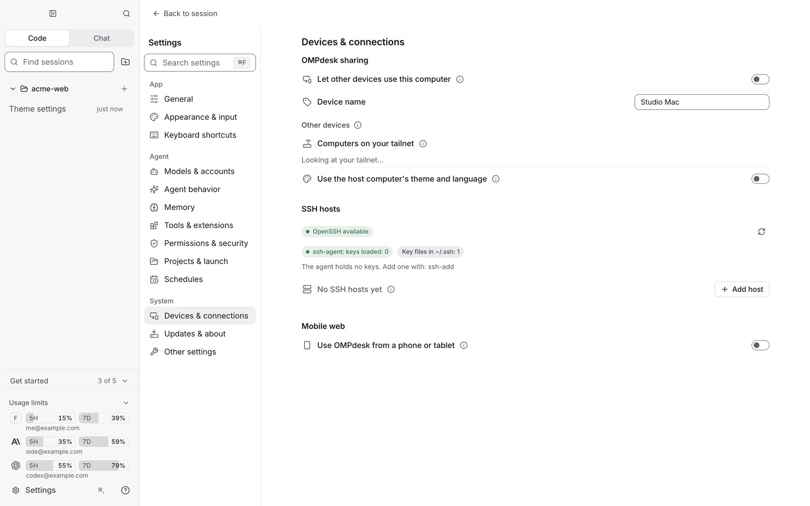

# 원격 기기

[English](remote-devices.md) · [README로 돌아가기](../README.ko.md)

다른 컴퓨터의 omp, 파일, Git, 계정으로 이 컴퓨터에서 작업해요. 탭은 그 컴퓨터에서 실행되고, 여기서 보고 이어서 지시해요.

## 두 컴퓨터 연결하기

1. 양쪽 컴퓨터에 OMPdesk를 설치하세요. omp는 각 컴퓨터에서 첫 실행 때 설치돼요.
2. **작업을 실행할 컴퓨터**에서 **설정 › 기기 및 연결 › OMPdesk 공유 › 다른 기기에서 이 컴퓨터 사용 허용**을 켜고, 표시된 연결 코드(`XXXX-XXXX`)를 확인하세요. 코드는 10분 동안 한 번만 쓸 수 있어요.
3. **지금 쓰는 컴퓨터**에서 **기기 연결**을 누르고 같은 네트워크의 기기를 고르거나 주소를 입력한 뒤 코드를 넣으세요. Tailscale 같은 네트워크에서는 주소를 직접 입력하세요.
4. 사이드바에서 연결한 기기의 프로젝트와 세션을 열어요.

연결은 기기별 키로 인증하고 암호화해요. 원격 탭의 설정·통계는 그 컴퓨터 기준이에요.

## 알아 두면 좋은 것

- 원격 탭은 그 컴퓨터의 omp, 계정, 파일, 터미널, 기록을 써요. 그 컴퓨터의 omp·확장·도구는 그 컴퓨터의 OMPdesk가 업데이트해요.
- [모바일 웹](mobile-web.ko.md)과는 별개예요. 모바일 웹은 Tailscale을 통해 휴대폰 브라우저에서 OMPdesk를 여는 기능이에요.
