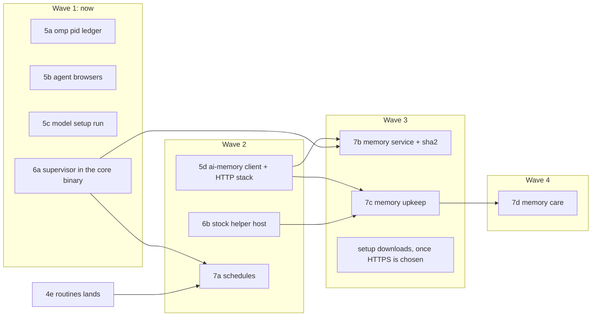

# What remains of `src/main` for the core, cut into units

Status 12 Nov 2026, read from `main` at `b0c90dd3`. Units 1, 2a–2i, 3a–3d and 4a–4c are on `main`; 4d (GitHub sign-in) and 4e (routines) are running. This document cuts what is left of the scope below into units for the strangler in `.omp/rules/native-rust.md`. It was made by reading and counting only: nothing was built or run. Every count is measured (Appendix A says how). A claim this document could not check by reading is marked **[not determined]**.

Scope: `src/main/remote/**`, `src/main/web/**`, `src/main/ai-memory/**`, `src/main/agent-control/**`, `src/main/setup/**`, `src/main/cli-tools/**`, the hubs (`sidecar*.ts`, `turn-resume*.ts`, `autopilot*.ts`) and the root files over 300 lines that reach no Electron at runtime (`schedules.ts`, `models-config.ts`, `omp-processes.ts`, `agent-browsers.ts`, `model-setup-runner.ts`, `desktop-slot.ts`, `i18n-text.ts`, `omp-runtime.ts`, `updater-state.ts`), plus `workspace-search.ts` (71 lines, named in the order). 147 files, 59,062 lines.

## 1. What the measurements say

### 1.1 Sizes

`src/main` holds 100,258 non-test lines in 388 files today.

| Area | Files | Lines | Code | Test lines that import it |
|---|---:|---:|---:|---:|
| `remote/**` | 31 | 11,941 | 8,930 | 14,887 in 36 files under `remote/` |
| `web/**` | 28 | 6,536 | 5,231 | 6,479 in 25 files under `web/` |
| `ai-memory/**` | 25 | 7,219 | 5,604 | 8,144 in 24 files under `ai-memory/` |
| `agent-control/**` | 20 | 12,773 | 10,330 | 11,403 in 17 files under `agent-control/` |
| `setup/**` | 11 | 3,466 | 2,654 | 3,693 in 14 files |
| `cli-tools/**` | 4 | 1,025 | 817 | 1,558 in 3 files |
| hubs: `sidecar-pool.ts` 3,048, `autopilot.ts` 2,239, `sidecar.ts` 1,514, `turn-resume.ts` 1,512, `autopilot-ship.ts` 637, `sidecar-factory.ts` 356, `autopilot-audit.ts` 257, `sidecar-run-state.ts` 233, `autopilot-land-check.ts` 218, `turn-resume-ends.ts` 157, `autopilot-approver.ts` 127, `sidecar-types.ts` 90, `autopilot-branches.ts` 76, `autopilot-notice-route.ts` 27 | 14 | 10,491 | | see Appendix A |
| root files named above | 11 | 4,786 | | see Appendix A |

The per-file table (lines, code, flags, Electron reach, every importer with the names it takes, runtime imports, the test files that import it) is Appendix A.

### 1.2 Electron is not what holds this code in TypeScript

- Only 20 files of `src/main` import Electron at runtime: `ipc.ts` 2,837, `index.ts` 2,550, `preview/host.ts` 1,167, `updater.ts` 1,062, `window.ts` 533, `sidecar-factory.ts` 356 (`app`), `menu.ts` 320, `gpu-fallback.ts` 270, `app-quit.ts` 215, `tray.ts` 192, `deep-link.ts` 135, `update-auth.ts` 125 (`net`, `safeStorage`), `hang-watchdog.ts` 111, `web/ipc-registry.ts` 88 (`BrowserWindow`), `i18n.ts` 62, `nsis-updater.ts` 51, `app-icon.ts` 30, `ssh/ipc.ts` 27, `runtime-log.ts` 16, and `src/preload/index.ts`. Together 10,147 lines in `src/main`.
- Of the 147 files in scope, two import Electron at runtime (`sidecar-factory.ts`, `web/ipc-registry.ts`). Three more name Electron types only (`web/preview-input.ts`, `web/preview-dialog.ts` and, through `ipc-registry.ts`'s types, the web windows); the objects reach them injected (`webContents.sendInputEvent`, an offscreen page's `onPaint`).
- 18 files in scope reach Electron only through `runtime-log.ts`, whose whole Electron use is `app.getPath("userData")` and `app.getVersion()` for the path and the `appVersion` field of `gui-runtime.jsonl` (`writeRuntimeLog`). Among them `serial-chain.ts`, so everything that chains steps reaches it. This is a seam, not a blocker: the first unit that logs from Rust adds a core event that main's `writeRuntimeLog` writes, which keeps one writer per log file (two processes appending to one JSONL file could interleave lines; none does today).

What does hold the hubs in TypeScript is **synchronous reads of state main owns, from the command handlers**. Measured call sites of `SidecarPool` methods (`sidecarPool.x(`, `pool.x(`, `this.#pool.x(`):

| Caller | Calls | Distinct methods |
|---|---:|---:|
| `ipc.ts` | 67 | 38 |
| `index.ts` | 60 | 39 |
| `agent-control/host.ts` | 52 | 17 |
| `tab-release.ts` | 5 | 4 |
| `tab-spawn.ts` | 4 | 4 |
| `control-socket/backend.ts` | 1 | 1 |

The pool is keyed by `ClientWindow` (`web/client-window.ts`, 22 lines: an interface that desktop windows and a paired page's `WebClientWindow` both implement), not by Electron's `BrowserWindow`. Main registers 215 IPC handlers (`ipc.handle`/`ipc.on`) in 16 files, `ipc.ts` 118 of them. `agent-control/service.ts` reads main through `AgentControlHost` (`service.ts:363-523`): 44 methods, 24 of them synchronous (`tabs`, `summaries`, `summaryOf`, `parentOf`, `devices`, `enabled`, `fullEnabled`, `manageEnabled`, `schedules`, `observe`, `spawn`, `start`, `setTask`, `view`, `notify`, …).

This is the gap ledger 4b names for `SshTools` ("It moves when the commands themselves are taken in the core"). It applies to the pool, the sidecar manager's status, turn-resume, the agent-control service, autopilot, the remote host services and the web router alike.

### 1.3 The rule a unit has to pass

A set of files is a unit when (a) every caller that stays TypeScript already awaits what it calls, (b) it does I/O of its own (a process, a file, a socket, a timer over those), (c) no staying code reads its in-memory state in the same tick, and (d) moving it duplicates no logic of stock omp, of the page or of `src/shared`. 2a–4c all passed it; what each left in TypeScript (`mergeProblem`, `boundDiff`, `treeBytes`, `isTailnetAddress`, `SshTools`, `ExtensionUpdater`) failed (a) or (c).

These files look movable but fail it, so they are **not units on their own**:

| File | Why it stays with its caller | Fails |
|---|---|---|
| `remote/quota-commands.ts` 359, `remote/peer-quota.ts` 128 | `ws-router.ts` `#weight` calls `commandUsesModel` and `quota.reserve` before it forwards a call (`ws-router.ts:857-876`); `PeerQuota` keeps usage on the device records `web-host.ts:149` and `devices.ts:279` own, read in the same tick for the device lists (`devices.ts:324`, `web-host.ts:329`) | a, c |
| `remote/keep-awake.ts` 94 | wraps the injected Electron `powerSaveBlocker` (`index.ts:2019`, `devices.ts:273`); `devices.ts:327` reads `held` synchronously | c, Electron |
| `web/rate-limit.ts` 202, `web/refusal-page.ts` 109, `web/preview-pacer.ts` 163, `web/web-tab-layouts.ts` 65 | synchronous helpers of `server.ts`, `ws-router.ts`, `preview-stream.ts`, `tab-layout.ts` | a |
| `web/file-edit-reports.ts` 71 | read synchronously by `ws-router.ts`, `ipc.ts`, `index.ts` and agent-control; inside the formal model `web-close-reports` | a, c |
| `workspace-search.ts` 71 | a wrapper over stock's own `grep` (pi-natives) in the stock helper (`search.text`); a Rust search would re-derive stock's (AGENTS.md › Where a new feature goes) | d |
| `models-config.ts` 642 + `models-config-stock.ts` 24 | edits `models.yml` through `yaml`'s `parseDocument` (`models-config.ts:18,89,627`), which keeps the person's comments and layout, and normalizes through stock (`catalog.roster`, `models.validate` in the stock helper). No comment-keeping YAML editor is in `Cargo.lock`; whether a maintained crate does this was not checked **[not determined]** | d |
| `desktop-slot.ts` 319 | a timer state machine whose one user, `desktop-slot-host.ts`, stays with the bridge | c |
| `i18n-text.ts` 403 | data for `i18n.ts`, which imports Electron's `app` | Electron |
| `omp-runtime.ts` pure parts (`parseOmpVersion`, `ompCandidates`, `pickOmp`, `isCompiledOmp`, `ompPathEnv`, `ompBunDefaults`, …) | ledger 4c: PATH lookup, install ownership and `parseOmpVersion` must work before any core runs; 13 files import them synchronously | 4c |
| `setup/plans.ts` 685, `cli-tools/plans.ts` 246, `cli-tools/catalog.ts` 87 | synchronous builders of `SetupService` and `CliUpdater`, which stay; `ownerCheckCommand`, `ownerUpdateCommand`, `parseLatest`, `bunView` are named in 4c as staying | a, 4c |
| `agent-control/mail.ts`, `app-schema.ts`, `auto-close.ts`, `tab-close.ts`, `pickup.ts`, `app-guard.ts` | rules `service.ts` and `app-control.ts` call synchronously; `tab-close.ts` is in `web-close-reports` | a |

Two claims a reader may meet elsewhere are wrong on the evidence. `web/host-actions.ts` importing `original-fs` is no reason for it to stay: `original-fs` exists to avoid Electron's asar patch, which a Rust process does not have (2a moved the same reads). And `sidecar-pool.ts` is not keyed by Electron windows (above).

### 1.4 Rust dependencies

`native/ompdesk/Cargo.lock` has tokio (with `net`, `process`, `time`), serde/serde_json, the ICU4X crates, `url`/`idna`, `notify` (macOS), `libc`, `socket2`, `mio`, `same-file`, `walkdir`, `windows-sys`. It has **no** HTTP (client or server), TLS, WebSocket, compression (deflate, brotli), hash (SHA-1/2), MAC/KDF (HMAC, HKDF), AEAD (AES-GCM), curve (X25519, P-256), base64 or constant-time crate. Random bytes come from `sys::random` (3a). What the remaining code uses, by `node:crypto` and package import:

| Need | Used by | Crate it would take (none in `Cargo.lock`) |
|---|---|---|
| SHA-256 | `ai-memory/{binary,root,suppress,sync}.ts`, `agent-control/service.ts:2882`, `autopilot-audit.ts:94`, `remote/{transcript-cache,image-blob-cache,crypto}.ts`, `web/devices-store.ts`, `session-list-share.ts` | `sha2`. These hashes are persisted or compared across computers and versions (a sync page hash, a cache file name, an image address), so they must stay SHA-256; 2d's SipHash trick does not apply |
| SHA-512 | `updater-state.ts:363` (`sha512FileBase64`, the update metadata) | `sha2` |
| constant-time compare | `schedules.ts:196` (webhook token), `web/auth.ts` (`stripServePrefix`), `web/devices-store.ts` (`authenticate`) | `subtle`, or a few hand-written lines with a Rust test |
| X25519, HKDF-SHA256, AES-256-GCM | `remote/crypto.ts`, `remote/wire.ts` (`FrameSealer`) | `x25519-dalek`, `hkdf`, `aes-gcm` |
| raw deflate with a carried context (`deflateRawSync` level 3, prefix `0x00`/`0x01`, 32 KB window) | `remote/wire.ts` | `flate2` (a backend that keeps a stream's dictionary across frames) |
| HTTP/1.1 client (loopback) | `ai-memory/client.ts` (REST and MCP `tools/call` to the local ai-memory server) | `hyper` + `hyper-util` + `http-body-util`, or a small hand-written loopback client |
| HTTPS client | `setup/download.ts`, `setup/archives.ts` (`fetch`), `updater.ts`/`update-auth.ts` (Electron `net`: Chromium's proxy and certificate store) | in `Cargo.lock` since 5d's fix: `http.rs` speaks TLS (`rustls` with `ring`, `tokio-rustls`, `rustls-platform-verifier` plus `NODE_EXTRA_CA_CERTS`) and follows redirects as `fetch` did; a pooled client adds `hyper-rustls`'s connector. Proxy settings are a behaviour question |
| HTTP/1.1 server, WebSocket with `permessage-deflate` (threshold 1024, level 3: `web/server.ts:285`) | `web/server.ts`, `web/ws-router.ts` | `hyper` + a WebSocket crate. Whether a maintained Rust WebSocket crate negotiates `permessage-deflate` was not checked **[not determined]**; without it every frame to a phone grows |
| brotli at quality 9 for a file without a built `.br` | `web/server.ts` `#brotliOf` | `brotli` |
| P-256 ECDSA verify (`ieee-p1363`, SHA-256) | `web/auth.ts` `verifyDeviceProof` | `p256` (with `ecdsa`) |
| Web Push: VAPID keys, ES256 JWT, `aes128gcm` content encoding (ECDH P-256 + HKDF + AES-128-GCM) | `web/push.ts`, `web/vapid-store.ts` (the `web-push` package) | `p256`, `hkdf`, `aes-gcm`, `sha2`, base64url |

Each crate a unit adds lands in `Cargo.lock`, `LICENSES/ompdesk-native-dependencies.txt` (`bun scripts/gen-crate-notices.ts`; `licenses:check` fails otherwise) and the binary's size, which the ledger records. Two units adding crates at once conflict on all three files. **Decide the HTTP stack once** (the first unit that needs HTTP, 5d below, picks it for 8a too) and **add `sha2` once** (7b below).

### 1.5 Formal models in the way

From `formal/manifest.json`. A unit that changes a covered file runs `verify-all.ts formal --only <id>` (its runs and its mutations), moves the `@code` tags to the Rust code and is stamped after the commit, as 2c–2i did for `repo-lock-core`.

| Model | Covers in scope |
|---|---|
| `turn-resume` | `turn-resume.ts`, `turn-resume-ends.ts`, `connectivity.ts`, `sidecar-run-state.ts`, `sidecar-pool.ts`, `remote/host-services.ts`, `ipc.ts` |
| `session-listing` | `remote/host-services.ts`, `sidecar-pool.ts`, `remote/host-session-list.ts`, `remote/client.ts:722-733`, `remote/wire.ts:416-441`, `remote/devices.ts:548-564, 649-651, 957-978`, `session-list-share.ts`, `session-index.ts` (lines) |
| `web-close-reports` | `web/file-edit-reports.ts`, `crates/core/src/web/router.rs` (`finish`, `receive`, `dispatch`; 8c), `web/ws-router.ts` (`WsRouter.connections`, `WsRouter.call`), `agent-control/tab-close.ts`, `agent-control/service.ts:3327-3339`, `agent-control/host.ts:960-969`, `tab-release.ts` |
| `tab-session` | `omp-launch.ts` `sessionOpen`, `sidecar.ts` `SidecarManager.restart`/`#observeResponse`/`#handleReady`/`#attemptRestart`/`#spawn` |
| `session-processes` | `session-processes.ts`, `sidecar.ts` `SidecarManager.dispose` |
| `repo-lock-core` | core `server.rs`, `run.rs`, `sys.rs`, `main.rs` whole, so any unit that touches those files drifts it |

No model covers the remote handshake, the web server's auth order or the pairing rules.

## 2. Units

Numbering goes on from the ledger. Lines are physical lines moved out of TypeScript (code lines in brackets). Every unit keeps the ledger's contract: clean cutover, the vitest file runs against the real core, captured tables for the pure parts, a ledger entry with its differences.

### 2.1 Leaf units: I/O that every caller already awaits (start now)

**5a. The omp pid ledger** (`omp-processes.ts` 356 [262])
- Moves: `omp-pids.json` (`OMP_PIDS_FILE`), `track`, `reapLeftovers`, the quit's stop of every omp, and the Windows creation-time lookup, which today starts `powershell.exe` with retries (`windowsStartTimes`, `IDENTIFY_RETRY_DELAYS_MS` up to 8 s because "a cold powershell.exe on a loaded machine can miss" 5 s). 3d's `sys.rs` `process_list` already reads `GetProcessTimes`, so the core answers it without a process.
- Stays: `track(child)` at the spawn (`sidecar.ts`, `sidecar-factory.ts` take `Pick<OmpProcesses, "track">`; it becomes a request that nothing awaits), `QUIT_OMP_STOP_MS` and the quit's order in `index.ts`, `omp-stop.ts` (used by `SidecarManager`, moves with 6c).
- First step: check whether 3d (a session's tagged processes the last launch did not bring back are ended) already covers what `reapLeftovers` does. Whatever it covers is deleted, not ported.
- Core: `omp.track`, `omp.reap`, `omp.stopAll`. Parity: `omp-processes.test.ts` 482. Crates: none. Models: none (`session-processes` covers `session-processes.ts` and `dispose` only). Rules: interrupted-work (quit), control-tools › Session processes. Risk: low to medium (the quit path).

**5b. Agent browsers** (`agent-browsers.ts` 348 [275])
- Moves: finding the Chromium browsers, the relay extension's install, opening a browser's extensions page, the status read. Its callers await it (`ipc.ts`: `findChromiumBrowsers`, `installRelayExtension`, `openExtensionsPage`, `reprobeAgentBrowserStatus`; `sidecar-factory.ts:242-244` awaits `agentBrowserStatus`, `resolveEgoBrowser`).
- Stays: `findOnPath`/`spawnPath` (4c), handed in with each request as git's runner is; `resolveAgentBrowser`'s pref rule in `sidecar-factory.ts`.
- Core: `browsers.find`, `browsers.status`, `browsers.installRelay`, `browsers.openExtensions`. Parity: `agent-browsers.test.ts` 274. Crates: none. Models: none. Rule: panels-sidebar › Preview. Risk: low.

**5c. The model setup run** (`model-setup-runner.ts` 322 [285])
- Moves: `ModelSetupRunner` (the omp research run, its input, `ResearchStream`, the timeout and the stop). One caller, `machine-services.ts`, awaits it.
- Stays: the omp it runs and its environment (`ompPathEnv`, `OMP_TELEMETRY_OFF`, `spawnCommand`/`needsShell`), handed in by main as for git and gh; the IPC.
- Core: `models.setupRun` with events `models.setupProgress`, `models.setupDone`, and `models.setupStop`. Parity: `model-setup-runner.test.ts` 276. Crates: none. Models: none. Rule: models-accounts › Model setup. Risk: low (the run ends with the core: its job object, or its process group main kills).

**5d. The ai-memory client** (`ai-memory/client.ts` 869 [706])
- Moves: `AiMemoryClient` (REST at `client.ts:166`, `/healthz` at `:142`, MCP `tools/call` at `:185`, the root token read from `auth-tokens/default`), `serverUrlFromConfig`. Every caller awaits it.
- Stays: nothing but the typed client. `plainSnippet` is checked for synchronous callers first **[not determined]**.
- Core: `memory.request` (one method with the route and body, or one per route: the unit decides). Parity: `client.test.ts` 897, and indirectly `service.test.ts` 1,403, `sync.test.ts` 1,117, `backfill.test.ts` 413. Crates: the HTTP client (§1.4), the decision 8a reuses. Models: none. Rule: memory (the token is never logged; the core logs no request). Risk: medium, all of it in the new dependency.

### 2.2 Enablers (start now, beside 5a–5c)

**6a. The supervisor is the core binary** (`setup/supervisor.ts` 370 [292] + `setup/runner.ts` 108 [83])
- Today every supervised run (an installer, a scheduled run, ai-memory's `setup`, Autopilot's land check, a worktree hook) starts Electron's own binary as Node (`process.execPath` with `ELECTRON_RUN_AS_NODE`) to run `SUPERVISOR_SOURCE`, which holds the child, ends its whole tree when its stdin closes and answers `SUPERVISOR_STOPPED_CODE` 130. That moves into a mode of `ompdesk-core` (`--supervise`), as 4b's askpass helper is a mode of it (`main.rs`), with 4b's per-process job on Windows and the process group on POSIX.
- Stays: `spawnSupervised`'s signature (it still returns a `ChildProcess`, so its seven callers do not change: `agent-control/host.ts`, `ai-memory/service.ts`, `autopilot-land-check.ts`, `index.ts`, `local/git/worktree-seed.ts`, `schedules.ts`, `setup/runner.ts`), `findBun` and every PATH lookup (4c), `isolatedLaunch`'s choice. Main starts the binary directly, so no running core is needed and 4c's "before any core runs" holds; `scripts/build-lock.ts` does not use the supervisor.
- This is also where 2i's leftover (`runWorktreeHook`) gets its tree kill without Node.
- Core: none (a process mode). Parity: `setup/runner.test.ts` 393, `setup/service.test.ts` 1,366, `schedules.test.ts` 866, `ai-memory/service.test.ts` 1,403, `worktree-seed.test.ts` hook cases. Crates: none. Models: `repo-lock-core` drifts (`main.rs`, `sys.rs`). Rules: machine-setup-updates, memory (the isolated `ai-memory setup` run must hold no handle of the app). Risk: medium (three OSes; an installer's tree must still die with the app). Win to measure: one Electron-as-Node process (its resident memory) per supervised run.

**6b. The stock helper's host** (`stock-helper.ts` 299 [240])
- Moves: starting and supervising the three Bun workers (bun path and environment handed in by main), the lanes, each request's 30 s timeout and `{cancel}`, the stuck-lane kill and restart, the extensions worker's 60 s idle exit (`EXTENSIONS_IDLE_EXIT_MS`). Callers all await `stockHelperRequest`: `session-store.ts` 7, `ipc.ts` 4, `index.ts` 3, `local/settings.ts` 3, `github-auth/pty.ts` 3, `terminal/requests.ts` 3, `models-config-stock.ts` 3, `local/git/worktree.ts` 2, `remote/host-services.ts` 2, `web/web-host.ts` 2, `ext-update/updater.ts` 1.
- Stays: the workers (`resources/gui-bridge/stock-helper/**`, omp's language).
- Why it is an enabler: after it, a core unit can call stock (`memory` care, a future models-config) without asking main.
- Must measure before and after: a session list read (`session-store.ts`; the list now crosses one more pipe) and terminal output (`pty.*` streams go through the terminals worker). If the terminal stream costs measurably more, that is the unit's finding, not a reason for two copies of the lane machinery.
- Core: `stock.request`, `stock.stop`; events for worker pushes. Parity: `stock-helper.test.ts` 338, `session-lists-report.test.ts` 484, `models-config.test.ts` 430, `local/settings.test.ts` 323, `bridge-input-history.test.ts` 250, `omp-availability.test.ts` 106. Crates: none. Models: none. Risk: medium (every list read and terminal passes through it).

### 2.3 Memory and schedules (after 5d, 6a, 6b)

**7a. Scheduled runs** (`schedules.ts` 837 [679]) after 4e has landed and after 6a.
- Moves: `ScheduleService`'s timers, journal and run logs, `ompRunLauncher` (through 6a), the webhook key and its constant-time check (`schedules.ts:196`, `:697`).
- Stays: `SCHEDULE_TICK_MS` (read by `routines/git.ts`); the omp and environment main hands in. Whether `agent-control/host.ts`, `ipc.ts` or `machine-services.ts` read `ScheduleService` state synchronously was not checked (all three import it as a type) **[not determined]**: the unit reads those call sites first, and a synchronous read is the 3a snapshot pattern or a reason to wait for 9b.
- Core: `schedules.*`, events for a run's start and end. Parity: `schedules.test.ts` 866, `agent-control/host.test.ts` 1,990 (shared), `routines/triggers.test.ts` 340, `web/webhook.test.ts` 233, `routines/git.test.ts` 189. Crates: `subtle` or a hand-written compare. Models: none. Rules: machine-setup-updates › scheduled runs, control-tools › schedules. Risk: medium.

**7b. The memory service's lifecycle** (`ai-memory/service.ts` 954, `binary.ts` 208, `unit.ts` 145, `root.ts` 137, `terminal.ts` 120, `suppress.ts` 87, `recall-state.ts` 37, `config.ts` 18: 1,706 [1,241]) after 5d and 6a.
- Moves: the service's start, health and restart, the binary's check (SHA-256, `binary.ts:61`), the logon entry (`unit.ts`), the generated root and its swap, the terminal wiring and suppression overlay files, the recall state file.
- Stays: the last `recallEnv()` answer, kept in main because `index.ts:1721` reads it synchronously; `ai-memory/ipc.ts` (IPC); the runtime-log lines (through the seam in §1.2).
- Core: `memory.service*` with state events. Parity: `service.test.ts` 1,403, `binary.test.ts` 330, `ipc.test.ts` 330, `unit.test.ts` 160, `root.test.ts` 133, `terminal.test.ts` 107, `e2e/packaged-ai-memory.e2e.ts` 154. Crates: `sha2` (added here once). Models: none. Rule: memory (service lifecycle, isolated setup, privacy). Risk: medium to high (ai-memory's service outlives the app by design).

**7c. Memory upkeep** (`upkeep.ts` 454, `distill.ts` 351, `retitle.ts` 231, `rules-file.ts` 186, `distill-model.ts` 91, `ambiguous-names.ts` 69, `supersede.ts` 19: 1,401) after 5d and 6b. Cut by caller tree: `upkeep.ts` calls the others synchronously, so they move together.
- Stays: the prompt texts in `resources/gui-bridge/memory-prompt.ts` (the bridge's; the core receives them as data, a Rust copy would be a second definition).
- Parity: `upkeep.test.ts` 605, `retitle.test.ts` 352, `distill.test.ts` 317, `rules-file.test.ts` 133, `distill-model.test.ts` 102, `ambiguous-names.test.ts` 67, `supersede.test.ts` 24. Crates: none beyond 5d. Risk: medium (model calls through 6b).

**7d. Memory care** (`backfill.ts` 479, `curate.ts` 425, `memory-judge.ts` 340, `care.ts` 284, `care-units.ts` 112: 1,640) after 7c.
- Moves: `MemoryCare`'s schedule and units, backfill, curation, both judges (`jevJudge` starts `omp --mode rpc -e memory-judge-host` in a temp folder, `memory-judge.ts:208`; `smolJudge` batches through the cheap model).
- Stays: the omp and environment main hands in; `freshness.ts`'s caller side (its git part is 2h's).
- Parity: `curate.test.ts` 419, `backfill.test.ts` 413, `memory-judge.test.ts` 289, `care.test.ts` 210, `bridge-memory-judge-stock.test.ts` 181. Crates: none. Risk: medium.

**7e. Memory between computers** (`ai-memory/sync.ts` 1,043, `recall-terms.ts` 104: 1,147) after 5d and after the remote host side (R6), or with a core-to-main ask for the link (3a's `control` event pattern) if it goes earlier.
- `MemorySync` pulls and pushes over the device link (`host.memory.pull`/`push`, `app-protocol.ts`), and `servePull`/`servePush` answer for `remote/host-services.ts`. Page hashes are SHA-256 of canonical text (`sync.ts:213`) compared with older versions on other computers, so they must stay byte-identical.
- Parity: `sync.test.ts` 1,117, `host-services.test.ts` 5,080 (shared), `recall-terms.test.ts` 109. Crates: `sha2` (7b). Risk: medium.

### 2.4 The hub program (taken as one program; see §3 for when)

All of these need the commands to be taken in the core first (§1.2). Each is sized for one session; the order inside the program is fixed.

| Id | Files (lines) | Moves | Stays, why | Parity tests (lines) | Models | New crates |
|---|---|---|---|---|---|---|
| **9a** Command entry in the core | `web/ipc-registry.ts` 88, `web/client-window.ts` 22, `web/web-client-window.ts` 102, `web/ipc-policy.ts` 574 (786) | the core receives every `invoke`/`send` of a window and of a paired page first and dispatches it: a Rust handler if one is registered, else an event to main, whose answer it relays. `IPC_POLICY` stays TypeScript-typed (it is typed over the channel union) and is handed to the core as data | main's 215 handlers in 16 files, each moving later with its subsystem; Electron's `ipcMain` as the desktop's transport until the shell swap | `ipc-policy.test.ts` 114, then every IPC-driven suite (16 test files import the registry: `sidecar-pool.test.ts` 4,211, `agent-control/host.test.ts` 1,990, `web/server.test.ts` 1,082, `web/ws-router.test.ts` 1,077, …) | none | none |
| **9b** omp's pipes | `bridge-client.ts` 201, `rpc-client.ts` 118, `rpc-bridge.ts` 175, `local/index.ts` 87 (581) | the omp child's stdio JSONL and the bridge's socket or named pipe are the core's; main sends commands and gets events through it | the local handlers (`src/main/local/**`, 4,726 lines; each already a core client or main state) and their routing | `local/*.test.ts`, `bridge-*-stock.test.ts`, `turn-resume.test.ts` 3,028, `agent-control/service.test.ts` 6,347 (all through the omp pipe) | none | none |
| **9c** The sidecar manager | `sidecar.ts` 1,514, `omp-launch.ts` 177, `omp-stop.ts` 207, `sidecar-types.ts` 90 (1,988; split the restart policy from the spawn if over two hours) | spawn, ready, restart, the session tag, dispose, frame bookkeeping (`withoutFrameBookkeeping`) | a mirror of each manager's status in main, written only from the core's events, because the pool and `ipc.ts` read `SidecarLike` synchronously; `sidecar-factory.ts` (`app`) until the shell swap | `sidecar.test.ts` 1,738, `shell-env.test.ts` 875, `sidecar-os-shutdown.test.ts` 103, `remote/link-traffic-relaunch.test.ts` 448 | `tab-session`, `session-processes` | none |
| **9d** The pool, part 1 | `sidecar-pool.ts` (the tab table, ownership, viewers), `sidecar-run-state.ts` 233 (≈1,600) | tabs, owners, viewers, run state | needs 9a: 67 + 60 + 52 call sites read it in the same tick | `sidecar-pool.test.ts` 4,211, `session-launch-parity.test.ts` 663 | `turn-resume`, `session-listing` | none |
| **9e** The pool, part 2 | rest of `sidecar-pool.ts`, `tab-spawn.ts` 225, `tab-release.ts` 42, `tab-layout.ts` 288, `web/web-tab-layouts.ts` 65 (≈2,000; split again if needed) | device tabs, layouts, release, worktree bindings | | `tab-spawn.test.ts` 507, `tab-layout.test.ts` 468, `tab-release.test.ts` 73, `web-tab-layouts.test.ts` 52 | `web-close-reports` (`tab-release.ts`), `session-listing` | none |
| **9f** Turn resume | `turn-resume.ts` 1,512, `turn-resume-ends.ts` 157, `connectivity.ts` 277 (1,946) | markers, holds, probes, scheduled retries | another session (the limit auto-resume work) is changing `turn-resume*.ts` now; this unit starts after it lands | `turn-resume.test.ts` 3,028, `turn-resume-limit.test.ts` 480, `connectivity.test.ts` 432, `turn-resume-ends.test.ts` 266, `autopilot-restart-resume.test.ts` 270 | `turn-resume` | none |
| **9g** Agent-control journals and mail | `send-outbox.ts`, `mail-outbox.ts`, `call-journal.ts`, `session-fates.ts`, `pending-cleanups.ts`, `mail.ts`, `custody.ts`, `pickup.ts`, `auto-close.ts`, `tab-close.ts` (1,283) | with the service code that calls them synchronously (`deliverOwed`, `redeliverSends`) | | `service.test.ts` 6,347 (shared), own tests 534 | `web-close-reports` (`tab-close.ts`) | none |
| **9h–9j** The agent-control service | `agent-control/service.ts` 5,173 (one class, 161 methods) in three units by tool family: sessions (open, stop, read, result), messages (send, report, answer, mail), work (compare, merge, schedule, autopilot) | `AgentControlHost`'s 24 synchronous methods become 3a's pattern: main pushes snapshots at the moment it observes a change | | `service.test.ts` 6,347, `control-socket/router.test.ts` 431, `cli.test.ts` 203 | `web-close-reports` (`service.ts:3327-3339`) | `sha2` (`service.ts:2882`) |
| **9k** Agent-control host | `agent-control/host.ts` 1,667, `branches.ts` 313 (`mergeProblem`, `boundDiff`: they stay synchronous for the service, so they move with it) | | | `host.test.ts` 1,990, `branches*.test.ts` 737 | `web-close-reports` (`host.ts:960-969`) | none |
| **9l** App control | `app-catalog.ts` 1,915, `app-settings.ts` 416, `app-control.ts` 400, `app-channels.ts` 358, `app-guard.ts` 178, `app-schema.ts` 93 (3,360: two units) | the `ompdesk_app` actions | `tools.ts` 977 (the tool definitions omp receives; `pack-drift.test.ts`, `skill-drift.test.ts` pin them against the skill) is checked for a second definition first | `app-control.test.ts` 1,454, `app-catalog.test.ts` 92 | none | none |
| **9m–9n** Autopilot | `autopilot.ts` 2,239 + `autopilot-branches.ts`, `autopilot-approver.ts`, `autopilot-notice-route.ts` (2,469); `autopilot-ship.ts` 637, `autopilot-audit.ts` 257, `autopilot-land-check.ts` 218 (1,112) | the run, its steps, ship and audit | after 9h–9k (Autopilot drives sessions through the service) | `autopilot-branch.test.ts` 538, `autopilot-actions.test.ts` 492, `autopilot.test.ts` 337, `autopilot-cycle-end.test.ts` 288, `autopilot-approver.test.ts` 188, `autopilot-audit*.test.ts` 282, `autopilot-land-check.test.ts` 125 | `repo-lock-core` (land check's scratch store) | `sha2` |

### 2.5 The remote program

| Id | Files (lines) | Moves | Parity tests (lines) | Crates | Models |
|---|---|---|---|---|---|
| **R1** Keys and stores | `remote/crypto.ts` 111, `identity.ts` 52, `trust-store.ts` 73, `hosts-store.ts` 62, `peers-store.ts` 58, `secure-file.ts` 20, `address.ts` 77 (453) | X25519 keys, the HKDF key schedule, the transcript hash, the 0600 JSON stores (`remote-identity.json`, `remote-peers.json`, `remote-hosts.json`) | `crypto.test.ts` 134, `secure-file.test.ts` 24, `transport.test.ts` 1,123 | `x25519-dalek`, `hkdf`, `sha2` | none |
| **R2** The sealed link | `remote/wire.ts` 468, `protocol.ts` 316, `link-traffic.ts` 207 (991) | `Link` (4-byte length, 16 MiB cap, ping 10 s, dead 30 s), `FrameSealer`/`FrameOpener` (AES-256-GCM, 96-bit counter nonce, strictly increasing), the deflate context, the traffic line | `wire.test.ts` 343, `transport.test.ts` 1,123, `link-traffic.test.ts` 118, `fanout-cpu-report.test.ts` 610 | `aes-gcm`, `flate2` | `session-listing` (`wire.ts:416-441`) |
| **R3** Dial and handshake | `remote/client.ts` 749, `host-server.ts` 624 (1,373) | the listener on the tailnet addresses, the staggered dial, probe, `auth-init`/`auth-resp`, key pinning, refusals | `transport.test.ts` 1,123, `devices.test.ts` 703 | none beyond R1, R2 | `session-listing` (`client.ts:722-733`) |
| **R4** Event encoding (moved to W2, after 9c/9d) | `remote/link-events.ts` 1,228 | the slim deltas and their decoder, so main hands raw omp events and the core encodes | `link-events.test.ts` 1,105, `link-events-stock.test.ts` 184, `message-update-slim.test.ts` 252, `link-traffic-report.test.ts` | none | none |
| **R5** Devices | `remote/devices.ts` 1,298 with `peer-quota.ts`, `keep-awake.ts` (a blocker event to main), `readopt.ts`, `tailscale/tailnet.ts` 104 (≈1,700) | the gate (`#gate`, `devices.ts:885-900`), quotas, link lifecycle | `devices.test.ts` 703, `peer-quota.test.ts` 154, `keep-awake.test.ts` 102, `readopt.test.ts` 118, `tailnet.test.ts` 96 | none | `session-listing` |
| **R6** Host services (two units) | `remote/host-services.ts` 2,780 | the host side of a device's tabs | `host-services.test.ts` 5,080 | `sha2` | `turn-resume`, `session-listing` |
| **R7** Device side | `remote-sidecar.ts` 899, `hosted-view.ts` 256, `hosted-autopilot.ts` 55, `host-session-list.ts` 121, `quota-commands.ts` 359, `app-protocol.ts` 963 (2,653: two units) | | `remote-sidecar.test.ts` 1,084 | none | `session-listing` |
| **R8** Bytes | `transcript-cache.ts` 282, `image-blob-cache.ts` 149, `image-reads.ts` 77, `host-upload.ts` 52, `sign-in-relay.ts` 131, `link-relay-socket.ts` 87, `preview-relay-tunnels.ts` 110 (888) | | `link-traffic-images.test.ts` 298, `sign-in-relay.test.ts` 223, `transcript-cache.test.ts` 154, `image-blob-cache.test.ts` 125, `image-reads.test.ts` 98, `host-upload.test.ts` 70 | `sha2` | none |

R5–R7 need the pool (9d, 9e) in the core: `RemoteSidecar` is a `SidecarLike` the pool holds, and `LocalHostServices` runs `SidecarManager`s.

R4 waits for the hubs (decided 12 Nov 2026, B2). Its encoder takes the raw omp events, which live only in main until 9c/9d: moved before them, main would serialize every raw event into the pipe and, on the device, parse the rebuilt whole events back, and the whole stream is up to ten times the slim one (`link-traffic-report.test.ts`: 450, 900 and 1800 tokens; a whole `message_update` is O(K²) in the reply), so main's work per event would grow, not shrink. And `createMessageUpdateSlimmer` (`message-update-slim.ts`) also slims the windows' stream in `sidecar-pool.ts`: a Rust slimmer for the link beside the pool's TypeScript one would be two copies of one rule. R4 moves in W2, once the pool's events reach the core, so one copy serves the windows and the link.

### 2.6 The web program

| Id | Files (lines) | Moves | Parity tests (lines) | Crates |
|---|---|---|---|---|
| **8a** The edge, built | Rust only | HTTP/1.1 on `127.0.0.1:47831`, the static allowlist, the built `.br` and the q9 fallback, CSP, `auth.ts`'s order, the cookie, tickets, the P-256 proof, the rate limits, the refusal page; landed with Rust tests and captured rows, not yet serving | Rust tests over rows captured from the TypeScript server | `hyper`, WebSocket, `brotli`, `p256`, `sha2`, `subtle`, base64 |
| **8b** The edge, cut over | `web/server.ts` 898, `auth.ts` 288, `rate-limit.ts` 202, `refusal-page.ts` 109, `serve-secret.ts` 40, `asset-archive.ts` 126, `devices-store.ts` 265, `blocks-store.ts` 118, `pairing.ts` 88, `blobs.ts` 265, `uploads.ts` 231 (2,630) | the core serves; WebSocket frames are relayed to main per connection until 8c | `server.test.ts` 1,082, `auth.test.ts` 264, `devices-store.test.ts` 249, `blobs.test.ts` 155, `uploads.test.ts` 151, `asset-archive.test.ts` 127, `rate-limit.test.ts` 114, `blocks-store.test.ts` 84, `pairing.test.ts` 55, `refusal-page.test.ts` 54, `serve-secret.test.ts` 49; e2e `mobile-web`, `mobile-attach`, `phone-*`, `pwa-install` | as 8a |
| **8c** The router (moved, W2: ledger 8c) | `web/ws-router.ts` 991, `web-host.ts` 406, `file-edit-reports.ts` 71, `host-actions.ts` 273 (1,741) | connections, batching (75 ms), resume (10 min), the answer-after-pushes order, the calls' checks and the web-only table's; main keeps running the calls (quota, uploads' landing, shaping), `file-edit-reports.ts` and `host-actions.ts` (measured 13 Nov 2026: main's CPU −9/−28/−39 % at 1/2/4 pages) | did not need 9a: the core hands main each checked call | `ws-router.test.ts` 1,077, `host-actions.test.ts` 299, `file-edit-reports.test.ts` 151 | none beyond 8a |
| **8d** Push | `web/push.ts` 122, `vapid-store.ts` 75, `web-push-notifier.ts` 310 (507) | VAPID keys, ES256, `aes128gcm` | `web-push-notifier.test.ts` 589, `web-push.integration.test.ts` 473, `push.test.ts` 196, `vapid-store.test.ts` 74 | `p256`, `hkdf`, `aes-gcm`, `sha2` |
| **8e** Mobile web's state machine | `tailscale/service.ts` 848 | the phases, the poll, publish and confirm around 4a's `tailscale.*` | `tailscale/service.test.ts` 951 | none |

8a and 8b are one unit of work split in two sessions so that the security code lands reviewed before it serves. That leaves Rust on `main` that nothing calls for the time between them, which the ledger has not done before; the alternative is one longer session. That is the owner's call.

### 2.7 What is left of `setup/**` and `cli-tools/**` under 4c's constraint

Movable: the supervisor (6a, 478 lines), and the downloads (`setup/download.ts` 98 `downloadVerified`, `setup/archives.ts` 177 `resolveArchiveRelease`/`resolveAgentDesktopRelease`/`resolveTailscaleRelease`/`fetchText`: 275 lines) once an HTTPS client is chosen (§1.4; `sha2` for the checksums). Parity `setup/download.test.ts` 181, `setup/archives.test.ts` 202. **Done as ledger 6c** (the downloads and lookups; the supervisor was 6a).

Stays until the core no longer has to repair itself (4c) or until 9a:

| File | Lines | Why |
|---|---:|---|
| `setup/service.ts` | 1,187 | `SetupService`'s state machine over prefs and IPC (`setup/ipc.ts`); its I/O is the supervisor's (6a) |
| `setup/plans.ts` | 685 | synchronous builders of `SetupService` |
| `setup/detect.ts` | 331 | first-launch detection (4c), `refreshSystemOmp` |
| `setup/git-aslr.ts` | 217 | the Windows registry read and the elevated script, part of setup's flow |
| `setup/paths.ts` | 185 | `applyManagedToolEnv` changes `process.env` for every later spawn; `refreshPath` (4c) |
| `setup/compiled-launcher.ts` | 73 | moves a compiled omp out of Bun's launcher path (4c) |
| `setup/ipc.ts` | 35 | IPC |
| `cli-tools/updater.ts` | 397 | `CliUpdater`: schedule and row state, like `ExtensionUpdater`, which 4c kept; `registerCliUpdateIpc` |
| `cli-tools/detect.ts` | 295 | `classifyInstall`, `writableTarget`, `cmdShimTarget`, `packageVersion` (4c) |
| `cli-tools/plans.ts`, `catalog.ts` | 333 | `ownerCheckCommand`, `ownerUpdateCommand`, `parseLatest`, `bunView` (4c) |
| `omp-runtime.ts` | 445 | `resolveOmp`, `systemOmp` and the pure parts they call (4c) |
| `spawn.ts`, `shell-env.ts` | 272 | PATH lookup and the login shell's environment (4c) |
| `ext-update/mcp-owner.ts`, `mcp-plans.ts`, `update-scheduler.ts` | 425 | 4c's kept rules and the scheduler |

That repair path is 4,880 lines.

## 3. Order and parallelism

### 3.1 What every unit shares on the Rust side

Each unit adds a module folder under `crates/core/src/`, one `register` line in `server.rs` and one `mod` line in `lib.rs` (trivial conflicts, a rebase fixes them). Real conflicts come from: `Cargo.toml`/`Cargo.lock` and `LICENSES/ompdesk-native-dependencies.txt` (any two units that add crates), `sys.rs` (5a's process times, 6a's job and process group, R1's random bytes), `run.rs` (5c, 6b, 7d run processes through `Exec`), `main.rs` (6a's mode), the ledger in `.omp/rules/native-rust.md` (every unit appends) and the `mac-native` list in the workflows (a workflow change goes in its own commit before a release commit, AGENTS.md › Release). `server.rs`, `run.rs`, `sys.rs` and `main.rs` are covered whole by `repo-lock-core`, so two units touching them both re-run its verification.

### 3.2 Waves (waves 1 and 2 as landed; the rest runs as the batches of §3.4)

- **Wave 1** (now, four sessions): 5a, 5b, 5c, 6a. Disjoint TypeScript; none adds a crate; 5a and 6a both touch `sys.rs` (merge carefully).
- **Wave 2**: 5d (picks the HTTP stack), 6b, 7a (once 4e is on `main` and 6a landed). Only 5d adds crates.
- **Wave 3**: 7b (adds `sha2`), 7c, and the setup downloads (§2.7) once 5d's choice is extended to HTTPS (`hyper-rustls`, `rustls-platform-verifier`).
- **Wave 4**: 7d. After wave 4 nothing in this scope passes §1.3 without the hub program.
- **Then** the hub program in its order: 9a, 9b, 9c, then 9d with 9f after it, 9e, 9g–9k, 9l (can run beside 9g–9k: disjoint files), 9m–9n. Inside it, at most two units at once: everything else shares `ipc.ts`/`index.ts` wiring.
- **Remote and web programs** after the hubs they lean on: R1, R2 and 8a can be built early as Rust-only work (no TypeScript changes, no conflicts with anyone), but cut over only in order: R3 after R1–R2; R4 any time after R2; R5–R7 after 9d–9e; R8 last. 8b after 8a; 8c after 9a; 8d after 8b; 8e with or after 8b, as 4a decided (`MobileWebService` drives the server through `MobileWebServerPort` start/stop/configure); 7e after R6.

### 3.3 When to start the hub program

Before the shell is swapped, each hub unit adds a pipe hop to every command it serves and a mirror of its state in main, and wins nothing at run time: main still parses every omp event to hand it to Electron's windows. The ledger says the shell is chosen by a prototype that measures three candidates (CEF, the system webview alone, the system webview with a separate Chromium for the Preview) against one pass list. The cheaper order is waves 1–4 now, the prototype next, and the hub program once the prototype passes, with 9a (the command entry) as its first unit. If the owner wants the hubs earlier, 9c's mirror pattern (main keeps a copy written only from the core's events) and 3a's snapshot pattern are how; each unit then has to show, by its parity suite and its formal model, that no same-tick read sees a stale mirror.

### 3.4 Batches (from 12 Nov 2026)

The owner's call: the units above move in batches, one session per batch, checked once before the batch lands (`.omp/rules/native-rust.md` › Batches). Waves 1 and 2 landed unit by unit (5a, 5b, 5c, 5d, 6a, 7a; 6b finishing). What remains, in order:

| Batch | Units | Needs | Runs beside |
|---|---|---|---|
| **B1 Memory** | 7b, 7c, 7d, and the setup downloads (§2.7) | 6b on `main`; the core's HTTPS (the fix restoring 5d's https and redirects) for the downloads | B2 |
| **B2 Link and edge, Rust side** | R1, R2, R3, 8a; R4 moved to W2 (§2.5) (8a's Rust lands before 8b serves, the ledger's first "built, not yet called" code; decided by the main session under the owner's speed call, reversible: the owner may ask for one longer session instead) | none | B1 |
| **P Shell prototype** | the three candidates of the ledger against its pass list, the Electron-to-new-shell update included | nothing: runs beside B1 and B2 (12 Nov 2026 19:4x) | B1, B2, W1, H1 |
| **W1 Web, cut over** | 8b, 8d, 8e | B2 | P, H1 |
| **H1 Hubs: entry and omp** | 9a, 9b, 9c | landed 12 Nov 2026 after P passed on Windows (macOS pending) | P, W1 |
| **H2 Hubs: pool and resume** | 9d, 9e, 9f | H1 | none (shares `ipc.ts`/`index.ts` wiring) |
| **H3 Hubs: agent control** | 9g, 9h, 9i, 9j, 9k | H2 | H4a, W2 |
| **H4a App control** | 9l (two units) | H2 | H3 |
| **H4b Autopilot** | 9m, 9n | H3 | W2 |
| **W2 Remote and web, rest** | R4, R5, R6, R7, R8, 8c, 7e | H2 (8c needs 9a) | H3, H4 |
| **S Shell swap** | the chosen shell, the handoff release, deletion of what §4 lists | everything above | none |

Eleven batches. From 12 Nov 2026 23:0x (the owner: "병렬로 작업을 다 해야하는데 왜 놀고있는거야"), every batch whose predecessor is on a pushed branch is built at once on a branch stacked on it (W1 on B2, H2 on H1, H3 and H4a on H2, W2's Rust side on B2); they still land in the order of this table, each after its own batch gate, rebased on what landed before.

## 4. What cannot move until the shell is swapped

| File | Lines | Reason |
|---|---:|---|
| `ipc.ts` (the Electron services left after 9a) | 2,837 | `app`, `BrowserWindow`, `clipboard`, `dialog`, `screen`, `shell`, `Notification` |
| `index.ts` | 2,550 | the app's wiring: `app`, `protocol`, `powerMonitor`, `powerSaveBlocker`, `globalShortcut`, `nativeTheme`, `net`, windows |
| `preview/host.ts`, `preview/agent-relay.ts` | 1,592 | `WebContentsView`, `session`, CDP, capture |
| `preview/visuals.ts`, `page-scripts.ts`, `preview-check.ts`, `layout.ts`, `relay-socket.ts`, `visual-navigation.ts` | 1,116 | served by `preview/host.ts`; `visuals.ts` (550, files and hashes) could move earlier **[not determined]**: not in this scope |
| `updater.ts`, `update-auth.ts`, `nsis-updater.ts` | 1,238 | Electron `net` (Chromium's proxy and certificates), `safeStorage`, `autoUpdater`; with `updater-state.ts` 408 the updater moves as the order's "updater" step, after an HTTPS client exists |
| `window.ts`, `menu.ts`, `tray.ts`, `app-quit.ts`, `deep-link.ts`, `gpu-fallback.ts`, `hang-watchdog.ts`, `app-icon.ts` | 1,906 | windows, menus, tray, quit, deep links, GPU, watchdog |
| `web/preview-stream.ts`, `preview-input.ts`, `preview-dialog.ts`, `preview-pacer.ts` | 773 | an offscreen page's paint stream, `webContents.sendInputEvent`, a preload that calls `ipcRenderer.sendSync` |
| `i18n.ts`, `i18n-text.ts` | 465 | `app.getLocale` and the strings it picks |
| `sidecar-factory.ts` | 356 | `app` (paths); the rest of it moves with 9c |
| `power/**` | 485 | lid and keep-awake backends beside Electron's `powerSaveBlocker` **[not determined]**: not read for this cut |
| `web/ipc-registry.ts`, `ssh/ipc.ts`, `runtime-log.ts` | 131 | Electron's IPC; `app.getPath` |

That is 35 files, 13,349 lines, all deleted with the swap (step 4). What is then left in TypeScript in `src/main` is the 4,880-line repair path of §2.7 (until the core no longer has to repair itself) and the typed clients of every moved unit; the clients' size was not measured **[not determined]** (in 2a–4c each moved file left a client; its size is in no ledger entry).

## 5. The two security-heavy areas

### 5.1 Remote transport and its crypto: not worth it now

What it is (`remote/crypto.ts`, `wire.ts`, `client.ts`, `host-server.ts`, remote-devices › Tailscale only, transport, routing): handshake v2 (`HANDSHAKE_VERSION` 2, a v1 peer gets `protocol`). Each side sends its static and an ephemeral X25519 key; the input keying material is `DH(eA,eB) ‖ DH(sA,eB) ‖ DH(eA,sB)`; `hkdfSync("sha256", ikm, empty salt, "ompdesk-auth-v2" ‖ transcript, 64)` gives the two 32-byte direction keys; frames are `counter(12) ‖ ciphertext ‖ tag(16)` under AES-256-GCM with a strictly increasing 96-bit counter nonce, after a raw deflate that carries its context across frames. The host pins one key per Tailscale node (TOFU, `key_mismatch`), and the gate (`devices.ts` `#gate`, lines 885-900) refuses a non-tailnet address, a node `whois` cannot name, a login not allowed and a blocked node, in that order. The identity key is JWK in `remote-identity.json` (0600). `PROTOCOL_VERSION` stays 1 on purpose: host and device must agree exactly, and features are negotiated by hello flags and `unsupported` answers.

Why not now:
1. A computer with this release talks to a computer with an older one. A Rust peer has to produce and accept the same bytes as every released TypeScript peer, and no test runs a TypeScript peer against anything else: `transport.test.ts` (1,123), `devices.test.ts` (703) and `wire.test.ts` (343) run TypeScript on both ends.
2. It needs five crates the core does not have (`x25519-dalek`, `hkdf`, `sha2`, `aes-gcm`, `flate2`), on the one boundary that keeps another computer out.
3. The gain needs the hubs first. Moving only the transport leaves `host-services.ts` and `remote-sidecar.ts` in main, so every frame is opened and inflated in the core and then crosses the pipe to main as JSON again. The work the remote rule measured as the link's largest cost ("A computer's link costs most, half of it deflating") would leave main's thread, but the parse would not.
4. `session-listing` covers `wire.ts:416-441`, `client.ts:722-733` and three ranges of `devices.ts`.

What a unit there must bring:
- Cross-implementation runs over real sockets: the TypeScript client against the Rust host and the Rust client against the TypeScript host, for `transport.test.ts`'s gate codes, TOFU per node, key changes and ports, and `wire.test.ts`'s sealing (including "seals each frame as AES-256-GCM under the raw key would").
- Fixed vectors: X25519 shared secrets, the HKDF output for a fixed transcript, sealed frames for fixed keys and counters, a deflate context carried across frames; generated from the TypeScript before it is deleted. `generateKeyPair` and the ephemeral key take no seed today, so the capture needs a seam in the TypeScript first.
- A mixed-version run: the last released app as one end (`e2e/remote-harness.ts` gives two apps with a fake Tailscale on loopback).
- The refusals unchanged: a counter that does not increase, a tag that fails, a frame over 16 MiB, a v1 handshake.
- `verify-all.ts formal --only session-listing` with its mutations, `@code` tags moved.
- `fanout-cpu-report.test.ts` and `link-traffic-report.test.ts` before and after, to show the number the move is for.

### 5.2 Web auth: not worth it now, required before the swap

What it is (`web/auth.ts` `checkRequest`, multi-viewer-web › Server and auth, › Threat model): loopback peer; any `Tailscale-Funnel-Request` refused; the 256-bit serve secret as a path prefix, compared in constant time, absent → a bare 404 with no header read (503 under the secret while serve is unconfirmed); `Host` (421), `Origin` and `Sec-Fetch-Site` (403); `Tailscale-User-Login` against the allowed logins, else the refusal page. Devices: a cookie `__Host-ompdesk` (HttpOnly, SameSite=Strict, Secure, 14 days sliding, 90 absolute) holding `<deviceId>.<secret>`, of which `web-devices.json` (0600) keeps only the SHA-256, compared in constant time; `/api/session` checks a P-256 signature over a server nonce (`ieee-p1363`) and gives a 30 s one-use ticket; `/api/pair` asks `whois` about serve's `X-Forwarded-For` and is rate limited (`PairingGuard`).

Why not now: Electron's Node stays until the swap, so the TypeScript server costs nothing extra; it adds seven crates (§1.4); the WebSocket's `permessage-deflate` has no checked Rust counterpart; and the router behind it cannot move before 9a, so moving the edge alone only adds a pipe hop to every frame a phone gets. It has to move before the shell is swapped, because the swap removes Node.

What a unit there must bring:
- `auth.test.ts` (264) and `server.test.ts` (1,082) unchanged against the core's server; both already speak real HTTP on an ephemeral port, so only their fakes (the IPC registry, the desktop window, `whois`) move behind the core's interface.
- A request matrix captured from the TypeScript server and replayed against the Rust one: method × path × secret prefix (absent, wrong, right, pending) × `Host` × `Origin` × `Sec-Fetch-Site` × login (absent, allowed, not allowed, blocked node) × cookie (none, valid, expired sliding, expired absolute, revoked) → status, every header byte (CSP included), body hash.
- P-256 proofs made by a real browser's WebCrypto (Playwright's Chromium and WebKit), accepted and refused alike.
- The e2e pairing and phone specs (`mobile-web`, `mobile-attach`, `phone-offline-send`, `phone-reconnect`, `pwa-install`) through the fake serve.
- No formal model covers this; the constant-time compares get Rust tests, and the order of `checkRequest` is pinned by the matrix.

## 6. What reading could not determine

- Whether a maintained Rust WebSocket crate negotiates `permessage-deflate` with the parameters `ws` uses, and whether one keeps `models.yml`'s comments and layout when editing YAML.
- Whether `agent-control/host.ts`, `ipc.ts` or `machine-services.ts` read `ScheduleService` state synchronously (7a), and whether `plainSnippet` (5d) has synchronous callers.
- How much of `omp-processes.ts`'s reaping 3d already does (5a's first step).
- What `power/**` and `preview/visuals.ts` need (outside this scope).
- The typed clients' size after each unit, and so the exact TypeScript left after the swap.
- Whether 4e changes `schedules.ts` (7a waits for it either way).
- The cost of a pipe hop for the terminal stream (6b) and for each IPC call (9a): both are measurements for those units.
- Seams inside `agent-control/service.ts` (one class, 161 methods): 9h–9j's split by tool family is a proposal from its interface, not from reading every method.

## Appendix A. Every file in scope
Generated on 12 Nov 2026 from this checkout by reading every `import`/`export … from`/`import()`/`require()` of `src/**`, `resources/gui-bridge/**`, `scripts/**` and `e2e/**`. **Lines** are physical lines of the file, **code** the lines that are neither blank nor comment. A test is any `*.test.*`, `*.e2e.*`, anything under `e2e/` or `test-fixtures/`, `test-*.ts`, `*-test-rig.ts` and `*-fixture.ts`. **Flags**: `E` imports Electron at runtime, `sock` imports `net`/`http`/`https`/`tls`/`ws`/`dgram`/`undici`, `child` imports `child_process`, `fs` imports `fs`/`fs/promises`/`original-fs`/`atomic-file.ts`, `timer` calls `setTimeout`/`setInterval`/`setImmediate`, `crypto` imports `node:crypto`, `core` imports `src/main/core/`. **Electron via** names a file that imports Electron at runtime and is reached through runtime (non-type) imports. **Imported by** lists non-test importers with the names they take (`type` = type-only import). **Imports** lists runtime imports inside `src/`. **Tests** are the test files that import the file, with their lines.

### remote (31 files, 11,941 lines, 8,930 code)
| File | Lines | Code | Flags | Electron via | Imported by | Imports | Tests |
|---|---:|---:|---|---|---|---|---|
| `remote/host-services.ts` | 2780 | 2115 | fs timer crypto | runtime-log.ts | index.ts (HOST_TAB_GRACE_MS, LocalHostServices); ipc.ts (type); remote/devices.ts (type); remote/hosted-autopilot.ts (type) | agent-control/branches.ts, canonical-cwd.ts, control-socket/env.ts, deleted-sessions.ts, delivery-ledger.ts, disk/saved-worktrees.ts, extension-reload.ts, launch-profile-store.ts, local/git/worktree.ts, local/image-blobs.ts, +37 more | remote/host-services.test.ts 5080, session-launch-parity.test.ts 663, remote/fanout-cpu-report.test.ts 610, session-lists-report.test.ts 484, remote/link-traffic-test-rig.ts 396, remote/test-devices.ts 231 |
| `remote/devices.ts` | 1298 | 1025 | sock timer | runtime-log.ts | index.ts (RemoteDevices); ipc.ts (type); terminal/ipc.ts (type) | remote/address.ts, remote/app-protocol.ts, remote/client.ts, remote/host-server.ts, remote/host-session-list.ts, remote/hosts-store.ts, remote/identity.ts, remote/image-blob-cache.ts, remote/keep-awake.ts, remote/link-relay-socket.ts, +11 more | remote/test-devices.ts 231 |
| `remote/link-events.ts` | 1228 | 971 | timer crypto |  | remote/host-services.ts (createLinkEventSender, createReadEncoder, encodedReadKey); remote/remote-sidecar.ts (createLinkEventDecoder, createReadDecoder, encodedReadKey) | event-batcher.ts, message-update-slim.ts, subagent-frames.ts | remote/host-services.test.ts 5080, remote/link-events.test.ts 1105, remote/remote-sidecar.test.ts 1084, message-update-slim.test.ts 252, remote/link-events-stock.test.ts 184 |
| `remote/app-protocol.ts` | 963 | 611 |  |  | agent-control/host.ts (GIT_METHODS, GIT_REQUEST_TIMEOUT_MS, ScheduleCreatedSchema, SchedulesStateSchema +1); ai-memory/curate.ts (isDurablePath); ai-memory/sync.ts (MEMORY_CONCLUSION_MAX_BYTES, MEMORY_METHODS, MEMORY_PAGE_MAX_BYTES, MEMORY_REQUEST_TIMEOUT_MS +9); autopilot-notice-route.ts (type); index.ts (HOST_FS_READ_BINARY_TIMEOUT_MS, SidebarProjectsStateSchema, decodeBinaryRead); ipc.ts (HOST_FS_READ_BINARY_TIMEOUT_MS, ModelOverrideInputSchema, decodeBinaryRead); machine-services.ts (AccountRotationStateSchema, BuiltinReaStateSchema, CreditSpendStateSchema, HOST_STATS_TIMEOUT_MS +8); remote/devices.ts (AUTOPILOT_NOTICE_EVENT, AutopilotNoticeEvent, DEVICE_RENAME_EVENT, DeviceNameSchema +34); remote/host-server.ts (DEVICE_RENAME_EVENT, HOST_NAME_EVENT, NAME_METHODS, NameParams); remote/host-services.ts (AGENT_REVIEW_EVENT, AUTOPILOT_NOTICE_EVENT, BenchmarkOptionsSchema, CustomProviderInputSchema +39); +7 more | sign-in-callback.ts, src/shared/account-rotation.ts, src/shared/ipc-error-codes.ts, src/shared/ipc-types.ts, src/shared/omp-update.ts, src/shared/rpc-types.ts, src/shared/schedules-schema.ts | remote/host-services.test.ts 5080, agent-control/host.test.ts 1990, ai-memory/sync.test.ts 1117, remote/remote-sidecar.test.ts 1084, remote/devices.test.ts 703, machine-services.test.ts 604 +5 more |
| `remote/remote-sidecar.ts` | 899 | 652 |  |  | remote/devices.ts (PendingTabCloses, RemoteSidecar) | remote/app-protocol.ts, remote/link-events.ts, remote/protocol.ts, remote/sign-in-relay.ts, src/shared/ipc-error-codes.ts, src/shared/project-origin.ts, src/shared/rpc-client.ts | sidecar-pool.test.ts 4211, remote/remote-sidecar.test.ts 1084, remote/link-traffic-relaunch.test.ts 448, remote/link-traffic-test-rig.ts 396 |
| `remote/client.ts` | 749 | 613 | sock timer |  | remote/devices.ts (RemoteClient, RemoteError, connectFirst, probeAny) | remote/address.ts, remote/crypto.ts, remote/protocol.ts, remote/wire.ts | remote/transport.test.ts 1123, remote/devices.test.ts 703 |
| `remote/host-server.ts` | 624 | 497 | sock timer |  | remote/client.ts (type); remote/devices.ts (RemoteHost); remote/host-services.ts (type) | remote/address.ts, remote/app-protocol.ts, remote/crypto.ts, remote/link-traffic.ts, remote/protocol.ts, remote/wire.ts, src/shared/ipc-error-codes.ts | remote/host-services.test.ts 5080, remote/transport.test.ts 1123, remote/devices.test.ts 703, session-launch-parity.test.ts 663, remote/fanout-cpu-report.test.ts 610, session-lists-report.test.ts 484 +1 more |
| `remote/wire.ts` | 468 | 340 | sock timer crypto |  | remote/client.ts (Link, WAKE_CHECK_MS); remote/host-server.ts (Link); remote/host-services.ts (FrameTooLargeError); remote/link-traffic.ts (type) |  | remote/host-services.test.ts 5080, remote/transport.test.ts 1123, remote/devices.test.ts 703, remote/fanout-cpu-report.test.ts 610, remote/link-traffic-relaunch.test.ts 448, remote/link-traffic-test-rig.ts 396 +4 more |
| `remote/quota-commands.ts` | 359 | 302 |  |  | remote/host-services.ts (commandUsesModel); web/ws-router.ts (commandUsesModel) |  | remote/quota-commands.test.ts 99 |
| `remote/protocol.ts` | 316 | 180 |  |  | remote/client.ts (AuthReply, HANDSHAKE_VERSION, HelloVersion, HostHelloMessage +6); remote/devices.ts (REFUSAL_CODES); remote/host-server.ts (AuthInit, ClientHello, HANDSHAKE_VERSION, HelloVersion +7); remote/host-services.ts (type); remote/link-events.ts (type); remote/remote-sidecar.ts (tabHolderOf); sidecar-pool.ts (type) | remote/crypto.ts | remote/host-services.test.ts 5080, remote/transport.test.ts 1123, remote/fanout-cpu-report.test.ts 610, session-lists-report.test.ts 484 |
| `remote/transcript-cache.ts` | 282 | 211 | fs crypto |  | remote/devices.ts (TranscriptCache); remote/remote-sidecar.ts (type) | atomic-file.ts | remote/transcript-cache.test.ts 154 |
| `remote/hosted-view.ts` | 256 | 182 |  |  | remote/host-services.ts (HostedTabView, labelForViewer); sidecar-pool.ts (HostedTabView) | sidecar-types.ts, src/shared/ipc-error-codes.ts, turn-stop-log.ts | remote/host-services.test.ts 5080 |
| `remote/link-traffic.ts` | 207 | 157 | timer |  | remote/host-server.ts (logLinkTraffic) | remote/app-protocol.ts | remote/fanout-cpu-report.test.ts 610, remote/link-traffic.test.ts 118 |
| `remote/image-blob-cache.ts` | 149 | 103 | fs crypto |  | remote/devices.ts (ImageBlobCache); remote/remote-sidecar.ts (type) | atomic-file.ts, local/image-blobs.ts | remote/remote-sidecar.test.ts 1084, remote/image-blob-cache.test.ts 125 |
| `remote/sign-in-relay.ts` | 131 | 99 | sock timer |  | remote/remote-sidecar.ts (startSignInRelay) | sign-in-callback.ts | remote/sign-in-relay.test.ts 223 |
| `remote/peer-quota.ts` | 128 | 88 |  |  | omp-log-tail.ts (localDay); remote/devices.ts (PeerQuota); remote/host-services.ts (type); web/devices-store.ts (type); web/web-host.ts (PeerQuota); web/ws-router.ts (type) |  | remote/host-services.test.ts 5080, web/devices-store.test.ts 249, remote/peer-quota.test.ts 154 |
| `remote/host-session-list.ts` | 121 | 87 |  |  | remote/devices.ts (HostSessionList) | session-list-share.ts, src/shared/session-list-delta.ts | session-lists-report.test.ts 484, remote/host-session-list.test.ts 215 |
| `remote/crypto.ts` | 111 | 81 | crypto |  | remote/client.ts (authKeys, dh, generateKeyPair); remote/host-server.ts (authKeys, dh, generateKeyPair); remote/hosts-store.ts (isRawKey); remote/identity.ts (exportPrivateKey, generateKeyPair, importKeyPair, randomDeviceId); remote/peers-store.ts (isRawKey); remote/protocol.ts (authTranscript, isRawKey); web/devices-store.ts (randomDeviceId) |  | remote/transport.test.ts 1123, remote/devices.test.ts 703, remote/crypto.test.ts 134 |
| `remote/preview-relay-tunnels.ts` | 110 | 83 |  |  | remote/host-services.ts (PreviewRelayTunnels) | preview/agent-relay.ts, src/shared/ipc-error-codes.ts |  |
| `remote/keep-awake.ts` | 94 | 62 | timer |  | index.ts (KeepAwakePolicy); power/lid-awake.ts (type); remote/devices.ts (KeepAwakePolicy) |  | remote/keep-awake.test.ts 102 |
| `remote/link-relay-socket.ts` | 87 | 66 |  |  | remote/devices.ts (LinkRelaySocket) | remote/app-protocol.ts |  |
| `remote/address.ts` | 77 | 47 | sock |  | remote/client.ts (formatAddress, parseAddress); remote/devices.ts (formatAddress, parseAddress, remotePortCandidates); remote/host-server.ts (formatAddress, remotePortCandidates) |  | remote/crypto.test.ts 134, remote/test-ports.ts 67, remote/test-ports.test.ts 48 |
| `remote/image-reads.ts` | 77 | 52 |  |  | ipc.ts (RemoteImageReads) |  | remote/link-traffic-images.test.ts 298, remote/image-reads.test.ts 98 |
| `remote/trust-store.ts` | 73 | 57 |  |  | remote/hosts-store.ts (TrustStore); remote/peers-store.ts (TrustStore); web/devices-store.ts (TrustStore) | remote/secure-file.ts |  |
| `remote/hosts-store.ts` | 62 | 43 |  |  | remote/client.ts (type); remote/devices.ts (HostStore) | remote/crypto.ts, remote/trust-store.ts | remote/transport.test.ts 1123, remote/devices.test.ts 703, e2e/remote-devices.e2e.ts 383, remote/crypto.test.ts 134 |
| `remote/peers-store.ts` | 58 | 36 |  |  | remote/devices.ts (PeerStore); remote/host-server.ts (type); remote/host-services.ts (type) | remote/crypto.ts, remote/trust-store.ts | remote/host-services.test.ts 5080, remote/transport.test.ts 1123, remote/devices.test.ts 703, session-launch-parity.test.ts 663, remote/fanout-cpu-report.test.ts 610, session-lists-report.test.ts 484 +3 more |
| `remote/hosted-autopilot.ts` | 55 | 35 |  |  | ipc.ts (hostedAutopilot) |  | remote/hosted-autopilot.test.ts 106 |
| `remote/readopt.ts` | 55 | 40 |  |  | index.ts (readoptHostTabs) | src/shared/ipc-error-codes.ts | remote/readopt.test.ts 118 |
| `remote/host-upload.ts` | 52 | 44 | crypto |  | ipc.ts (uploadToHost) | remote/app-protocol.ts, src/shared/ipc-error-codes.ts, src/shared/ipc-types.ts | remote/host-upload.test.ts 70 |
| `remote/identity.ts` | 52 | 39 | crypto |  | remote/client.ts (type); remote/devices.ts (loadIdentity); remote/host-server.ts (type) | remote/crypto.ts, remote/secure-file.ts | remote/transport.test.ts 1123, remote/devices.test.ts 703, e2e/remote-devices.e2e.ts 383, remote/crypto.test.ts 134 |
| `remote/secure-file.ts` | 20 | 12 | fs |  | remote/host-services.ts (readJson, writeSecureJson); remote/identity.ts (readJson, writeSecureJson); remote/trust-store.ts (readJson, writeSecureJson); web/asset-archive.ts (readJson, writeSecureJson); web/blocks-store.ts (readJson, writeSecureJson); web/serve-secret.ts (readJson, writeSecureJson); web/vapid-store.ts (readJson, writeSecureJson) | atomic-file.ts | remote/secure-file.test.ts 24 |

### web (28 files, 6,536 lines, 5,208 code)
| File | Lines | Code | Flags | Electron via | Imported by | Imports | Tests |
|---|---:|---:|---|---|---|---|---|
| `web/ws-router.ts` | 991 | 780 | timer crypto |  | web/host-actions.ts (type); web/server.ts (MAX_FRAME_BYTES); web/web-host.ts (CLOSE_REVOKED, WsRouter) | remote/quota-commands.ts, src/shared/ipc-error-codes.ts, src/shared/ipc-types.ts, src/shared/mobile-web.ts, src/shared/web-protocol.ts, web/ipc-policy.ts, web/rate-limit.ts | web/ws-router.test.ts 1077, remote/fanout-cpu-report.test.ts 610, e2e/fixture/preview-stream-main.ts 456, web/host-actions.test.ts 299 |
| `web/server.ts` | 898 | 766 | sock fs timer crypto |  | web/web-host.ts (WebServer) | src/shared/web-protocol.ts, src/shared/web-push.ts, web/auth.ts, web/blobs.ts, web/devices-store.ts, web/push.ts, web/rate-limit.ts, web/refusal-page.ts, web/uploads.ts, web/ws-router.ts |  |
| `web/ipc-policy.ts` | 574 | 536 |  |  | agent-control/app-channels.ts (type); agent-control/app-control.ts (type); web/ws-router.ts (IPC_POLICY) | src/shared/agent-control.ts, src/shared/ipc-types.ts, src/shared/mail-accounts.ts, src/shared/mobile-web.ts, src/shared/preview.ts, src/shared/schedules.ts, src/shared/sidebar-projects.ts, src/shared/ssh-tools.ts | web/ws-router.test.ts 1077, web/ipc-policy.test.ts 114, agent-control/app-catalog.test.ts 92 |
| `web/web-host.ts` | 406 | 329 | fs timer |  | index.ts (WebHost) | models-config.ts, remote/peer-quota.ts, src/shared/mobile-web.ts, src/shared/web-protocol.ts, stock-helper.ts, web/asset-archive.ts, web/blobs.ts, web/blocks-store.ts, web/devices-store.ts, web/host-actions.ts, +9 more | web/server.test.ts 1082, web/web-push.integration.test.ts 473, web/webhook.test.ts 233 |
| `web/preview-stream.ts` | 320 | 253 | timer |  | preview/host.ts (POLL_MAX_WAIT_MS, PageStream); web/preview-dialog.ts (type) | web/preview-pacer.ts | web/preview-stream.test.ts 339 |
| `web/web-push-notifier.ts` | 310 | 251 |  |  | web/web-host.ts (WebPushNotifier) | i18n-text.ts, notification-batch.ts, src/shared/notification-summary.ts, web/devices-store.ts | web/web-push-notifier.test.ts 589, web/web-push.integration.test.ts 473 |
| `web/auth.ts` | 288 | 196 | sock crypto |  | web/server.ts (OneTimeTokens, TICKET_TTL_MS, checkRequest, clearedDeviceCookie +7); web/web-host.ts (type) | src/shared/mobile-web.ts | web/auth.test.ts 264 |
| `web/host-actions.ts` | 273 | 242 | fs |  | web/web-host.ts (createHostActions) | external-url.ts, src/shared/ipc-error-codes.ts, src/shared/web-host.ts, workspace-fs.ts | web/host-actions.test.ts 299 |
| `web/blobs.ts` | 265 | 226 | sock fs crypto |  | web/host-actions.ts (type); web/server.ts (BLOB_URL_PREFIX); web/web-host.ts (BlobStore); web/ws-router.ts (type) |  | web/ws-router.test.ts 1077, e2e/fixture/preview-stream-main.ts 456, web/host-actions.test.ts 299, web/blobs.test.ts 155 |
| `web/devices-store.ts` | 265 | 209 | crypto |  | web/host-actions.ts (type); web/pairing.ts (sanitizeGrants); web/server.ts (pushSettingsOf); web/web-host.ts (WebDevices); web/web-push-notifier.ts (pushSettingsOf); web/ws-router.ts (type) | remote/crypto.ts, remote/trust-store.ts, src/shared/web-protocol.ts, src/shared/web-push.ts | web/ws-router.test.ts 1077, remote/fanout-cpu-report.test.ts 610, web/web-push-notifier.test.ts 589, e2e/fixture/preview-stream-main.ts 456, web/host-actions.test.ts 299, web/devices-store.test.ts 249 |
| `web/uploads.ts` | 231 | 182 | sock fs crypto |  | index.ts (UploadStore); ipc.ts (attachHere); remote/host-services.ts (UploadError); web/host-actions.ts (type); web/server.ts (UploadError); web/web-host.ts (UploadStore); web/ws-router.ts (type) |  | remote/host-services.test.ts 5080, web/uploads.test.ts 151 |
| `web/preview-input.ts` | 223 | 172 | E |  | preview/host.ts (InputMapper, InputSequence, previewStreamBatchSchema) |  | web/preview-input.test.ts 224 |
| `web/rate-limit.ts` | 202 | 155 |  |  | web/server.ts (PairingGuard, SlidingWindowLimiter, UnpairedThrottle); web/ws-router.ts (ConcurrencyLimiter, TokenBucket) |  | web/rate-limit.test.ts 114 |
| `web/preview-pacer.ts` | 163 | 104 |  |  | preview/host.ts (streamProfile); web/preview-stream.ts (FramePacer) |  | web/preview-stream.test.ts 339, web/preview-pacer.test.ts 162 |
| `web/asset-archive.ts` | 126 | 91 | fs crypto |  | web/web-host.ts (AssetArchive) | remote/secure-file.ts | web/asset-archive.test.ts 127 |
| `web/push.ts` | 122 | 92 |  |  | web/server.ts (isPushEndpoint); web/web-host.ts (PushSender); web/web-push-notifier.ts (type) |  | web/web-push-notifier.test.ts 589, web/web-push.integration.test.ts 473, web/push.test.ts 196 |
| `web/blocks-store.ts` | 118 | 88 |  |  | remote/devices.ts (type); web/server.ts (type); web/web-host.ts (WebBlocks) | remote/secure-file.ts | remote/test-devices.ts 231, web/blocks-store.test.ts 84 |
| `web/refusal-page.ts` | 109 | 92 |  |  | web/server.ts (refusalPage) |  | web/refusal-page.test.ts 54 |
| `web/web-client-window.ts` | 102 | 73 |  |  | index.ts (WebClientWindow); web/web-host.ts (WebClientWindow, WebWindows); web/ws-router.ts (type) |  | web/ws-router.test.ts 1077, remote/fanout-cpu-report.test.ts 610, e2e/fixture/preview-stream-main.ts 456 |
| `web/ipc-registry.ts` | 88 | 56 | E |  | ai-memory/ipc.ts (type); cli-tools/updater.ts (type); diagnostic-bundle.ts (type); diagnostics.ts (type); disk/care.ts (type); ext-update/ipc.ts (type); github-auth/ipc.ts (type); index.ts (IpcRegistry); ipc.ts (type); omp-updater.ts (type); +8 more |  | ext-update/updater.test.ts 1270, web/server.test.ts 1082, web/ws-router.test.ts 1077, preview/host.test.ts 713, cli-tools/updater.test.ts 612, web/web-push.integration.test.ts 473 +10 more |
| `web/pairing.ts` | 88 | 67 | timer crypto |  | web/server.ts (type); web/web-host.ts (PairingConfirmations) | src/shared/web-protocol.ts, web/devices-store.ts | web/pairing.test.ts 55 |
| `web/vapid-store.ts` | 75 | 52 | crypto |  | web/push.ts (type); web/web-host.ts (VapidStore) | remote/secure-file.ts | web/push.test.ts 196, web/vapid-store.test.ts 74 |
| `web/file-edit-reports.ts` | 71 | 38 |  |  | agent-control/host.ts (type); agent-control/service.ts (type); agent-control/tab-close.ts (type); index.ts (FileEditReports); ipc.ts (parseFileEditReport) |  | agent-control/service.test.ts 6347, agent-control/host.test.ts 1990, web/ws-router.test.ts 1077, web/file-edit-reports.test.ts 151, agent-control/tab-close.test.ts 24 |
| `web/preview-dialog.ts` | 67 | 45 | E fs |  | ipc.ts (writeDialogPreload); preview/host.ts (DIALOG_CHANNEL, dialogRequestSchema, dialogReturnValue) |  | e2e/fixture/preview-stream-main.ts 456 |
| `web/web-tab-layouts.ts` | 65 | 46 |  |  | index.ts (WebTabLayouts) | tab-layout.ts | web/web-tab-layouts.test.ts 52 |
| `web/serve-secret.ts` | 40 | 25 | crypto |  | web/web-host.ts (ServeSecretStore) | remote/secure-file.ts | web/serve-secret.test.ts 49 |
| `web/web-push-module.d.ts` | 34 | 30 |  |  |  |  |  |
| `web/client-window.ts` | 22 | 12 |  |  | agent-control/host.ts (isWebWindow); autopilot.ts (type); ipc.ts (isWebWindow); notify-triage.ts (type); preview/host.ts (isWebWindow); remote/hosted-autopilot.ts (type); sidecar-pool.ts (isWebWindow); tab-release.ts (type); tab-spawn.ts (isWebWindow); terminal/ipc.ts (isWebWindow); +4 more |  | sidecar-pool.test.ts 4211, agent-control/host.test.ts 1990, web/server.test.ts 1082, session-launch-parity.test.ts 663, remote/fanout-cpu-report.test.ts 610, tab-spawn.test.ts 507 +8 more |

### ai-memory (25 files, 7,219 lines, 5,652 code)
| File | Lines | Code | Flags | Electron via | Imported by | Imports | Tests |
|---|---:|---:|---|---|---|---|---|
| `ai-memory/sync.ts` | 1043 | 820 | fs timer crypto |  | ai-memory/recall-terms.ts (readConclusions); index.ts (MemorySync, serveConclusionPull, serveConclusionPush, servePull +1) | atomic-file.ts, remote/app-protocol.ts, src/shared/ipc-error-codes.ts | remote/host-services.test.ts 5080, ai-memory/sync.test.ts 1117, ai-memory/recall-terms.test.ts 109 |
| `ai-memory/service.ts` | 954 | 745 | fs timer | runtime-log.ts | ai-memory/ipc.ts (type); index.ts (AiMemoryService) | ai-memory/binary.ts, ai-memory/client.ts, ai-memory/config.ts, ai-memory/root.ts, ai-memory/suppress.ts, ai-memory/terminal.ts, ai-memory/unit.ts, serial-chain.ts, setup/runner.ts, spawn.ts, +1 more | ai-memory/service.test.ts 1403, ai-memory/ipc.test.ts 330, ai-memory/memory-capture-stock.test.ts 243 |
| `ai-memory/client.ts` | 869 | 706 | fs |  | ai-memory/backfill.ts (type); ai-memory/care-units.ts (type); ai-memory/care.ts (type); ai-memory/curate.ts (type); ai-memory/retitle.ts (type); ai-memory/service.ts (AiMemoryClient, DEFAULT_SERVER_URL, serverUrlFromConfig); ai-memory/sync.ts (type); ai-memory/upkeep.ts (type); index.ts (AiMemoryClient) |  | remote/host-services.test.ts 5080, ai-memory/service.test.ts 1403, ai-memory/sync.test.ts 1117, ai-memory/client.test.ts 897, ai-memory/backfill.test.ts 413 |
| `ai-memory/backfill.ts` | 479 | 393 | fs |  | ai-memory/care-units.ts (backfillConclusions) |  | ai-memory/backfill.test.ts 413 |
| `ai-memory/upkeep.ts` | 454 | 379 | fs timer |  | index.ts (MemoryUpkeep) | ai-memory/ambiguous-names.ts, ai-memory/distill.ts, ai-memory/retitle.ts, ai-memory/rules-file.ts, ai-memory/supersede.ts, atomic-file.ts | ai-memory/upkeep.test.ts 605 |
| `ai-memory/curate.ts` | 425 | 345 |  |  | ai-memory/care-units.ts (curateMemory, projectRules) | ai-memory/distill.ts, ai-memory/memory-judge.ts, ai-memory/rules-file.ts, remote/app-protocol.ts | ai-memory/curate.test.ts 419 |
| `ai-memory/distill.ts` | 351 | 257 |  |  | ai-memory/curate.ts (GLOBAL_PROJECT); ai-memory/distill-model.ts (type); ai-memory/memory-judge.ts (type); ai-memory/supersede.ts (KIND_LAYOUT); ai-memory/upkeep.ts (DISTILL_MIN_PROMPTS, GLOBAL_PROJECT, KIND_LAYOUT, KNOWN_EXCERPT_CHARS +8) |  | ai-memory/upkeep.test.ts 605, ai-memory/distill.test.ts 317 |
| `ai-memory/memory-judge.ts` | 340 | 254 | child fs |  | ai-memory/care-units.ts (type); ai-memory/curate.ts (PAGE_CHARS, bodyText, pageText); index.ts (chainJudges, jevJudge, smolJudge) | omp-runtime.ts, shell-env.ts, spawn.ts | ai-memory/curate.test.ts 419, ai-memory/memory-judge.test.ts 289, bridge-memory-judge-stock.test.ts 181 |
| `ai-memory/care.ts` | 284 | 230 | fs timer |  | ai-memory/care-units.ts (type); ai-memory/ipc.ts (type); index.ts (MemoryCare) | atomic-file.ts | ai-memory/care.test.ts 210 |
| `ai-memory/freshness.ts` | 264 | 217 |  | runtime-log.ts | ai-memory/care-units.ts (checkFreshness) | local/git/exec.ts | ai-memory/freshness.test.ts 298 |
| `ai-memory/retitle.ts` | 231 | 185 |  |  | ai-memory/upkeep.ts (retitleSessionPages) |  | ai-memory/retitle.test.ts 352 |
| `ai-memory/binary.ts` | 208 | 127 | child fs crypto |  | ai-memory/service.ts (AI_MEMORY_REQUIREMENT, codeRequirementProblem, probeVersion, pruneStaged +3) | spawn.ts, src/shared/ai-memory.ts | ai-memory/service.test.ts 1403, ai-memory/binary.test.ts 330, e2e/packaged-ai-memory.e2e.ts 154 |
| `ai-memory/ipc.ts` | 192 | 180 | timer |  | index.ts (registerAiMemoryIpc) | src/shared/ipc-types.ts | ai-memory/ipc.test.ts 330 |
| `ai-memory/rules-file.ts` | 186 | 135 | fs |  | ai-memory/curate.ts (contentTerms, readRulesText, rulesOutline); ai-memory/upkeep.ts (readRulesText, rulesIndex, rulesOutline, statedByRules) |  | ai-memory/rules-file.test.ts 133 |
| `ai-memory/unit.ts` | 145 | 111 | child fs |  | ai-memory/service.ts (launchdControl, logonControl); index.ts (pidFileControl) | ai-memory/terminal.ts | ai-memory/service.test.ts 1403, ai-memory/unit.test.ts 160 |
| `ai-memory/root.ts` | 137 | 99 | fs crypto |  | ai-memory/service.ts (generateRoot, rootComplete) | ai-memory/terminal.ts | ai-memory/service.test.ts 1403, ai-memory/memory-capture-stock.test.ts 243, ai-memory/root.test.ts 133 |
| `ai-memory/terminal.ts` | 120 | 77 | fs |  | ai-memory/root.ts (readMcp); ai-memory/service.ts (legacyOwned, listSharedSkills, readTerminalWiring, removeNewSharedSkills +1); ai-memory/unit.ts (withinPath) |  | ai-memory/service.test.ts 1403, ai-memory/memory-capture-stock.test.ts 243, ai-memory/terminal.test.ts 107 |
| `ai-memory/care-units.ts` | 112 | 91 |  | runtime-log.ts | index.ts (careUnits) | ai-memory/backfill.ts, ai-memory/curate.ts, ai-memory/freshness.ts |  |
| `ai-memory/recall-terms.ts` | 104 | 86 | fs |  | index.ts (RecallTermsIndex) | ai-memory/sync.ts, atomic-file.ts | ai-memory/recall-terms.test.ts 109 |
| `ai-memory/distill-model.ts` | 91 | 74 | fs |  | ai-memory/memory-judge.ts (type); ai-memory/upkeep.ts (type); index.ts (runSmol) |  | ai-memory/upkeep.test.ts 605, ai-memory/memory-judge.test.ts 289, ai-memory/distill-model.test.ts 102 |
| `ai-memory/suppress.ts` | 87 | 53 | fs crypto |  | ai-memory/service.ts (TERMINAL_EXTENSION_ID, TERMINAL_MCP_ID, suppressionOverlay) |  | ai-memory/service.test.ts 1403 |
| `ai-memory/ambiguous-names.ts` | 69 | 48 |  |  | ai-memory/upkeep.ts (renameAmbiguousProjects) |  | ai-memory/ambiguous-names.test.ts 67 |
| `ai-memory/recall-state.ts` | 37 | 21 | fs |  | index.ts (RecallStateFile) | atomic-file.ts | ai-memory/recall-state.test.ts 43 |
| `ai-memory/supersede.ts` | 19 | 11 |  |  | ai-memory/upkeep.ts (pageToReplace) | ai-memory/distill.ts | ai-memory/supersede.test.ts 24 |
| `ai-memory/config.ts` | 18 | 8 |  |  | ai-memory/service.ts (withoutLocalEmbeddings) |  |  |

### agent-control (20 files, 12,773 lines, 10,557 code)
| File | Lines | Code | Flags | Electron via | Imported by | Imports | Tests |
|---|---:|---:|---|---|---|---|---|
| `agent-control/service.ts` | 5173 | 4173 | timer crypto | runtime-log.ts | agent-control/host.ts (AgentControl, SessionFolderMissing); control-socket/backend.ts (waits) | agent-control/app-control.ts, agent-control/auto-close.ts, agent-control/branches.ts, agent-control/custody.ts, agent-control/mail.ts, agent-control/pending-cleanups.ts, agent-control/pickup.ts, agent-control/send-outbox.ts, agent-control/session-fates.ts, agent-control/tab-close.ts, +10 more | agent-control/service.test.ts 6347, control-socket/router.test.ts 431, control-socket/control-test-rig.ts 344, control-socket/cli.test.ts 203 |
| `agent-control/app-catalog.ts` | 1915 | 1771 | timer |  | agent-control/app-control.ts (ACTION_BY_ID) | agent-control/app-guard.ts, agent-control/app-schema.ts, agent-control/app-settings.ts, src/shared/agent-control.ts, src/shared/ipc-types.ts, src/shared/mobile-web.ts, src/shared/project-origin.ts, src/shared/sidebar-projects.ts, src/shared/tool-approval.ts | agent-control/app-control.test.ts 1454, agent-control/app-catalog.test.ts 92 |
| `agent-control/host.ts` | 1667 | 1371 | fs timer | runtime-log.ts | control-socket/backend.ts (type); ipc.ts (AgentControlRuntime, CARD_TIMEOUT_MS) | agent-control/branches.ts, agent-control/call-journal.ts, agent-control/mail-outbox.ts, agent-control/mail.ts, agent-control/pending-cleanups.ts, agent-control/send-outbox.ts, agent-control/service.ts, agent-control/session-fates.ts, agent-control/tab-close.ts, deleted-sessions.ts, +13 more | agent-control/host.test.ts 1990 |
| `agent-control/tools.ts` | 977 | 932 |  |  | agent-control/service.ts (ARGS, MESSAGE_MAX_CHARS, READ_DEFAULT_MESSAGES, READ_MAX_CHARS +4); sidecar.ts (AGENT_CONTROL_DEFINITIONS) | agent-control/mail.ts, src/shared/agent-control.ts, src/shared/schedules.ts | sidecar.test.ts 1738, pstack/pack-drift.test.ts 270, agent-control/tools.test.ts 144, agent-control/skill-drift.test.ts 83 |
| `agent-control/app-settings.ts` | 416 | 363 |  |  | agent-control/app-catalog.ts (SETTINGS, settingActionId); agent-control/app-channels.ts (SETTINGS, settingActionId); agent-control/app-control.ts (HOST_PREFS, SETTINGS, SETTING_BY_ID, settingActionId); agent-control/app-guard.ts (SETTINGS, SETTING_BY_ID) | src/shared/account-rotation.ts, src/shared/agent-control.ts, src/shared/builtin-mcp.ts, src/shared/default-browser.ts, src/shared/desktop-prefs.ts, src/shared/ipc-types.ts, src/shared/local-engines.ts, src/shared/reply-language.ts, src/shared/theme-names.ts | agent-control/app-catalog.test.ts 92 |
| `agent-control/app-control.ts` | 400 | 336 |  |  | agent-control/host.ts (type); agent-control/service.ts (AppControl, AppRefusal) | agent-control/app-catalog.ts, agent-control/app-channels.ts, agent-control/app-guard.ts, agent-control/app-schema.ts, agent-control/app-settings.ts | agent-control/app-control.test.ts 1454 |
| `agent-control/app-channels.ts` | 358 | 340 |  |  | agent-control/app-control.ts (AGENT_CHANNELS) | agent-control/app-settings.ts, src/shared/account-rotation.ts, src/shared/agent-control.ts, src/shared/builtin-mcp.ts, src/shared/ipc-types.ts, src/shared/local-engines.ts, src/shared/mail-accounts.ts, src/shared/mobile-web.ts, src/shared/preview.ts, src/shared/schedules.ts, +2 more | agent-control/app-catalog.test.ts 92 |
| `agent-control/branches.ts` | 313 | 194 | core | runtime-log.ts | agent-control/custody.ts (type); agent-control/host.ts (branchEvidence, branchFacts, landingFacts, mergeBranch +1); agent-control/service.ts (boundDiff, mergeProblem); disk/saved-worktrees.ts (discardNewWorktree); remote/host-services.ts (branchEvidence, branchFacts, landingFacts, mergeBranch +1); worktree-orphans.ts (type) | core/process.ts, local/git/exec.ts, local/git/worktree-seed.ts | agent-control/service.test.ts 6347, remote/host-services.test.ts 5080, agent-control/branches-worktrees.test.ts 351, agent-control/branches-merge.test.ts 212, agent-control/branches.test.ts 101, agent-control/branches-test-rig.ts 73 +1 more |
| `agent-control/mail.ts` | 256 | 183 |  |  | agent-control/host.ts (mailDetails, mailText); agent-control/mail-outbox.ts (type); agent-control/pickup.ts (type); agent-control/service.ts (Mailbox, deliveryFor, mailDetails, mailText); agent-control/tools.ts (MAIL_KINDS); bridge-agent-mail-stock-harness.ts (deliveryFor) |  | agent-control/service.test.ts 6347, bridge-agent-mail-restart-stock.test.ts 115, agent-control/mail.test.ts 22 |
| `agent-control/send-outbox.ts` | 253 | 182 | fs |  | agent-control/host.ts (SendOutbox); agent-control/service.ts (deliverOwed, receiverKey, redeliverSends) | atomic-file.ts | agent-control/service.test.ts 6347, agent-control/send-outbox.test.ts 139 |
| `agent-control/app-guard.ts` | 178 | 121 |  |  | agent-control/app-catalog.ts (AppRefusal); agent-control/app-channels.ts (type); agent-control/app-control.ts (AppRefusal, FULL_CONTROL_SETTINGS, POWER_SETTING, covers +5) | agent-control/app-settings.ts | agent-control/app-control.test.ts 1454 |
| `agent-control/session-fates.ts` | 153 | 103 | fs |  | agent-control/host.ts (FATE_BY, SessionFates); agent-control/service.ts (FATE_BY, SessionFates, fateWhen) | atomic-file.ts | agent-control/service.test.ts 6347 |
| `agent-control/call-journal.ts` | 151 | 103 | fs |  | agent-control/host.ts (CallJournal); agent-control/service.ts (type) | atomic-file.ts | agent-control/service.test.ts 6347 |
| `agent-control/mail-outbox.ts` | 145 | 104 | fs |  | agent-control/host.ts (MailOutbox, redeliverMail) | atomic-file.ts | agent-control/mail-outbox.test.ts 138, bridge-agent-mail-restart-stock.test.ts 115 |
| `agent-control/pending-cleanups.ts` | 99 | 71 | fs |  | agent-control/host.ts (PendingCleanups); agent-control/service.ts (PendingCleanups) | atomic-file.ts | agent-control/service.test.ts 6347 |
| `agent-control/auto-close.ts` | 98 | 58 |  |  | agent-control/service.ts (autoCloseDecision) |  | agent-control/auto-close.test.ts 164 |
| `agent-control/app-schema.ts` | 93 | 78 |  |  | agent-control/app-catalog.ts (NO_ARGS, objectSchema); agent-control/app-control.ts (validateArgs); agent-control/app-settings.ts (type) |  | agent-control/app-control.test.ts 1454 |
| `agent-control/custody.ts` | 52 | 37 |  |  | agent-control/service.ts (custodyOf) |  | agent-control/custody.test.ts 40 |
| `agent-control/tab-close.ts` | 46 | 19 |  |  | agent-control/host.ts (tabCloseStep); agent-control/service.ts (needsPersonTurn, tabCloseStep) |  | agent-control/service.test.ts 6347, agent-control/tab-close.test.ts 24 |
| `agent-control/pickup.ts` | 30 | 18 |  |  | agent-control/service.ts (pickupOf) | src/shared/agent-control.ts | agent-control/pickup.test.ts 29 |

### setup (11 files, 3,466 lines, 2,754 code)
| File | Lines | Code | Flags | Electron via | Imported by | Imports | Tests |
|---|---:|---:|---|---|---|---|---|
| `setup/service.ts` | 1187 | 975 | child fs timer | runtime-log.ts | scripts/omp-update-lock-check.ts; scripts/setup-install-check.ts; cli-tools/updater.ts (type); ext-update/updater.ts (type); index.ts (SetupService); omp-updater.ts (type) | omp-runtime.ts, runtime-log.ts, serial-chain.ts, setup/archives.ts, setup/compiled-launcher.ts, setup/detect.ts, setup/download.ts, setup/git-aslr.ts, setup/paths.ts, setup/plans.ts, +4 more | setup/service.test.ts 1366, ext-update/updater.test.ts 1270, cli-tools/updater.test.ts 612, omp-updater.test.ts 420, setup/omp-update-install.test.ts 259 |
| `setup/plans.ts` | 685 | 573 |  |  | scripts/setup-assets-health.ts (PORTABLE_GIT); cli-tools/plans.ts (type); cli-tools/updater.ts (type); ext-update/updater.ts (type); setup/archives.ts (type); setup/git-aslr.ts (powershellScript, psQuote); setup/runner.ts (type); setup/service.ts (OMP_PACKAGE, buildPlan, manualSteps, selectMethod +1); setup/supervisor.ts (type) | setup/paths.ts, spawn.ts | ai-memory/service.test.ts 1403, setup/service.test.ts 1366, setup/plans.test.ts 618, setup/runner.test.ts 393, setup/omp-update-install.test.ts 259, scripts/setup-assets-health.test.ts 198 +2 more |
| `setup/supervisor.ts` | 370 | 292 | child fs timer crypto |  | agent-control/host.ts (SUPERVISOR_STOPPED_CODE); autopilot-land-check.ts (SUPERVISOR_STOPPED_CODE, spawnSupervised); index.ts (findBun); local/git/worktree-seed.ts (SUPERVISOR_STOPPED_CODE, spawnSupervised); schedules.ts (SUPERVISOR_STOPPED_CODE, spawnSupervised); setup/runner.ts (spawnSupervised) | setup/paths.ts, spawn.ts | ai-memory/service.test.ts 1403, schedules.test.ts 866, setup/runner.test.ts 393 |
| `setup/detect.ts` | 331 | 265 | child fs | runtime-log.ts | setup/service.ts (detectMachine) | agent-desktop.ts, builtin-mcp.ts, omp-runtime.ts, runtime-log.ts, setup/archives.ts, setup/git-aslr.ts, setup/paths.ts, shell-env.ts, spawn.ts, src/shared/builtin-mcp.ts, +3 more | setup/service.test.ts 1366, setup/omp-update-install.test.ts 259, setup/detect-agent-desktop.test.ts 96, setup/detect-brew.test.ts 43, setup/detect-bun.test.ts 24, setup/detect-git-shell.test.ts 20 |
| `setup/git-aslr.ts` | 217 | 158 | child fs |  | setup/detect.ts (readGitAslrOverride); setup/service.ts (GIT_ASLR_RECORD, gitAslrSpawn, parseFixOutput, parseUndoOutput +6) | setup/plans.ts | setup/git-aslr.test.ts 122, setup/git-aslr.windows.test.ts 119 |
| `setup/paths.ts` | 185 | 126 | child fs |  | scripts/omp-update-lock-check.ts (bunInstallDir, managedToolsDir, setupPlatform); scripts/setup-install-check.ts (applyManagedToolEnv, bunInstallDir, managedToolsDir, refreshPath +1); agent-desktop.ts (managedAgentDesktop); autopilot-land-check.ts (findGitBash); cli-tools/detect.ts (managedBinDirs); control-socket/cli-install.ts (bunInstallDir, mergePathLists); index.ts (applyManagedToolEnv, bunInstallDir, managedToolsDir, setupPlatform); omp-runtime.ts (bunInstallDir); setup/detect.ts (findGitBash, managedAgentDesktop); setup/plans.ts (managedAgentDesktopDir, managedGitRoot); +2 more | shell-env.ts | e2e/real-agent-desktop.e2e.ts 331, setup/paths.test.ts 180, setup/detect-agent-desktop.test.ts 96, agent-desktop.test.ts 69 |
| `setup/archives.ts` | 177 | 133 |  |  | scripts/build-agent-desktop.ts (fetchText, resolveAgentDesktopRelease); scripts/setup-assets-health.ts (resolveAgentDesktopRelease, resolveArchiveRelease); agent-desktop.ts (AGENT_DESKTOP_MIN_VERSION); setup/detect.ts (AGENT_DESKTOP_MIN_VERSION); setup/service.ts (fetchText, resolveAgentDesktopRelease, resolveArchiveRelease, resolveTailscaleRelease) | src/shared/builtin-mcp.ts | setup/archives.test.ts 202 |
| `setup/runner.ts` | 108 | 83 | timer |  | ai-memory/service.ts (SetupRunner); setup/service.ts (SetupRunner) | setup/supervisor.ts | ai-memory/service.test.ts 1403, setup/service.test.ts 1366, setup/runner.test.ts 393 |
| `setup/download.ts` | 98 | 78 | fs crypto |  | scripts/build-agent-desktop.ts (downloadVerified); scripts/setup-assets-health.ts (downloadVerified); setup/service.ts (DownloadError, downloadVerified) |  | setup/service.test.ts 1366, setup/download.test.ts 181 |
| `setup/compiled-launcher.ts` | 73 | 44 | fs |  | setup/service.ts (setAsideCompiledOmp, settleSetAside) | omp-runtime.ts |  |
| `setup/ipc.ts` | 35 | 27 |  |  | index.ts (registerSetupIpc) | src/shared/ipc-types.ts, src/shared/setup.ts | setup/ipc.test.ts 70 |

### cli-tools (4 files, 1,025 lines, 817 code)
| File | Lines | Code | Flags | Electron via | Imported by | Imports | Tests |
|---|---:|---:|---|---|---|---|---|
| `cli-tools/updater.ts` | 397 | 335 | child fs | runtime-log.ts | ext-update/updater.ts (runCheckProcess); index.ts (CliUpdater, psCommands, registerCliUpdateIpc) | cli-tools/catalog.ts, cli-tools/detect.ts, cli-tools/plans.ts, omp-runtime.ts, serial-chain.ts, spawn.ts, src/shared/cli-update.ts, src/shared/ipc-types.ts, src/shared/version.ts, update-scheduler.ts | cli-tools/updater.test.ts 612 |
| `cli-tools/detect.ts` | 295 | 228 | child fs |  | cli-tools/plans.ts (type); cli-tools/updater.ts (detectCliTool, findBrew); ext-update/mcp-owner.ts (classifyInstall, cmdShimTarget, packageVersion, writableTarget); ext-update/updater.ts (findBrew, probeOutput) | agent-desktop.ts, cli-tools/catalog.ts, omp-runtime.ts, setup/paths.ts, shell-env.ts, spawn.ts, src/shared/version.ts | cli-tools/updater.test.ts 612, cli-tools/detect.test.ts 610, cli-tools/plans.test.ts 336, ext-update/mcp-owner.test.ts 269 |
| `cli-tools/plans.ts` | 246 | 193 | fs |  | cli-tools/updater.ts (checkCommand, parseLatest, runningIn, updateCommand +1); ext-update/mcp-owner.ts (type); ext-update/mcp-plans.ts (NPM_BIN, bunView, command, ownerCheckCommand +2); ext-update/updater.ts (type) | cli-tools/catalog.ts, omp-runtime.ts, spawn.ts | cli-tools/plans.test.ts 336, ext-update/mcp-plans.test.ts 205 |
| `cli-tools/catalog.ts` | 87 | 61 |  |  | cli-tools/detect.ts (CLI_TOOL_SPECS); cli-tools/plans.ts (CLI_TOOL_SPECS); cli-tools/updater.ts (relevantTools) |  | cli-tools/detect.test.ts 610 |

### hubs (18 files, 12,065 lines, 8,817 code)
| File | Lines | Code | Flags | Electron via | Imported by | Imports | Tests |
|---|---:|---:|---|---|---|---|---|
| `sidecar-pool.ts` | 3048 | 2130 | timer |  | agent-control/host.ts (type); autopilot.ts (type); control-socket/backend.ts (type); desktop-slot-host.ts (type); diagnostic-bundle.ts (type); index.ts (SidecarPool); ipc.ts (type); remote/host-services.ts (STOP_SESSION_WAIT_MS); remote/hosted-autopilot.ts (type); routines/ports.ts (type); +7 more | canonical-cwd.ts, deleted-sessions.ts, extension-reload.ts, message-update-slim.ts, model-wait-count.ts, omp-exits.ts, omp-restart.ts, remote/app-protocol.ts, remote/hosted-view.ts, sidecar-run-state.ts, +15 more | sidecar-pool.test.ts 4211, session-launch-parity.test.ts 663, remote/fanout-cpu-report.test.ts 610, web/web-push-notifier.test.ts 589, web/web-push.integration.test.ts 473, control-socket/control-test-rig.ts 344 +2 more |
| `autopilot.ts` | 2239 | 1804 | fs timer crypto | runtime-log.ts | index.ts (type); ipc.ts (Autopilot); remote/hosted-autopilot.ts (type) | autopilot-approver.ts, autopilot-audit.ts, autopilot-branches.ts, autopilot-ship.ts, local/git/exec.ts, local/git/pr.ts, release-detect.ts, serial-chain.ts, src/shared/autopilot-branch.ts, src/shared/autopilot-log.ts, +2 more | autopilot-branch.test.ts 538, autopilot-actions.test.ts 492, autopilot-test-rig.ts 440, autopilot.test.ts 337, autopilot-cycle-end.test.ts 288, autopilot-restart-resume.test.ts 270 |
| `sidecar.ts` | 1514 | 985 | child timer | runtime-log.ts | remote/host-services.ts (type); sidecar-factory.ts (SidecarManager); sidecar-pool.ts (type); sidecar-types.ts (type); worktree-lifecycle.ts (type) | agent-control/tools.ts, agent-priority.ts, boot-model.ts, bridge-client.ts, control-socket/env.ts, event-batcher.ts, frame-bookkeeping.ts, local/index.ts, local/queue.ts, omp-launch.ts, +13 more | sidecar-pool.test.ts 4211, sidecar.test.ts 1738, shell-env.test.ts 875, remote/fanout-cpu-report.test.ts 610, sidecar-factory.test.ts 451, remote/link-traffic-relaunch.test.ts 448 +3 more |
| `turn-resume.ts` | 1512 | 1036 | fs |  | autopilot-notice-route.ts (type); autopilot.ts (type); index.ts (InterruptedTurnStore, TurnResume, limitLook, retryDelays); ipc.ts (personsPrompt, trackMove); local/prompt-origin.ts (personsPrompt); remote/devices.ts (type); remote/host-services.ts (MovesInFlight, personsPrompt, trackMove); sidecar-pool.ts (MovesInFlight); turn-resume-ends.ts (type) | atomic-file.ts, canonical-cwd.ts, deleted-sessions.ts, rpc-client.ts, src/shared/agent-control.ts, src/shared/quota-reset.ts, turn-resume-ends.ts, turn-stop-log.ts | sidecar-pool.test.ts 4211, turn-resume.test.ts 3028, turn-resume-limit.test.ts 480, turn-resume-test-rig.ts 465, autopilot-test-rig.ts 440, autopilot-restart-resume.test.ts 270 |
| `schedules.ts` | 837 | 679 | child fs timer crypto |  | agent-control/host.ts (type); index.ts (ScheduleService, ompRunLauncher); ipc.ts (type); machine-services.ts (type); routines/git.ts (SCHEDULE_TICK_MS); routines/triggers.ts (type); web/server.ts (type) | atomic-file.ts, omp-runtime.ts, setup/supervisor.ts, spawn.ts, src/shared/agent-control.ts, src/shared/ipc-error-codes.ts, src/shared/schedules.ts | agent-control/host.test.ts 1990, schedules.test.ts 866, routines/triggers.test.ts 340, web/webhook.test.ts 233, routines/git.test.ts 189 |
| `models-config.ts` | 642 | 516 | fs |  | index.ts (deleteModelsProvider, insertModelsProvider, listModelsProviders); ipc.ts (modelsPath); machine-services.ts (deleteModelsProvider, listModelsProviders, setModelOverride, upsertModelsProvider); web/web-host.ts (readModelsText, writeModelsText) | agent-paths.ts, atomic-file.ts, models-config-stock.ts, src/shared/ipc-error-codes.ts | models-config.test.ts 430 |
| `autopilot-ship.ts` | 637 | 501 |  | runtime-log.ts | autopilot.ts (ShipRunner) | autopilot-land-check.ts, local/git/exec.ts, serial-chain.ts | autopilot-branch.test.ts 538, autopilot-ship-test-rig.ts 111, autopilot-ship.test.ts 72 |
| `sidecar-factory.ts` | 356 | 263 | E | hang-watchdog.ts, i18n.ts, runtime-log.ts | index.ts (deviceLanguage, localSidecarFactory); ipc.ts (deviceLanguage) | agent-browsers.ts, agent-desktop.ts, agent-priority.ts, boot-model.ts, builtin-mcp.ts, control-socket/env.ts, i18n.ts, omp-availability.ts, omp-runtime.ts, runtime-log.ts, +12 more | session-launch-parity.test.ts 663, sidecar-factory.test.ts 451 |
| `autopilot-audit.ts` | 257 | 194 | fs crypto | runtime-log.ts | autopilot.ts (auditCycle, takeSnapshot) | local/git/exec.ts | autopilot-audit-local.test.ts 144, autopilot-audit.test.ts 138, autopilot-audit-test-rig.ts 51 |
| `sidecar-run-state.ts` | 233 | 167 |  |  | remote/host-services.ts (idleRun, runBusy, runFromReading, runReading +3); remote/hosted-view.ts (type); sidecar-pool.ts (idleRun, runBusy, runFromReading, runReading +3) |  | sidecar-run-state.test.ts 67 |
| `autopilot-land-check.ts` | 218 | 162 | fs timer | runtime-log.ts | autopilot-ship.ts (checkLandCandidate) | local/git/exec.ts, local/git/worktree-seed.ts, setup/paths.ts, setup/supervisor.ts, shell-env.ts, spawn.ts, src/shared/git-env.ts | autopilot-land-check.test.ts 125, autopilot-ship-test-rig.ts 111 |
| `turn-resume-ends.ts` | 157 | 91 |  |  | turn-resume.ts (holdEnd, personsRun) |  | turn-resume-ends.test.ts 266 |
| `autopilot-approver.ts` | 127 | 91 |  |  | autopilot.ts (AutopilotApprover) | src/shared/agent-control.ts, src/shared/tool-approval.ts | autopilot-approver.test.ts 188 |
| `sidecar-types.ts` | 90 | 40 |  |  | account-rotation.ts (type); agent-control/host.ts (type); autopilot.ts (type); desktop-slot-host.ts (type); diagnostic-bundle.ts (type); ipc.ts (type); remote/host-services.ts (VIEW_ENDED_EVENT); remote/hosted-autopilot.ts (type); remote/hosted-view.ts (VIEW_ENDED_EVENT); remote/remote-sidecar.ts (type); +4 more |  | remote/host-services.test.ts 5080, sidecar-pool.test.ts 4211, turn-resume.test.ts 3028, remote/fanout-cpu-report.test.ts 610, autopilot-branch.test.ts 538, tab-spawn.test.ts 507 +18 more |
| `autopilot-branches.ts` | 76 | 62 |  | runtime-log.ts | autopilot.ts (readBranchEntries, readBranchInfo) | local/git/exec.ts, src/shared/autopilot-branch.ts | autopilot-branches.test.ts 97 |
| `workspace-search.ts` | 71 | 57 |  |  | ipc.ts (searchWorkspace); remote/host-services.ts (searchWorkspace) |  | workspace-search.test.ts 38 |
| `autopilot-notice-route.ts` | 27 | 19 |  |  | ipc.ts (routeHostAutopilotNotice) |  | autopilot-notice-route.test.ts 40 |
| `models-config-stock.ts` | 24 | 20 |  |  | machine-services.ts (modelsConfigMetadata); models-config.ts (modelsConfigMetadata, normalizeModelsConfig) | stock-helper.ts | models-config.test.ts 430 |

### root (10 files, 4,037 lines, 3,059 code)
| File | Lines | Code | Flags | Electron via | Imported by | Imports | Tests |
|---|---:|---:|---|---|---|---|---|
| `workspace-fs.ts` | 576 | 457 | core |  | ipc.ts (FS_BINARY_LOCAL_MAX_BYTES, listWorkspace, mutateWorkspace, readPlanFile +7); remote/host-services.ts (FS_BINARY_REMOTE_MAX_BYTES, listDirectories, listWorkspace, mutateWorkspace +6); web/host-actions.ts (FS_BINARY_LOCAL_MAX_BYTES, resolveWithin, sniffMime) | core/process.ts, src/shared/ipc-error-codes.ts, src/shared/ipc-types.ts | remote/host-services.test.ts 5080, workspace-fs.test.ts 507, media-stream.test.ts 132, workspace-fs-order.test.ts 97 |
| `omp-runtime.ts` | 445 | 305 | child fs timer |  | scripts/omp-update-lock-check.ts (MIN_OMP_VERSION, resolveOmp); scripts/setup-install-check.ts (MIN_OMP_VERSION, resolveOmp); agent-desktop.ts (parseOmpVersion); ai-memory/memory-judge.ts (OMP_TELEMETRY_OFF, ompPathEnv); benchmark-runner.ts (OMP_TELEMETRY_OFF, ompPathEnv); boot-model.ts (ompPackageRoot, ompPathEnv); cli-tools/detect.ts (parseOmpVersion); cli-tools/plans.ts (parseOmpVersion); cli-tools/updater.ts (parseOmpVersion); ext-update/mcp-owner.ts (parseOmpVersion); +14 more | setup/paths.ts, shell-env.ts, spawn.ts, src/shared/version.ts | sidecar.test.ts 1738, shell-env.test.ts 875, schedules.test.ts 866, formal/audit-toolchain.test.ts 710, session-launch-parity.test.ts 663, bridge-restore-subagents-stock.test.ts 616 +22 more |
| `session-index.ts` | 436 | 294 | fs timer core |  | index.ts (SessionIndex); ipc.ts (type); remote/host-services.ts (type); tab-spawn.ts (type) | agent-paths.ts, core/process.ts, deleted-sessions.ts, omp-availability.ts, session-cache.ts, session-list-share.ts, session-pace.ts, session-snippet.ts, session-store.ts, src/shared/ipc-error-codes.ts, +1 more | session-lists-report.test.ts 484, session-index.test.ts 414, session-index-first-prompt.test.ts 174, session-index-activity.test.ts 143, omp-availability.test.ts 106 |
| `session-processes.ts` | 424 | 294 | fs timer crypto core |  | index.ts (SESSION_PROCESSES_FILE, SessionProcesses); memory-record.ts (type); memory-watch.ts (listTaggedProcesses); sidecar-factory.ts (type); sidecar.ts (type) | atomic-file.ts, core/process.ts, omp-launch.ts | session-processes.test.ts 342, memory-record.test.ts 124 |
| `updater-state.ts` | 408 | 264 | fs timer crypto |  | update-auth.ts (classifyRepoAccess, firstUpdateToken, githubApiHeaders); updater.ts (DOWNLOAD_IDLE_TIMEOUT_MS, SWAP_SCRIPT, SingleTransfer, StageBundleError +12) |  | updater-state.test.ts 497, update-provider.test.ts 222 |
| `i18n-text.ts` | 403 | 385 |  |  | autopilot.ts (type); i18n.ts (MAIN_TEXT); ipc.ts (type); notification-batch.ts (MAIN_TEXT); updater.ts (type); web/web-push-notifier.ts (MAIN_TEXT) |  | autopilot-test-rig.ts 440, updater-install.test.ts 310, app-quit.test.ts 204, background-work.test.ts 155, updater-check.test.ts 118, native-labels.test.ts 116 +3 more |
| `omp-processes.ts` | 356 | 262 | child fs timer |  | index.ts (OMP_PIDS_FILE, OmpProcesses); sidecar-factory.ts (type); sidecar.ts (type) | atomic-file.ts, omp-stop.ts | omp-processes.test.ts 482 |
| `agent-browsers.ts` | 348 | 275 | child fs |  | ipc.ts (findChromiumBrowsers, installRelayExtension, openExtensionsPage, reprobeAgentBrowserStatus); sidecar-factory.ts (agentBrowserStatus, resolveEgoBrowser) | shell-env.ts, spawn.ts, src/shared/default-browser.ts | agent-browsers.test.ts 274 |
| `model-setup-runner.ts` | 322 | 285 | child timer |  | machine-services.ts (ModelSetupRunner) | omp-runtime.ts, spawn.ts, src/shared/ipc-error-codes.ts, src/shared/model-setup.ts | model-setup-runner.test.ts 276 |
| `desktop-slot.ts` | 319 | 238 | timer |  | desktop-slot-host.ts (DesktopSlot) |  | desktop-slot.test.ts 506 |
