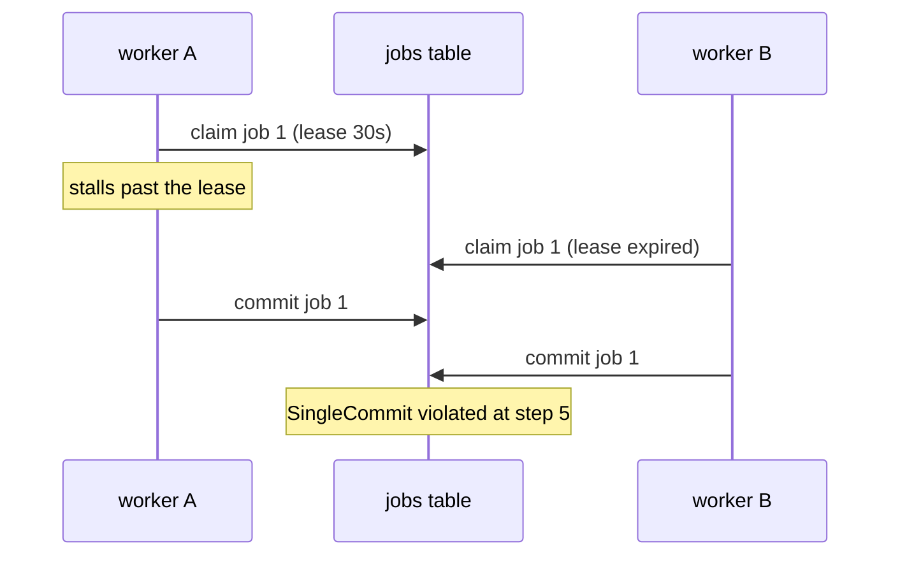

# Report: findings.json and the HTML page

> Adapted from opum-ai/proof-skills (MIT, Opum AI). See LICENSES/proof-skills-MIT.txt in the OMPdesk app resources.

Every workflow ends in a report the user can read, share and come back to. The source of truth is `formal/findings.json`. `report.ts` renders it into one self-contained HTML page, and you show that page in OMPdesk's Preview panel. `<skill-dir>` is the folder of SKILL.md.

This file defines what the report must say. `report.ts` decides how it looks.

## Source of truth: `formal/findings.json`

Write the findings file first (schema [findings.schema.json](../assets/findings.schema.json), a valid example in [findings.example.json](../assets/templates/findings.example.json)), then render the page from it. This keeps the report reproducible, lets CI or a later session regenerate it, and lets the simplify workflow (W4) read prior results. Fill it from the saved evidence, not from memory: `tlc.ts --json FILE` writes the structured trace rows that map straight to a finding's `trace[]`.

## Render and show

```bash
bun <skill-dir>/scripts/report.ts formal/findings.json                    # writes formal/reports/<concern>.html, prints the path
bun <skill-dir>/scripts/report.ts formal/findings.json --out some/page.html
```

`report.ts` exits 2 if `findings.json` does not match the schema and names the bad field. The page has inline CSS, no scripts and no external fetches, and every string from the JSON is escaped, so it opens anywhere and cannot run anything. The default path is `<folder of findings.json>/reports/<concern>.html`. Reuse the same path on every re-run so the page keeps one stable location.

Then show it:
- When OMPdesk's `gui_visualize` tool exists in this session, open the HTML file with it. It shows a project `.html` file as a tab of the Preview panel and keeps a version per change, so a re-render of the same file updates the same visual.
- Otherwise name the file path in your reply and say that you could not open it.

When you run as a subagent that may not write report files, put the report's content (verdict, findings with traces, what was verified with bounds, trust base, re-run commands) in your final message, so the parent session can render it. Keep the terminal reply short either way: the page carries the detail.

## Required content, in this order

`report.ts` renders these sections in this order. Fill the fields so none of them is empty without a reason.

1. **Verdict strip.** One sentence and counts: confirmed, suspected and refuted findings, properties checked, and the bounds. For example: "2 confirmed races in job leasing; 5 properties hold for 2 workers x 3 jobs x at most 2 retries (1.2M states)." (`summary`.) A reader who stops here must still get the truth.
2. **Findings**, most severe first. Each finding shows:
   - ID, title, severity, status (confirmed, suspected, refuted or fixed);
   - the violated property, quoted from the spec, with its plain-English meaning;
   - **the counterexample trace** as a step table: actor, action, the `@code` location, and the state variables that changed. The step where the property breaks is marked (`"violation": true` on that row). When the concern has several actors, also put a Mermaid `sequenceDiagram` in your chat reply (see below);
   - when the concern has a shape (a graph, a state machine, a topology), a diagram with the counterexample highlighted (the `diagram` field, below);
   - the reproduction (test or script path) and its result, including the saved log of it failing on the original code;
   - the fix (a diff under 15 lines, or a PR link) and the evidence that it works: the re-check passed, and the mutation check failed as expected.
3. **Simplifications** (W4 reports only, before "What was verified"). For each change: the code removed or changed, the invariant that justifies it, the re-verification result, the assumptions relied on, the decision (removed, downgraded, kept or rejected) and the lines-of-code delta (`simplifications[]`).
4. **What was verified.** A table of properties: name, kind (invariant, action property, liveness, refinement, theorem or bounded check), result, tool, and bounds or "unbounded (proof)" (`properties[]`).
5. **Model scope and assumptions.** What is modeled, what is abstracted, what is out of scope, from SCOPE.md, plus the Assumptions list from CORRESPONDENCE.md (`scope`). This is where readers learn what the green checks do not cover.
6. **Trust base.** Every check listed here must point to a saved log under `formal/<concern>/evidence/`. A claim with no log is reported as "not recorded", never as passed (`trust_base` and each property's `evidence`).
   - TLA+: tool and version, states generated and distinct, depth, and the sanity checks that ran (must-fail invariants failed, coverage showed no dead actions, mutations were all DETECTED).
   - Lean: toolchain, the axioms of each headline theorem (`lean-check.ts` prints them), the remaining `sorry` count (must be 0 for any claim marked "proven"), and any use of `native_decide`.
7. **Re-run.** The exact commands, copy-pasteable (`rerun[]`), for example `bun formal/tools/scripts/verify-all.ts formal --only job-lease`.
8. **Next steps.** Suggested follow-up workflows: simplify, CI guard, deeper bounds (`next_steps[]`).

Honesty rules for every field: state the bounds ("2 workers, 3 jobs, at most 2 retries", states explored, depth); a pass means no counterexample within the model, not that the code is correct; name the abstractions that could hide a bug; a counterexample is not a bug until it was reproduced.

## Diagrams: draw the system the bug lives in

A trace table tells the reader what happened. A diagram shows where it happened. Draw the mechanism, label every arrow, and show one claim per figure.

| Concern | Draw | How |
|---|---|---|
| Graphs, DAGs, schedulers, dependency or build graphs | The graph of the counterexample, with the violating edge or node highlighted and trace-step badges on the nodes | the finding's `diagram` field |
| State machines and lifecycles | States and allowed transitions, with the illegal transition highlighted | `diagram` (the edges are the transitions) |
| Protocols and topologies (queues, caches, replicas) | Components and message flows, with the dropped, duplicated or reordered message marked | `diagram` |
| Multi-actor races (threads, workers, handlers, services) | A sequence of the trace, marking the step where the property breaks | a Mermaid `sequenceDiagram` in the chat reply, plus the trace table in the report |

### The `diagram` field

`report.ts` draws the `diagram` object of a finding as an inline SVG figure: a layered left-to-right layout, cycles drawn as back edges, text escaped, no scripts. The caption is fixed ("F1: where the counterexample runs"), so name the claim in the node labels and the edge labels.

```json
{
  "nodes": [
    { "id": "1", "label": "build" },
    { "id": "2", "label": "test" },
    { "id": "3", "label": "deploy" }
  ],
  "edges": [
    { "from": "1", "to": "2", "label": "needs" },
    ["2", "3", "needs"]
  ],
  "highlight": ["3", "2->3"],
  "steps": { "1": 1, "3": 2 }
}
```

- `nodes`: a node id string, or `{ "id": ..., "label": ... }` (the label defaults to the id).
- `edges`: `{ "from", "to", "label" }` or the short form `[from, to, label]`; an edge whose end is not a node is dropped. Keep one edge per pair of nodes.
- `highlight`: the counterexample as a flat list of node ids and edges written `"from->to"`.
- `steps`: optional map from node id to the trace step number, drawn as a badge on the node.

The figure uses the page's colors, so it works in light and dark themes. Keep graphs small (a dozen nodes or fewer): draw the part of the system the trace touches.

### Mermaid in chat

Mermaid does not render in the static HTML file (the page has no scripts). Put the trace as a Mermaid block in your chat reply, where OMPdesk renders it:

````

````

One Mermaid participant per actor in the trace, one arrow per row, a note on the row where the property breaks. For a state machine use `stateDiagram-v2`. For a long trace, show the 6 to 8 steps that matter and say how many were left out.

## Trace-only report (W8)

For W8 the report is short: the story in domain terms, the changed-variables table, the diagram, and the verdict (real bug, modeling error, property too strong). Write a `findings.json` with one finding and empty `properties` only when the user wants a page; in chat, the Mermaid block plus the story is usually enough. Skip the sections that do not apply.

## Naming

- Title: a name, not a sentence. `<Concern> verification` or the system's own name, for example `Job lease verification`. Keep it stable across re-runs.
- Summary: the verdict sentence.
- File: `formal/reports/<concern>.html`.
- After rendering, give the user the path (or the Preview tab) and the verdict sentence.
