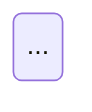

# Statechart: show what the user sees, from a TLA+ model

> Adapted from pstack (MIT, Lauren Tan). See LICENSES/MIT-pstack.txt.

Use this when someone who does not read TLA+ must judge behavior: "show the PM the bug", "draw what the user sees", "turn the agreed chart into a TLA+ skeleton". The chart shows what an app's user sees. A PM reads it to decide whether that behavior is right. `<skill-dir>` is the folder that holds the SKILL.md you read; the scripts are Bun-run `.mjs` files that take TLC from the same shared cache as `tlc.ts` (the first run fetches it, see `setup.ts tla`).

Label each state with what is on the screen, such as "Paying". Label each step with what the user does or sees happen, such as "tap Pay" or "the charge goes through". Keep variable and action names out of labels. The scripts call this user the reader, as in `readerActions` and reader steps.

Run `bun <skill-dir>/scripts/statechart/statechart.mjs --help` for the commands and the full reading guide. Work in a scratch folder outside the repo (the command writes its files next to its input, and `--out DIR` moves them). For the model itself, see `tla-patterns.md` and `tla-pitfalls.md`. For the code-to-spec tie, see `correspondence.md`. For where this fits in a job, see `workflows.md` (W3 design verification before code, W8 explain a trace).

## Show it to the PM or a non-technical reader

This is the usual entry point. Paste the chart into the chat so it renders inline: put the contents of `chart.mmd` (or `bug-N.mmd` for one bug) in a fenced block marked `mermaid`.

````

````

The inline Mermaid text is the primary output. When OMPdesk's `gui_visualize` tool exists, also open the PNGs (from `--png`) in the Preview panel. `--png` renders each chart with `npx -y @mermaid-js/mermaid-cli`, which needs Node with `npx` and a one-time Chromium download; when that fails the command exits 2 and keeps the `.mmd` files, so show those.

## Pick the direction

Use `from-spec` when a TLA+ model exists or the code is concrete enough to model. Use `from-chart` when there is no model and the PM should agree on the behavior before anyone writes or changes the code.

If the code already has a TLA+ spec, start from a copy of that spec. Add the variables the user sees, and keep the spec's existing invariants. To audit the code against that spec, make the copy model what the code does, and pass the spec unchanged as `--against`. Check it with the config that its authors say it passes, and pass that config as `--against-config` unless it has the spec's file name. One mapping labels both models, so label states and steps only from variables that both have. In a code model or a new spec, tie every variable and action to code that a reviewer can open, and take its name from that code. Make each action one indivisible step in the code. Put the file and line of the code that checks each condition of an action in a comment on that condition, as in `\* pay.ts:120`.

```
bun <skill-dir>/scripts/statechart/statechart.mjs from-spec Pay.tla [--config FILE] [--fixed PayFixed.tla | --against Agreed.tla] [--expect-broken RULE]... [--out DIR] [--png]
bun <skill-dir>/scripts/statechart/statechart.mjs from-chart agreed.mmd [--module Name] [--expect-broken RULE]... [--out DIR] [--png]
```

Exit codes: 0 every rule holds (or exactly the `--expect-broken` rules break), 1 another rule is broken or the spec does not draw the agreed chart, 2 the command cannot finish (bad input, a mapping to fill in, `--png` cannot render), 3 `UNAVAILABLE`: TLC could not be prepared, for example offline. Exit 3 means "not checked", never a pass. A user-set `TLA2TOOLS` (path to `tla2tools.jar`) and `JAVA` win over the shared cache.

## Spec to chart (from-spec)

1. Choose the chart's states. When the PM cares about something the screen does not show, such as a second charge while the screen still says "Paying", name the state "Paying, charged twice". Start with few states, and split a state only when the split separates two bugs.
2. Write each rule the PM agrees to as one invariant, with the PM's sentence as its comment. Each rule names what the user sees on a screen or gets from a request, and the code that can change it. Refuse a rule that lacks one of them. For a rule that applies once everything settles, define `Settled == ~ENABLED System`, where `System` is the disjunction of the actions the user does not take. Report each broken rule as a bug. Never weaken a rule to make the chart pass.
3. Run `from-spec`, then fill in the mapping file it writes (`<Spec>.map.mjs`, a scaffold with every hook documented). Put the labels in `state` and `step`, and list the user's actions in `readerActions` by action name. When two bugs end on the same screen through different code paths, add `cause` and make it name the code path. To color the states by what the PM cares about, such as "Toast shown", return that group from `group`. The legend names the groups, and states that break a rule still get a red border. TLC names each step after the innermost named action that takes it, so give each kind of step its own named action.
4. If there is an open fix, model it from the code and pass that model as `--fixed`. Its file and module name differ from the spec's (`PayFixed.tla` with `MODULE PayFixed`).
5. Look at every chart (inline, or the PNGs with `--png`). Check that each numbered path reads in order. If a label reads like code, fix `state` or `step` and run the command again.
6. Replay each bug's story against the real code, as a test or a live repro, one step per model action. Drive only entry points that a user or client reaches, and assert only what they see. A test that asserts a flag that it sets, or that searches the source text, proves nothing. When a run proves part of the story and reading the code proves the rest, say which part each proves. When the test copies code that it cannot import, give the commit and line range of the copy, and list what the copy leaves out. If a bug does not reproduce, assume the model is wrong until you show otherwise. Fix the model, not the rule.

## Chart to spec (from-chart)

1. Draw the chart the PM agrees to. Use one region for each thing that changes independently, such as the connection and the sync badge (regions are separated by `--` inside one composite state). Add one `%% never Name: A & B -- the PM's sentence` line per rule, naming states of different regions. Draw "the app closes" as an edge to the state the user sees next. A `%% when A` or `%% when not A` line right after a transition is its guard on the other regions.
2. Run `from-chart`. It writes `<Module>.tla`, `.cfg` and `.map.mjs` (and keeps them on later runs: delete `<Module>.tla` to write it again), checks every rule, and compares the spec's drawing with the chart. If a rule breaks, the agreed chart has a design bug. Take the bug to the PM.
3. Add the real code's guards and variables to the spec that `from-chart` wrote, and run `from-chart` again. For each difference it prints, ask the PM whether the code is wrong or the chart needs a correction. `compare-charts.mjs EXPECTED.mmd ACTUAL.mmd` runs that comparison by hand (exit 0 same, 1 differs).

`chart-to-tla.mjs CHART.mmd --module Name [--dir OUT]` writes only the skeleton, without running TLC.

## Reading a chart

- Gray states work. Red states break a rule. With `--fixed`, red states stay wrong with the fix, and green states are fixed by it or exist only with it. With `--against`, red states break a rule in either model, and green states exist only in the spec.
- A thick blue border and numbered labels mark one bug's path. `bug-N.mmd` has only the steps of bug N. Mermaid state diagrams cannot color an edge.
- A state is bad when it breaks a rule, or when every path from the start to it passes a state that breaks one. TLC stops each path at the first state that breaks the rule, so a rule that stays broken colors only the states where it first breaks and the states after them that no path without a bug reaches.
- A label "with the fix, STEP" or "in the spec, STEP" is a step that only the other model takes. "with the fix, STEP cannot happen" loops on the state where that model stops the step.
- Two parallel regions (contexts on one side, progress on the other) appear only when that has fewer states and the regions combine back into exactly every state and step of TLC's graph. In regions, "[when A]" or "[unless A]" says which states of the other region a step needs. Other words in [ ] come from the mapping's `guard()` and "after N s" from its `timer()`. TLC checks neither and has no clock, so a reviewer checks them against the code.
- `stories.md` has one entry per bug: the rule, why it breaks, the shortest path in reader steps, and what the other model does instead. `summary.json` has the counts. Take every count you quote from it.

## Hand off

Give the PM the Mermaid source of each chart (inline in the reply, plus the PNG when `--png` worked). Add one line per bug with the rule it breaks, its steps as the chart numbers them, whether it reproduced, and whether the open fix fixes it. With `--against`, also say whether the spec already lists it: in the configs that `stories.md` names, in the spec's notes on what the model leaves out, or not at all. Do not report that a rule holds while the command lists conditions with no file and line. Attach `stories.md` and the command that regenerates everything (`--expect-broken` makes one command rebuild every chart and stop on any change). Say what the model leaves out, and that a pass means no counterexample within the modeled bounds.
